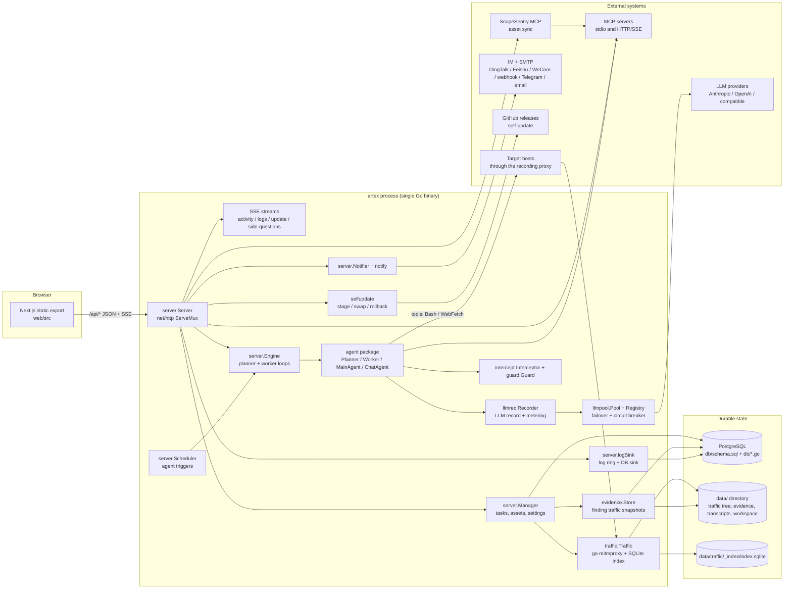
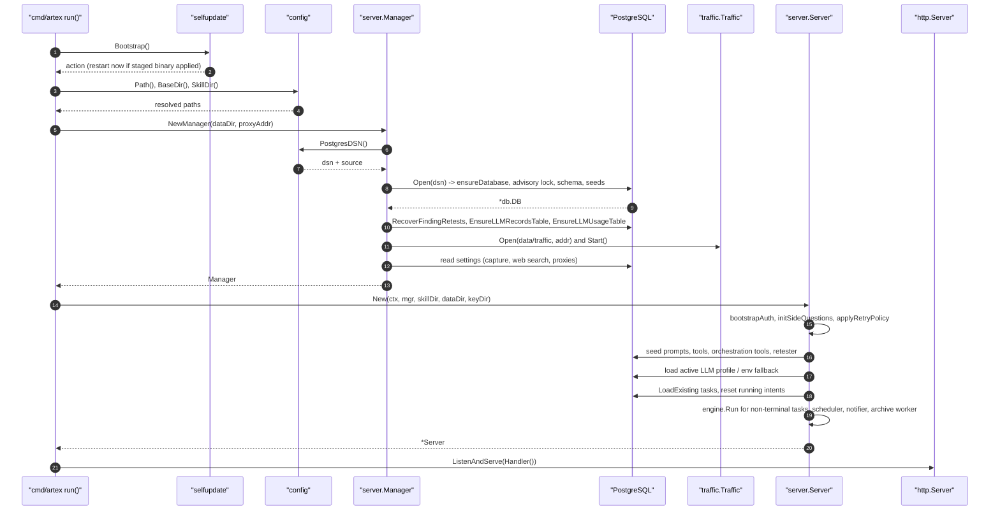
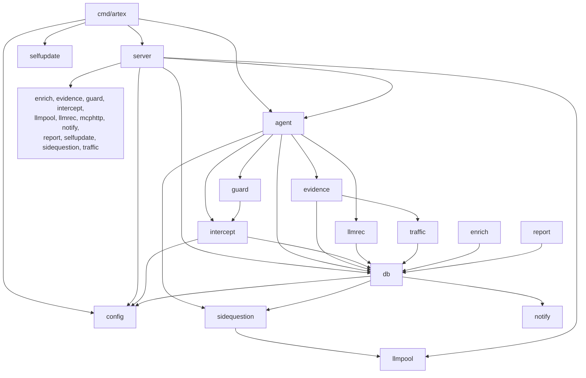
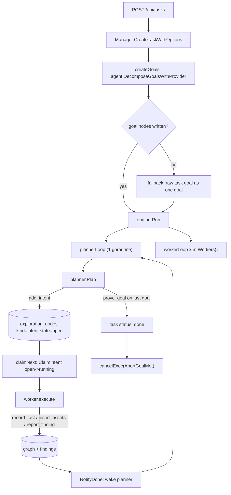
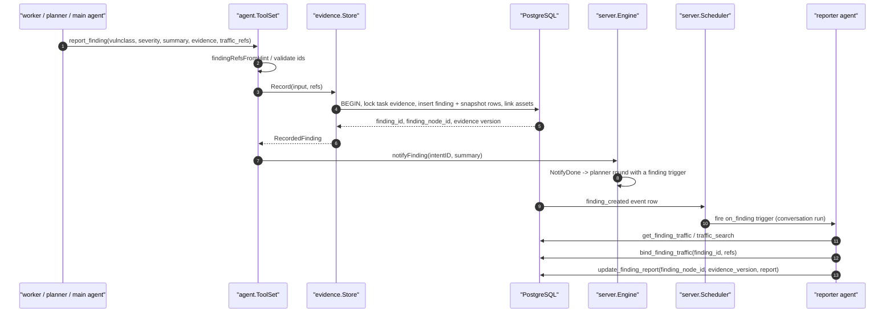
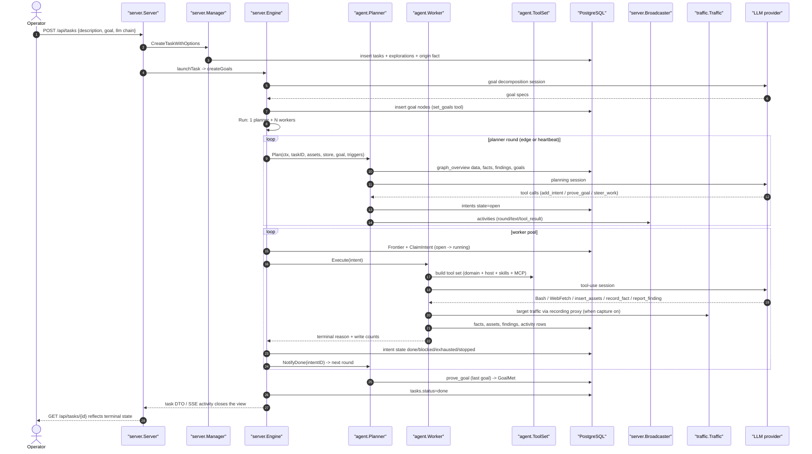

# ARTEX Architecture

| Field | Value |
| --- | --- |
| Repository | `github.com/Autumn-27/artex` (module path in `go.mod:1`) |
| Branch | `chore/i18n-en-es-hardening` |
| Commit analysed | `fdfb7a17b7da5e2de716c0e98475ec77a41c64c6` (`fdfb7a1`, 2026-10-14) |
| Go toolchain | `go 1.26.10` (`go.mod:3`) |
| Web stack | Next.js 16 App Router, React 19, TypeScript, Tailwind 4, zustand (`web/package.json`) |
| Scope | Whole running system: Go backend, embedded frontend, PostgreSQL schema, file-system state, process boundaries |

This document describes the code as it exists on the branch above. Everything here was read from source; every
structural claim carries a `path:line` citation. When the schema and the Go code disagree, the schema and the
DDL in `db/` win, because that is what PostgreSQL actually stores.

The working tree carried uncommitted changes while this document was written (the index already contained
staged edits unrelated to it). Citations refer to the working tree as read, which is the state a reviewer
reproducing them will see.

---

## Table of contents

- [0. How to read this document](#0-how-to-read-this-document)
- [1. System overview](#1-system-overview)
  - [1.1 What ARTEX is](#11-what-artex-is)
  - [1.2 Deployment shape](#12-deployment-shape)
  - [1.3 Component diagram](#13-component-diagram)
- [2. Runtime topology and startup sequence](#2-runtime-topology-and-startup-sequence)
  - [2.1 Process and port topology](#21-process-and-port-topology)
  - [2.2 Boot sequence, step by step](#22-boot-sequence-step-by-step)
  - [2.3 Boot sequence diagram](#23-boot-sequence-diagram)
  - [2.4 Shutdown and restart protocol](#24-shutdown-and-restart-protocol)
  - [2.5 Configuration precedence](#25-configuration-precedence)
  - [2.6 Build variants](#26-build-variants)
- [3. Backend module map](#3-backend-module-map)
  - [3.0 Package dependency graph](#30-package-dependency-graph)
  - [3.1 agent](#31-agent)
  - [3.2 cmd/artex](#32-cmdartex)
  - [3.3 config](#33-config)
  - [3.4 db](#34-db)
  - [3.5 enrich](#35-enrich)
  - [3.6 evidence](#36-evidence)
  - [3.7 guard](#37-guard)
  - [3.8 intercept](#38-intercept)
  - [3.9 llmpool](#39-llmpool)
  - [3.10 llmrec](#310-llmrec)
  - [3.11 mcphttp](#311-mcphttp)
  - [3.12 notify](#312-notify)
  - [3.13 report](#313-report)
  - [3.14 selfupdate](#314-selfupdate)
  - [3.15 server](#315-server)
  - [3.16 sidequestion](#316-sidequestion)
  - [3.17 traffic](#317-traffic)
- [4. The agent engine in depth](#4-the-agent-engine-in-depth)
  - [4.1 One task run, end to end](#41-one-task-run-end-to-end)
  - [4.2 Goal decomposition](#42-goal-decomposition)
  - [4.3 The planner round](#43-the-planner-round)
  - [4.4 Worker execution](#44-worker-execution)
  - [4.5 Tool catalog](#45-tool-catalog)
  - [4.6 Prompt composition](#46-prompt-composition)
  - [4.7 Blackboard, asset graph and inheritance](#47-blackboard-asset-graph-and-inheritance)
  - [4.8 Finding workflow](#48-finding-workflow)
  - [4.9 Retester loop](#49-retester-loop)
  - [4.10 Cancellation and terminal reasons](#410-cancellation-and-terminal-reasons)
  - [4.11 LLM calls and metering](#411-llm-calls-and-metering)
  - [4.12 Concurrency and admission](#412-concurrency-and-admission)
  - [4.13 Full task-run sequence diagram](#413-full-task-run-sequence-diagram)
- [5. Data model](#5-data-model)
  - [5.1 Schema ownership and application](#51-schema-ownership-and-application)
  - [5.2 Table inventory](#52-table-inventory)
  - [5.3 Core relations](#53-core-relations)
  - [5.4 Startup migrations and seeds](#54-startup-migrations-and-seeds)
  - [5.5 State that is not in PostgreSQL](#55-state-that-is-not-in-postgresql)
- [6. HTTP and API surface](#6-http-and-api-surface)
  - [6.1 Handler assembly and middleware](#61-handler-assembly-and-middleware)
  - [6.2 Route table](#62-route-table)
  - [6.3 Authentication model](#63-authentication-model)
  - [6.4 Realtime channel](#64-realtime-channel)
  - [6.5 Error and message contract](#65-error-and-message-contract)
- [7. Frontend architecture](#7-frontend-architecture)
  - [7.1 Static export pipeline](#71-static-export-pipeline)
  - [7.2 Source layout](#72-source-layout)
  - [7.3 Route tree](#73-route-tree)
  - [7.4 API client](#74-api-client)
  - [7.5 Client state](#75-client-state)
  - [7.6 i18n runtime as implemented](#76-i18n-runtime-as-implemented)
  - [7.7 Locale contract: English and Spanish](#77-locale-contract-english-and-spanish)
  - [7.8 Auth guard](#78-auth-guard)
- [8. Cross-cutting concerns](#8-cross-cutting-concerns)
  - [8.1 Observability](#81-observability)
  - [8.2 Notifications](#82-notifications)
  - [8.3 Evidence capture](#83-evidence-capture)
  - [8.4 Traffic interception and command guard](#84-traffic-interception-and-command-guard)
  - [8.5 Self-update](#85-self-update)
  - [8.6 Skill distribution](#86-skill-distribution)
  - [8.7 Language handling across the backend](#87-language-handling-across-the-backend)
- [9. Integration points](#9-integration-points)
  - [9.1 Frontend to backend](#91-frontend-to-backend)
  - [9.2 Backend to database](#92-backend-to-database)
  - [9.3 Backend to agent runtime](#93-backend-to-agent-runtime)
  - [9.4 Process boundaries and external systems](#94-process-boundaries-and-external-systems)
  - [9.5 File-system artifacts](#95-file-system-artifacts)

---

## 0. How to read this document

**Citation format.** `path:line` points at a single line; `path:12-40` points at a range. Line numbers are valid
for the commit in the header table. If a later commit shifts them, the surrounding prose still names the exact
symbol to search for.

**Evidence rule.** Nothing in this document is inferred from naming alone. When behaviour is derived from a
comment, the comment is attributed ("the source comment states ..."). Behaviour that could not be verified from
code is not described.

**Diagrams.** All diagrams are Mermaid and use English-only labels so they render in any viewer.

---

## 1. System overview

### 1.1 What ARTEX is

ARTEX is an LLM-driven, multi-agent autonomous penetration-testing platform. The operator describes an
engagement (a task with a description and a goal), and a set of language-model agents then run the work:

| Agent role | Implementation | Purpose |
| --- | --- | --- |
| Goals decomposer | `agent/goals.go:126` (`DecomposeGoalsWithProvider`) | Turns the free-text goal into concrete, checkable goal nodes. |
| Planner | `agent/planner.go:23` (`Planner`), `agent/planner.go:355` (`Plan`) | The only intent generator. Reads graph state, judges goals, emits exploration intents. |
| Worker | `agent/worker.go:54` (`Worker`), `agent/worker.go:361` (`execute`) | Executes exactly one intent, writes facts, assets and findings back to the graph. |
| Main agent | `agent/mainagent.go:20` (`MainAgent`), `agent/mainagent.go:112` (`Chat`) | Human interface inside a task: hints, intents, steering, goal edits. |
| Chat agent | `agent/chat.go:25` (`ChatAgent`), `agent/chat.go:105` (`Chat`) | Task-independent assistant for the chat page and for custom conversation agents. |
| Finding retester | `agent/retester.go:4` (`RetesterDefaultPrompt`) + `server/finding_retests.go:208` (`seedFindingRetester`) | Standalone conversation agent that re-verifies one already-recorded finding. |
| Reporter | `server/orchestration.go:745` (`seedReporterAgent`) | Trigger-driven agent that writes the long-form report for a confirmed finding. |

The engine that binds these together is event-driven, not scripted: graph changes wake the planner, the planner
emits intents, and a pool of workers claims intents from the frontier. The design intent is stated in the
`Engine` doc comment (`server/engine.go:102-108`, type at `server/engine.go:109`).

The system is explicitly authorized-testing software: every outbound probe runs under agent-supplied shell
tools, through an optional recording proxy, and through a guard/intercept layer that can block or ask for
approval (`guard/guard.go:31`, `intercept/intercept.go:141`).

### 1.2 Deployment shape

ARTEX ships as **one Go binary** that can embed the compiled frontend, with **PostgreSQL as the only application
datastore**:

| Concern | Implementation | Reference |
| --- | --- | --- |
| HTTP server + API | Go `net/http` with `ServeMux` patterns | `server/server.go:760` (`Handler`) |
| Web UI | Next.js static export embedded via `//go:embed all:webui/dist`, gated by build tag `embedui` | `server/webui_embed.go:16-19` |
| Web UI, un-embedded | 404 stub; developer runs `next dev` separately | `server/webui_stub.go:16-18` |
| Application database | PostgreSQL through `pgx` (`database/sql` driver `pgx`) | `db/db.go:23`, `db/db.go:134` (`Open`) |
| Traffic recording | Embedded go-mitmproxy proxy + sidecar SQLite index + file tree | `traffic/traffic.go:1-5`, `traffic/traffic.go:189-194` |
| Evidence bodies | Content-addressed files under `<data>/evidence` | `evidence/store.go:29` (`New`) |
| Raw LLM transcripts | JSON transcript store under `<data>/transcripts` | `server/task_llm.go:562` |
| JWT signing key | `<baseDir>/jwt.key`, 0600, outside the browsable workspace | `server/auth.go:79` (`loadOrCreateJWTKey`) |
| Workspace files | `<data>` itself, browsable through `/api/workspace/*` | `server/workspace.go:44` (`wsResolve`) |

Startup fails hard when PostgreSQL is not configured: `config.PostgresDSN` returns an error naming the config
file it inspected, and there is deliberately no built-in default (`config/config.go:201-214`).

### 1.3 Component diagram



---

## 2. Runtime topology and startup sequence

### 2.1 Process and port topology

| Process | Default bind | Purpose | Reference |
| --- | --- | --- | --- |
| `artex` HTTP server | `127.0.0.1:8787` (`-addr`) | UI, JSON API, SSE | `cmd/artex/main.go:55`, `cmd/artex/main.go:117-121` |
| `artex` traffic proxy | `127.0.0.1:8788` (`-proxy`, empty disables) | Recording MITM proxy | `cmd/artex/main.go:57`, `server/manager.go:395` |
| PostgreSQL | operator-provided DSN | All application state | `config/config.go:201` |
| `start.sh` / `start.bat` | n/a | Supervisor: relaunches on exit code 75 | `start.sh:12-13`, `start.sh:26` |

The HTTP server is created with `ReadHeaderTimeout: 10 * time.Second` (`cmd/artex/main.go:117-121`). Serving
the UI and the API on the same origin is what makes the static export work behind a reverse proxy — the
frontend builds same-origin SSE URLs for that reason (`web/src/lib/api.ts:201-212`).

The process is deliberately single-tenant: one administrator account, one active task selection, one shared
asset store. There is no user table; the only credential is the admin password hash stored in `settings`
(`server/auth.go:25` `authPassKey`, `server/auth.go:159` `readPassHash`).

### 2.2 Boot sequence, step by step

The entry point is small and strictly ordered. `main` only maps the return code onto the process exit code
(`cmd/artex/main.go:51-53`); all work is in `run` (`cmd/artex/main.go:53`).

| # | Step | Code |
| --- | --- | --- |
| 1 | Parse flags: `-addr`, `-data`, `-proxy` | `cmd/artex/main.go:54-67` |
| 2 | Publish the build version to the server package (used by `GET /api/health`) | `cmd/artex/main.go:63`, `server/server.go:34-36` |
| 3 | Print banner and version/runtime/address | `cmd/artex/main.go:65`, `cmd/artex/main.go:38` |
| 4 | Redirect `log` output into the in-memory log sink (also keeps stderr) | `cmd/artex/main.go:69`, `server/logsink.go:50` |
| 5 | Self-update bootstrap: apply a staged binary or count a boot attempt and roll back | `cmd/artex/main.go:75-78`, `selfupdate/bootstrap.go:50` |
| 6 | Resolve and log the config file path; log whether it exists | `cmd/artex/main.go:83-91`, `config/config.go:146` |
| 7 | Install signal context for `SIGINT`/`SIGTERM` | `cmd/artex/main.go:93` |
| 8 | Create a cancellable-cause shutdown context (deliberately detached from the signal context) | `cmd/artex/main.go:95`, `cmd/artex/main.go:151` |
| 9 | `server.NewManager`: resolve DSN, open PostgreSQL, apply schema, seed, start traffic proxy | `cmd/artex/main.go:98`, `server/manager.go:355` |
| 10 | Arm the 30s "the new build survived" settle timer | `cmd/artex/main.go:107`, `selfupdate/bootstrap.go:156-157` |
| 11 | Resolve the skill directory | `cmd/artex/main.go:110`, `config/config.go:180` |
| 12 | `server.New`: auth bootstrap, agent/tool/prompt wiring, background workers, LLM install, task restore | `cmd/artex/main.go:115`, `server/server.go:228` |
| 13 | Warn if bound to a non-loopback address while no admin password is set | `cmd/artex/main.go:116`, `server/auth.go:433` |
| 14 | Build the root handler (`srv.Handler()`) and start `ListenAndServe` in a goroutine | `cmd/artex/main.go:117-129`, `server/server.go:760` |
| 15 | Block on task context cancellation or `server.RestartRequested()` | `cmd/artex/main.go:133-138` |
| 16 | Graceful `httpSrv.Shutdown` with a 5s budget, return exit code | `cmd/artex/main.go:140-145` |

Inside `server.NewManager` (`server/manager.go:355`) the order is:

1. Make the data directory absolute and create it (`server/manager.go:362-366`).
2. Resolve the DSN and log its source (`server/manager.go:368-371`).
3. `pgdb.Open` — schema + seeds, see [5.4](#54-startup-migrations-and-seeds) (`server/manager.go:373`).
4. `RecoverFindingRetests` — re-drive retests interrupted by a crash (`server/manager.go:377`).
5. `EnsureLLMRecordsTable` and `EnsureLLMUsageTable` — the two tables created outside `schema.sql`
   (`server/manager.go:381-386`).
6. Construct the `Manager` (holds `pg`, `assets`, `interceptor`) (`server/manager.go:387`).
7. If `-proxy` is non-empty, `traffic.Open(...)`, recover delete staging, then start the proxy in a goroutine
   (`server/manager.go:388-421`).
8. Load persisted toggles and web-search/global-proxy settings from `settings` (`server/manager.go:426-455`).
9. Push the global proxy into the MITM upstream (`server/manager.go:456-459`).
10. Build the `enrich.Engine` and reconcile the browser MCP proxy (`server/manager.go:457-460`).

Inside `server.New` (`server/server.go:228`) the order is:

1. Load or create `jwt.key` (`server/server.go:229`, `server/auth.go:79`).
2. Construct `Server` with the engine and empty in-memory maps (`server/server.go:232-238`).
3. `bootstrapAuth` — cache the password hash, issue the console setup token or apply `ARTEX_ADMIN_PASSWORD`
   (`server/server.go:241`, `server/auth.go:234`).
4. `initSideQuestions` (`server/server.go:242`, `server/side_questions.go:71`).
5. `applyRetryPolicy` — push the global LLM retry policy into the circuit-breaker registry
   (`server/server.go:245`).
6. Install the authoritative agent resolver and the global readiness predicate on the engine
   (`server/server.go:248-261`).
7. Wire DB-backed prompt overrides, wrap-up prompts, wrap-up budgets, output language, agent augmentation
   (`wireAgentAugment`), tool resolution (`wireTools`), prompt seeding, orchestration tool seeding, retester
   seeding, evidence GC goroutine, Python detection, scheduler goroutine, notifier goroutine, MCP discovery
   goroutine, log sink DB (`server/server.go:263-348`).
8. Install the LLM provider: persisted DB config first, then `agent.FromEnv()`, else idle
   (`server/server.go:350-362`).
9. `restoreTaskRuntimes` — reload tasks, reset stale `running` intents, restart loops for non-terminal tasks
   (`server/server.go:363`, `server/server.go:373`).
10. `reconcileConcurrency`, start the archive worker, wire the intercept reviewer
    (`server/server.go:364-366`).

### 2.3 Boot sequence diagram



### 2.4 Shutdown and restart protocol

Two exits exist and both are part of the update contract:

| Exit | Code | Meaning | Reference |
| --- | --- | --- | --- |
| Signal | 0 | Normal stop; the supervisor stops looping | `cmd/artex/main.go:133-135`, `start.sh:66-68` |
| Restart request | 75 (`EX_TEMPFAIL`) | Swap in the staged binary and relaunch | `cmd/artex/main.go:136-139`, `selfupdate/selfupdate.go:32-34` |
| Crash | other | Supervisor waits then relaunches | `start.sh:76` |

Shutdown cancels the process context with the named cause `agent.AbortShutdown`
(`agent/cancelcause.go:66-68`), which every running agent observes through
`context.Cause`; interrupted intents are reset to `open` on the next boot
(`server/server.go:371-374`, `db/exploration.go:312`). The HTTP server gets 5 seconds to drain
(`cmd/artex/main.go:141-144`).

### 2.5 Configuration precedence

Configuration has three sources and a strict precedence: **environment variable > config file > code default**.
There are two independent families — bootstrap configuration read by `config`, and runtime settings stored in
PostgreSQL and editable in the UI.

| Setting | Env | Config file key | Default | Reference |
| --- | --- | --- | --- | --- |
| PostgreSQL DSN | `ARTEX_PG_DSN` | `database.dsn` or `database.{host,port,user,password,dbname,sslmode}` | none — startup error | `config/config.go:201-232` |
| Config file location | `ARTEX_CONFIG` | n/a | `./config.json`, then `<baseDir>/config.json` | `config/config.go:146-163` |
| Skill root | `ARTEX_SKILL_DIR` | `skill_dir` | `<baseDir>/skills` | `config/config.go:180-193` |
| Bootstrap output language | `ARTEX_LANG` | `language` | `en` (`config.DefaultLanguage`) | `config/config.go:87-99`, `config/config.go:38` |
| Setup token | `ARTEX_SETUP_TOKEN` | n/a | random token printed to console | `server/auth.go:30-33`, `server/auth.go:234` |
| Initial admin password | `ARTEX_ADMIN_PASSWORD` | n/a | unset (setup screen required) | `server/auth.go:34-35` |
| CORS allowlist | CORS env (see `corsOriginsEnv`) | n/a | `defaultCORSOrigins` | `server/server.go:4033-4045` |
| LLM provider (legacy path) | `ARTEX_LLM_PROVIDER`, `ANTHROPIC_API_KEY`, `OPENAI_API_KEY`, `ARTEX_LLM_BASE_URL`, `ARTEX_LLM_MODEL`, `ARTEX_LLM_PROXY`, `ARTEX_LLM_STREAM` | n/a | no provider → engine idle | `agent/provider.go:145-196` |
| Notifier background loop kill switch | `ARTEX_NOTIFY_BACKGROUND_DISABLED` (`notifyBackgroundDisabledEnv`) | n/a | enabled | `server/notifier.go:37`, `server/server.go:337-343` |

`BaseDir` is the directory of the running executable, except when the binary sits in a temp/build-cache
directory (that is, under `go run`), where it falls back to the working directory (`config/config.go:107-140`).

Runtime settings are rows in the `settings` table (`db/settings.go:9` for `GetSetting`, `db/settings.go:21` for
`SetSetting`) and are read through typed helpers (`db/settings.go:47` `GetBool`, `db/settings.go:56` `SetBool`).
The keys that change system behaviour are declared as constants in `server/manager.go:250-292`. Notable ones:

| Key constant | Setting key | Effect |
| --- | --- | --- |
| `settingTrafficCapture` | `traffic_capture` | Recording proxy injected into agents, traffic tools exposed |
| `settingAgentTrafficBinding` | `agent_traffic_binding` | Whether agents may auto-bind traffic evidence to findings |
| `settingWebSearchOn` / `settingWebSearchBackend` | `web_search_enabled`, `web_search_backend` | `web_search` tool backend (`ddgs`, `brave-free`, `tavily`, `deepseek`) |
| `settingGlobalProxy` | `global_proxy` | Egress proxy for all target traffic |
| `settingWorkers` | `workers` | Worker pool size, default 3 (`server/manager.go:288`) |
| `settingLLMRecord` | `llm_record` | Raw LLM request/response recording |
| `settingLLMPoolOn` / `settingLLMPoolBindFallback` | `llm_pool_enabled`, `llm_pool_bind_fallback` | Failover chain behaviour |
| `settingConcurrencyOn` / `settingConcurrencyLimit` | `task_concurrency_enabled`, `task_concurrency_limit` | Simultaneous-running-task cap, default 5 |
| `settingNoaCompaction` | `noa_compaction` | Experimental external context compaction |
| `settingOutputLanguage` | `output_language` | Runtime output language (overrides `ARTEX_LANG`) |

### 2.6 Build variants

| Variant | Build command | Behaviour | Reference |
| --- | --- | --- | --- |
| Embedded (release) | `go build -tags embedui ./cmd/artex` after `pnpm run build:static` and copying `web/out` to `server/webui/dist` | UI served from the binary | `server/webui_embed.go:16-19`, `build.sh:123-126`, `build.sh:220` |
| No-embed (development) | plain `go build` | `/` returns 404 with a hint; run `next dev` | `server/webui_stub.go:16-18` |
| Docker | prebuilt binary + `start.sh` + `skills/` | `EXPOSE 8787 8788`, `VOLUME /app/data` | `Dockerfile:32-44` |

The embedded handler resolves requests in four steps — exact file, `<path>/index.html`, `<path>.html`, then SPA
fallback to `index.html` — which matches Next's `trailingSlash: true` export layout
(`server/webui_embed.go:24-46`, `web/next.config.mjs:23-31`).

---

## 3. Backend module map

### 3.0 Package dependency graph

Seventeen Go packages plus the command. Sizes are total Go lines including tests, measured from the working
tree (`wc -l <pkg>/*.go`).

| Package | Lines | Imports (internal) | Imported by |
| --- | --- | --- | --- |
| `agent` | 10,942 | db, evidence, guard, intercept, llmrec, sidequestion | server, cmd/artex |
| `cmd/artex` | 239 | agent, config, selfupdate, server | — (main) |
| `config` | 704 | — | db, intercept, server, cmd/artex |
| `db` | 30,275 | config, notify, sidequestion | agent, enrich, evidence, intercept, llmrec, report, server, sidequestion, traffic |
| `enrich` | 292 | db | server |
| `evidence` | 787 | db, traffic | agent, server |
| `guard` | 260 | intercept | agent, server |
| `intercept` | 1,707 | config, db | agent, guard, server |
| `llmpool` | 1,010 | — | server, sidequestion |
| `llmrec` | 785 | db | agent, server |
| `mcphttp` | 685 | — | server |
| `notify` | 5,887 | — (standard library only, by design: `notify/notify.go:1-9`) | db, server |
| `report` | 469 | db | server |
| `selfupdate` | 1,531 | — | server, cmd/artex |
| `server` | 40,293 | all of the above | cmd/artex |
| `sidequestion` | 1,440 | llmpool | agent, db, server |
| `traffic` | 4,158 | db | evidence, server |



Architectural rule visible in the graph: `agent` never imports `server`. Everything the server must inject into
the agent runtime is a package-level function variable (`agent/assembly.go:34`, `agent/toolcatalog.go:108`,
`agent/prompt.go:14`, `agent/outputlang.go:11`, `agent/finding_workflow.go:16`, `agent/wrapup.go:19-24`). This
keeps the agent layer unit-testable without a server and makes the wiring order explicit in `server/server.go`.

---

### 3.1 agent

**Responsibility.** The LLM runtime: all agent roles, their tool sets, prompt composition, the harness around a
model turn, terminal-reason rendering, context compaction, and the cancellation-cause vocabulary. It reads and
writes PostgreSQL only through `db` stores handed in by the caller.

**Key types and functions.**

| Symbol | Location | Role |
| --- | --- | --- |
| `Planner` | `agent/planner.go:23` | Event-driven intent generator; one `Plan` call per wake-up. |
| `Planner.Plan` | `agent/planner.go:355` | Builds tool set, system prompt and situational user input, runs one harness session. |
| `NewPlanner` | `agent/planner.go:51` | Constructor: provider, model, work dir, transcript store, context window, max turns. |
| `Worker` | `agent/worker.go:54` | Executes exactly one intent. |
| `Worker.Execute` / `ExecuteWithMessage` | `agent/worker.go:349`, `agent/worker.go:357` | Entry points; both delegate to `execute` (`agent/worker.go:361`). |
| `MainAgent` | `agent/mainagent.go:20` | Conversational interface bound to a task. |
| `MainAgent.Chat` | `agent/mainagent.go:112` | One human turn, with goal/hint notification callbacks. |
| `ChatAgent` | `agent/chat.go:25` | Task-independent conversational runner. |
| `ChatAgent.Chat` | `agent/chat.go:105` | One turn keyed by any agent key and a session id. |
| `DecomposeGoalsWithProvider` | `agent/goals.go:126` | Goal decomposition call. |
| `ToolSet` | `agent/tools.go:53` | Holds the per-run stores and every domain tool constructor. |
| `NewToolSet` | `agent/tools.go:163` | Binds an exploration store and a worker name. |
| `ToolSet.PlannerTools` | `agent/tools.go:2033` | Planner domain tool list. |
| `ToolSet.WorkerTools` | `agent/tools_insert.go:644` | Worker domain tool list. |
| `ToolSet.MainAgentTools` | `agent/tools_insert.go:664` | Main-agent domain tool list. |
| `ToolSet.AllDomainTools` | `agent/tools_insert.go:688` | Deduplicated union used to build the server-side registry. |
| `BuiltinToolSeeds` | `agent/toolcatalog.go:64` | Enumerates every built-in tool with its default agent bindings. |
| `ToolResolve` (hook) | `agent/toolcatalog.go:108` | Server-injected filter/override applied to each assembled tool list. |
| `DecorateTool` | `agent/toolcatalog.go:114` | Wraps a tool with DB-overridden description/schema and default-argument injection. |
| `AugmentTools` | `agent/assembly.go:39` | Applies `ToolAugment` (skills, MCP, host tools) and tailors the deferred-tool block. |
| `renderSystem` | `agent/prompt.go:39` | Renders the DB template over the code default, with fallback. |
| `PromptOverride` (hook) | `agent/prompt.go:14` | Server-injected accessor for `agent_prompts`. |
| `langDirective` | `agent/prompt.go:80` | Code-owned output-language tail appended after the prompt body. |
| `OutputLanguage` (hook) | `agent/outputlang.go:11` | Resolver for the active output language code. |
| `deferredSystem` | `agent/deferred.go:18` | Splits the system prompt into a static part and an unlockable tool block. |
| `Compactor` | `agent/compaction.go:35` | Folds cold graph regions into digest nodes. |
| `coldGraph` | `agent/coldgraph.go:50` | Connectivity model used to decide what is cold. |
| `captureRunSession` | `agent/capture.go:37` | Streams one harness session, emitting activities and an intercept trace. |
| `AbortCause` | `agent/cancelcause.go:11` | Named cancellation cause. |
| `AbortReason` | `agent/cancelcause.go:71` | Resolves code/short/text from a run context. |
| `terminalText` | `agent/terminalreason.go:49` | Renders the terminal summary and markdown detail for a run with no final text. |
| `FindingRecorder` | `agent/finding_recorder.go:11` | Interface the evidence store implements; called from `report_finding`. |
| `RunInfo` | `agent/runinfo.go:18` | Task/exploration/intent ids carried on the context for tool metering. |

**Dependencies.** Outbound: `db` (all stores and node kinds), `evidence` (record interface), `guard` (hook
registry handed in as `harness.HookRunner`), `intercept` (task context, review context, trace), `llmrec`
(capture wrapper used by provider construction), `sidequestion` (side-question capture). Inbound: `server` and
`cmd/artex` only.

**Data owned.** No tables. It writes through `db.ExplorationStore`, `db.AssetStore` and the `FindingRecorder`
interface, and it keeps only ephemeral state: per-task planner todo stores (`agent/planner.go:108`), the
compaction round counter, and per-run tool write counters (`agent/tools.go:143`).

---

### 3.2 cmd/artex

**Responsibility.** Process entry: flags, banner, log capture, self-update bootstrap, signal handling,
construction of `server.Manager` and `server.Server`, HTTP listen, graceful shutdown, exit code.

| Symbol | Location | Role |
| --- | --- | --- |
| `main` | `cmd/artex/main.go:51` | `os.Exit(run())`. |
| `run` | `cmd/artex/main.go:53` | The whole boot sequence ([2.2](#22-boot-sequence-step-by-step)). |
| `printBanner` | `cmd/artex/main.go:38` | Banner plus version/OS/arch/address. |
| `shutdownContext` | `cmd/artex/main.go:151` | Cancel-cause context detached from the signal context so the cause is never lost. |
| `version` | `cmd/artex/main.go:27` | Injected with `-ldflags "-X main.version=<tag>"`; default `dev`. |

**Dependencies.** Outbound: `agent` (only for `agent.AbortShutdown`), `config`, `selfupdate`, `server`.
Inbound: none.

**Data owned.** None; it only decides the data directory (`-data`, default `<baseDir>/data`).

---

### 3.3 config

**Responsibility.** Bootstrap configuration with the precedence env > config file > default. It intentionally
holds no runtime settings; those live in the `settings` table.

| Symbol | Location | Role |
| --- | --- | --- |
| `Database` | `config/config.go:17` | DSN, or component fields assembled into a URL. |
| `Config` | `config/config.go:28` | On-disk shape: `database`, `skill_dir`, `language`. |
| `Path` | `config/config.go:146` | `ARTEX_CONFIG` else `./config.json` else `<baseDir>/config.json`. |
| `Load` | `config/config.go:165` | Reads and parses; a missing file yields a zero `Config`. |
| `BaseDir` | `config/config.go:107` | Executable directory, with a `go run` fallback to the CWD. |
| `SkillDir` | `config/config.go:180` | Env > file > `<baseDir>/skills`; created on demand. |
| `PostgresDSN` | `config/config.go:201` | Env > `database.dsn` > assembled fields; error when none. |
| `Redact` | `config/config.go:245` | Password-masked DSN for logs. |
| `SupportedLanguages` | `config/config.go:39` | `en`, `ko`, `zh`, `es`, `ja`. |
| `DefaultLanguage` | `config/config.go:44` | `en`. |
| `Language` | `config/config.go:87` | `ARTEX_LANG` > `language` > `DefaultLanguage`. |
| `CurrentLanguage` (hook) | `config/config.go:63` | Runtime language supplied by the server. |
| `ActiveLanguage` | `config/config.go:71` | Hook value or the `ko` fallback used only by standalone tests. |

**Dependencies.** None (standard library only). Inbound: `db`, `intercept`, `server`, `cmd/artex`.

**Data owned.** The process environment and `config.json` only.

---

### 3.4 db

**Responsibility.** The PostgreSQL data source: connection, schema application, seeding, and every query.
It also embeds the published contract of each area as Go types (`Node`, `Activity`, `Task`, `DBFinding`, …).

| Symbol | Location | Role |
| --- | --- | --- |
| `schemaSQL` | `db/db.go:20-21` | `//go:embed schema.sql` — the whole schema. |
| `DB` | `db/db.go:99` | Thin wrapper over `*sql.DB`; no application-level write mutex. |
| `Open` | `db/db.go:134` | Create database if absent, connect, apply schema under an advisory lock, seed. |
| `DSN` | `db/db.go:93` | Delegates to `config.PostgresDSN`. |
| `ensureDatabase` | `db/db.go:103` | Connects to `postgres` and issues `CREATE DATABASE` when needed. |
| `withSchemaMigrationLock` | `db/db.go:63` | Session-level `pg_advisory_lock` pinned to one connection. |
| `applySchemaWithRetry` | `db/db.go:47` | Retries on PostgreSQL deadlock (`40P01`). |
| `maxOpenConns` | `db/db.go:33` | Pool cap of 32, deliberately below PostgreSQL's default 100. |
| `ExplorationStore` | `db/exploration.go:172` | One task's graph store (nodes, edges, activity, main sessions). |
| `Node` / `Activity` | `db/exploration.go:67`, `db/exploration.go:87` | Graph node and transcript row shapes. |
| `CreateExploration` / `Exploration` | `db/exploration.go:178`, `db/exploration.go:185` | Graph lifecycle. |
| `AddNode` / `AddIntent` / `AddGoal` | `db/exploration.go:197`, `:220`, `:228` | Graph writes. |
| `Frontier` / `ClaimIntent` | `db/exploration.go:1136`, `db/exploration.go:1173` | Worker work acquisition (`open` → `running` CAS). |
| `AppendActivity` | `db/exploration.go:1205` | Transcript persistence. |
| `AssetStore` | `db/assets.go:87` | Process-wide asset graph + company store. |
| `AssetStore.QueryDSL` | `db/asset_dsl.go:509` | Asset query DSL used by `list_assets`. |
| `AssetStore.TaskCoverage` | `db/task_scope.go:328` | Coverage denominator/tested computation. |
| `RecordFindingTx` | `db/finding_traffic.go:342` | Finding + evidence snapshot insert inside one transaction. |
| `GetSetting` / `SetSetting` | `db/settings.go:9`, `db/settings.go:21` | Settings KV. |
| `EnsureLLMRecordsTable` | `db/commands.go:191` | Creates `llm_records` outside `schema.sql`. |
| `EnsureLLMUsageTable` | `db/llm_usage.go:51` | Creates `llm_usage` outside `schema.sql`. |
| `RecoverFindingRetests` | `db/finding_retests.go:267` | Re-drives interrupted retests at boot. |

**Dependencies.** Outbound: `config` (DSN/language), `notify` (label helpers and snapshot types), `sidequestion`
(persisted session/request shapes). Inbound: nearly everything else.

**Data owned.** All 50 tables in [5.2](#52-table-inventory) except the traffic SQLite index. Every read and
write of PostgreSQL in the repository goes through this package.

---

### 3.5 enrich

**Responsibility.** Asynchronous asset auto-completion: DNS resolution and HTTP probing for assets the agents
write, routed through the recording proxy when capture is on.

| Symbol | Location | Role |
| --- | --- | --- |
| `Engine` | `enrich/enrich.go:42` | Worker pool with a cooldown map. |
| `New` | `enrich/enrich.go:63` | Takes the asset store, a proxy getter and a worker count. |
| `Engine.ResolveDomain` | `enrich/enrich.go:119` | Enqueues a DNS job. |
| `Engine.ProbeSite` | `enrich/enrich.go:122` | Enqueues an HTTP job. |
| `Engine.worker` | `enrich/enrich.go:145` | Job loop with cooldown suppression. |
| `Engine.doDNS` / `doHTTP` | `enrich/enrich.go:180`, `enrich/enrich.go:224` | The two job bodies. |

**Dependencies.** Outbound: `db` (asset updates). Inbound: `server` (`Manager.enrich`, `server/manager.go:457`;
exposed through `server/manager.go:351`).

**Data owned.** Writes `assets` columns owned by `db/assets.go` (resolved IPs, HTTP status, title, technologies).

---

### 3.6 evidence

**Responsibility.** Turns traffic references into immutable, content-addressed evidence snapshots bound to a
finding, and garbage-collects unreferenced bodies.

| Symbol | Location | Role |
| --- | --- | --- |
| `Store` | `evidence/store.go:23` | `db.DB` + `traffic.Traffic` + a directory. |
| `New` | `evidence/store.go:29` | Constructor used per request and per GC run. |
| `Store.prepare` | `evidence/store.go:146` | Resolves refs into `db.PreparedTrafficEvidence`. |
| `Store.Record` | `evidence/store.go:182` | Records a finding plus its snapshots in one transaction. |
| `Store.Bind` / `WithBinding` | `evidence/store.go:197`, `evidence/store.go:215` | Late binding of traffic to an existing finding. |
| `Store.OpenBody` | `evidence/store.go:247` | Streams a stored request/response body. |
| `Store.Collect` / `RunGC` | `evidence/store.go:347`, `evidence/store.go:406` | Reference counting and deletion. |
| `Store.StageFindingsExport` | `evidence/store.go:120` | Copies evidence into an export directory. |

**Dependencies.** Outbound: `db`, `traffic`. Inbound: `agent` (via the `FindingRecorder` interface),
`server` (wired at `server/finding_traffic.go:35`).

**Data owned.** `traffic_evidence_snapshots`, `finding_traffic_bindings`, and the files under
`<data>/evidence/<hash prefix>/`.

---

### 3.7 guard

**Responsibility.** Command/tool guard: a `hook.Registry` that runs before and after every tool call, applies
intercept rules, blocks destructive or out-of-scope actions, and keeps an audit trail.

| Symbol | Location | Role |
| --- | --- | --- |
| `Guard` | `guard/guard.go:31` | Hook registry plus audit entries and attribution counters. |
| `New` / `NewWithInterceptor` | `guard/guard.go:41`, `guard/guard.go:44` | With or without rule evaluation. |
| `Guard.Hooks` | `guard/guard.go:55` | Returns the `hook.Registry` handed to the harness. |
| `Guard.preToolUse` | `guard/guard.go:57` | Pre-call decision point. |
| `Guard.applyIntercept` | `guard/guard.go:83` | Applies the intercept decision (allow/ask/deny). |
| `Guard.postToolUse` | `guard/guard.go:157` | Post-call bookkeeping. |
| `Guard.Audit` | `guard/guard.go:200` | Audit entries for `GET /api/audit`. |

**Dependencies.** Outbound: `intercept`. Inbound: `agent` (as `harness.HookRunner`), `server`.

**Data owned.** In-memory audit slice only; persisted intercept decisions belong to `intercept`.

---

### 3.8 intercept

**Responsibility.** User-configurable tool-call interception: rule compilation and matching, the ask/approval
flow with a pending-decision channel, an LLM judge fallback, per-tool enable/disable, and audit persistence.

| Symbol | Location | Role |
| --- | --- | --- |
| `Interceptor` | `intercept/intercept.go:141` | Rule cache, pending manager, reviewer hook. |
| `New` | `intercept/intercept.go:167` | Takes the DB handle. |
| `Interceptor.Match` | `intercept/intercept.go:521` | Rule evaluation for one tool call. |
| `Interceptor.Judge` | `intercept/intercept.go:445` | Model-based verdict when no rule matched. |
| `Interceptor.HandleAsk` | `intercept/intercept.go:597` | Blocks the tool call until a human or timeout decides. |
| `Interceptor.Decide` | `intercept/intercept.go:684` | Resolves a pending item. |
| `Interceptor.Log` | `intercept/intercept.go:580` | Persists the audit row. |
| `Interceptor.IsToolEnabled` | `intercept/intercept.go:249` | Per-tool kill switch. |
| `WithTrace` | `intercept/trace.go:49` | Attaches the review trace to a run context. |
| `BuildReviewInput` | `intercept/review_context.go:54` | Builds the judge's input from tool + arguments + cwd. |
| `ParseVerdict` | `intercept/prompt.go:162` | Parses the judge's answer. |

**Dependencies.** Outbound: `config` (language for labels), `db` (rules, settings, pending, audit). Inbound:
`agent` (task context, review context), `guard`, `server`.

**Data owned.** `intercept_rules`, `intercept_pending`, `task_intercept_rules`, `asset_intercept_rules`, and the
intercept-related `settings` keys (`tool_config`, judge configuration).

---

### 3.9 llmpool

**Responsibility.** Provider failover: an ordered member list, per-call member selection with rotation, error
classification (retryable vs hard), and a circuit-breaker registry with persisted state.

| Symbol | Location | Role |
| --- | --- | --- |
| `Member` | `llmpool/pool.go:20` | One bound profile: provider, name, model, priority. |
| `Pool` | `llmpool/pool.go:48` | Ordered members + health registry. |
| `New` | `llmpool/pool.go:57` | Constructor. |
| `Pool.Stream` / `Complete` | `llmpool/pool.go:82`, `llmpool/pool.go:130` | Failover-aware calls. |
| `Pool.order` | `llmpool/pool.go:168` | Per-request member ordering (health, priority, rotation). |
| `shouldFailover` | `llmpool/pool.go:231` | Decides whether an error moves to the next member. |
| `Registry` | `llmpool/health.go:44` | Breaker state per profile id. |
| `NewRegistry` | `llmpool/health.go:92` | Takes persist/forget callbacks. |
| `Registry.Pass` / `Trip` / `Reset` | `llmpool/health.go:119`, `:138`, `:165` | State transitions. |
| `Registry.SetPolicy` | `llmpool/health.go:64` | Soft-trip count and cooldown. |

**Dependencies.** None internally (it consumes `norma/llm`). Inbound: `server` (`server/llmpool.go:22` builds the
registry with DB persistence), `sidequestion`.

**Data owned.** No tables itself; the server mirrors `Registry` state into `llm_profile_health`
(`server/llmpool.go:23-36`).

---

### 3.10 llmrec

**Responsibility.** A provider wrapper that records every LLM call — raw bodies into `llm_records`, token
metering into `llm_usage` — and a capture context used to snapshot raw HTTP attempts.

| Symbol | Location | Role |
| --- | --- | --- |
| `Recorder` | `llmrec/llmrec.go:64` | Provider decorator. |
| `Wrap` | `llmrec/llmrec.go:81` | Wraps a provider; `enabled` is consulted per call. |
| `Recorder.Stream` / `Complete` | `llmrec/llmrec.go:118`, `llmrec/llmrec.go:222` | Intercepted call paths. |
| `Recorder.recordUsage` | `llmrec/llmrec.go:267` | Writes one `llm_usage` row. |
| `Recorder.record` | `llmrec/llmrec.go:296` | Writes one `llm_records` row (bodies included). |
| `WithTaskID` / `WithWorker` | `llmrec/llmrec.go:24`, `llmrec/llmrec.go:46` | Attributes a call to a task and agent. |
| `Capture` | `llmrec/capture.go:29` | Raw request/response tee for transports. |
| `NewCapture` | `llmrec/capture.go:41` | Installs the capture on a context. |
| `Capture.TeeResponse` | `llmrec/capture.go:73` | Streams the body while keeping a copy. |

**Dependencies.** Outbound: `db`. Inbound: `server` (wraps providers in `applyLLM`, `server/server.go:557`),
`agent` (transport-level capture).

**Data owned.** `llm_records`, `llm_usage`.

---

### 3.11 mcphttp

**Responsibility.** Model Context Protocol client for HTTP transports (streamable HTTP and legacy SSE), turning
remote MCP tools into `actool.CoreTool` values named `mcp__<server>__<tool>`.

| Symbol | Location | Role |
| --- | --- | --- |
| `ToolName` | `mcphttp/client.go:35` | `mcp__` plus server plus tool. |
| `Client` | `mcphttp/client.go:60` | JSON-RPC over HTTP with session handling. |
| `New` | `mcphttp/client.go:99` | Streamable HTTP transport. |
| `NewSSE` | `mcphttp/client.go:124` | Legacy SSE transport. |
| `Client.initialize` | `mcphttp/client.go:242` | MCP handshake. |
| `Client.Tools` | `mcphttp/client.go:258` | `tools/list` mapped to core tools. |
| `Client.wrap` | `mcphttp/client.go:282` | Per-tool wrapper including permission and argument marshalling. |
| `Client.Call` | `mcphttp/client.go:330` | `tools/call`. |
| `Client.Close` | `mcphttp/client.go:357` | Session teardown. |

**Dependencies.** None internally. Inbound: `server` (`connectMCP` at `server/mcpdiscover.go:40`, used by
`server/assembly.go` and by the ScopeSentry sync at `server/sync_scopesentry.go:69`).

**Data owned.** None; the server caches discovered tools in `mcp_tools_cache` (`server/mcpdiscover.go:65`).

---

### 3.12 notify

**Responsibility.** A standard-library-only adapter layer for outbound notifications: channel implementations,
config validation, message rendering (markdown/HTML), severity and status labels in the active language,
filtering, masking and SSRF checks. It knows nothing about the database or the server.

| Symbol | Location | Role |
| --- | --- | --- |
| Package contract | `notify/notify.go:1-9` | Layer rules: leaf package, stateless channels, `map[string]any` config. |
| `Channel` | `notify/channel.go:13` | `Kind`, `Validate`, `Send` returning delivered count. |
| `Get` / `Kinds` | `notify/channel.go:58`, `notify/channel.go:70` | Registry lookup. |
| Kind constants | `notify/notify.go:16-21` | `dingtalk`, `feishu`, `wecom`, `webhook`, `telegram`, `email`. |
| Event constants | `notify/notify.go:26-28` | `finding_created`, `finding_status_changed`. |
| `Snapshot` / `Item` / `Message` | `notify/event.go:10`, `notify/event.go:26`, `notify/event.go:58` | Transport shape between server and channels. |
| `SeverityRank` / `SeverityLabel` / `StatusLabel` | `notify/notify.go:43`, `notify/notify.go:83`, `notify/notify.go:91` | Ranking and localized labels. |
| `Lang` (hook) | `notify/notify.go:51` | Injected language resolver. |
| Channel implementations | `notify/dingtalk.go`, `notify/feishu.go`, `notify/wecom.go`, `notify/webhook.go`, `notify/telegram.go`, `notify/email.go` | One file per channel. |

**Dependencies.** None internally. Inbound: `db` (snapshot and label types), `server` (the delivery engine
`server/notifier.go:96`).

**Data owned.** None.

---

### 3.13 report

**Responsibility.** Markdown and CSV rendering of findings for API export.

| Symbol | Location | Role |
| --- | --- | --- |
| `Markdown` | `report/report.go:49` | Renders the per-task report from graph nodes. |
| `Input` | `report/report.go:16` | Report inputs (task, findings, counters). |
| `FindingsMarkdown` | `report/findings.go:38` | Multi-finding export. |
| `SingleFindingMarkdown` | `report/findings.go:95` | One finding. |
| `FindingsCSV` | `report/findings.go:147` | CSV export. |
| `FindingFilename` | `report/findings.go:127` | Stable download filename. |

**Dependencies.** Outbound: `db` (finding DTOs). Inbound: `server` (`getReport`, `findingsExport`).

**Data owned.** None.

---

### 3.14 selfupdate

**Responsibility.** In-binary self-update: locate the running binary and staging paths, fetch the latest GitHub
release, verify checksums, stage, smoke-test, atomic swap, rollback on repeated failure.

| Symbol | Location | Role |
| --- | --- | --- |
| `ExitRestart` | `selfupdate/selfupdate.go:34` | Exit code 75 that asks the supervisor to relaunch. |
| `Paths` / `ResolvePaths` | `selfupdate/selfupdate.go:43`, `selfupdate/selfupdate.go:56` | Binary, staging and backup locations. |
| `CompareVersions` | `selfupdate/selfupdate.go:119` | Version ordering. |
| `InDocker` | `selfupdate/selfupdate.go:165` | Container detection. |
| `FetchLatest` | `selfupdate/github.go:88` | GitHub release lookup. |
| `AssetName` | `selfupdate/github.go:127` | Release asset naming. |
| `Stage` | `selfupdate/stage.go:47` | Download, verify, extract. |
| `Bootstrap` | `selfupdate/bootstrap.go:50` | Runs before anything else at boot. |
| `applyStaged` / `confirmOrRollback` | `selfupdate/bootstrap.go:76`, `selfupdate/bootstrap.go:110` | Swap and roll back. |
| `SettleDelay` / `Settle` | `selfupdate/bootstrap.go:157`, `selfupdate/bootstrap.go:137` | 30-second survival window. |
| `Rollback` | `selfupdate/bootstrap.go:242` | Manual rollback. |

**Dependencies.** None internally. Inbound: `cmd/artex` (`Bootstrap`, `Settle`), `server` (`updateCheck`,
`updateApply`, `updateRollback` at `server/update.go:223`, `:283`, `:328`).

**Data owned.** The staging directory next to the binary and the update marker file.

---

### 3.15 server

**Responsibility.** The composition root: HTTP API, engine, manager, auth, SSE broadcast, log sink, scheduler,
notifier, side questions, archives, and all DB-to-runtime wiring.

| Symbol | Location | Role |
| --- | --- | --- |
| `Server` | `server/server.go:111` | Holds manager, engine, auth state, LLM caches, trigger queues, side-question state. |
| `New` | `server/server.go:228` | Full runtime assembly ([2.2](#22-boot-sequence-step-by-step)). |
| `Server.Handler` | `server/server.go:760` | Builds the route mux and middleware chain. |
| `Manager` | `server/manager.go:218` | Owns PG, asset store, traffic, enrich, interceptor, live task handles. |
| `NewManager` | `server/manager.go:355` | Opens PostgreSQL and starts the proxy. |
| `Task` | `server/manager.go:29` | Runtime handle for one engagement. |
| `Engine` | `server/engine.go:109` | Planner/worker loop driver. |
| `Engine.Run` | `server/engine.go:783` | Starts loops for a task (idempotent). |
| `Engine.plannerLoop` | `server/engine.go:835` | Debounced, heartbeat-driven planning rounds. |
| `Engine.workerLoop` | `server/engine.go:951` | Worker pool loop. |
| `Engine.runIntent` | `server/engine.go:1017` | Executes and settles one claimed intent. |
| `Engine.settleTask` | `server/engine_timeout.go:184` | Task-deadline settlement. |
| `Broadcaster` | `server/broadcast.go:13` | Per-task in-process pub/sub for SSE. |
| `logSink` | `server/logsink.go:34` | In-memory log ring plus async DB persistence. |
| `Notifier` | `server/notifier.go:96` | Delivery engine. |
| `Scheduler` | `server/scheduler.go:22` | Agent trigger scheduler. |
| `taskLLMRuntime` | `server/task_llm.go:50` | Per-task provider router. |
| `agentsForTask` | `server/task_llm.go:552` | Builds the task-scoped goal/planner/worker/main bundle. |
| `wireAgentAugment` | `server/assembly.go:25` | DB/FS-driven skills + MCP + host tools. |
| `wireTools` | `server/assembly.go:212` | DB tool catalog filter/override. |
| `seedPrompts` | `server/assembly.go:194` | Prompt seeding. |
| `applyLLM` | `server/server.go:538` | Installs the global provider and chat agent. |

**Dependencies.** Outbound: every internal package. Inbound: `cmd/artex` only.

**Data owned.** All tables indirectly (it is the only writer besides `db` itself); additionally the
in-memory broadcaster, log ring, trigger queues, provider caches, and the archive wake channel.

---

### 3.16 sidequestion

**Responsibility.** Mid-run side questions: a parent (conversation, task chat or worker intent) can ask a
question against a snapshot of the parent's context, with its own context budget, persistence and replay.

| Symbol | Location | Role |
| --- | --- | --- |
| `Parent` | `sidequestion/capture.go:18` | Identifies the owner (kind + ids). |
| `Model` | `sidequestion/capture.go:36` | Provider/model pair plus profile identity. |
| `Snapshot` | `sidequestion/capture.go:46` | Frozen parent context. |
| `SideQuestionService` | `sidequestion/service.go:27` | `Answer` (`:35`) and `Respond` (`context.go:349`). |
| `Exchange` | `sidequestion/request.go:13` | One question/answer record with status. |
| `BuildRequest` | `sidequestion/request.go:94` | Builds the completion request from snapshot + history + question. |
| `Memory` / `ContextInfo` | `sidequestion/context.go:32`, `sidequestion/context.go:40` | Persisted summarization state and budget reporting. |
| `contextBuilder.compactSnapshot` | `sidequestion/context.go:227` | Keeps the request inside the model window. |

**Dependencies.** Outbound: `llmpool` (shared circuit breaker per profile). Inbound: `agent` (capture hook),
`db` (persistence), `server` (HTTP + provider binding).

**Data owned.** Through `db`: `side_question_sessions`, `side_question_requests`; in memory: the per-request
cancel map in `server/side_questions.go:50`.

---

### 3.17 traffic

**Responsibility.** The traffic-recording subsystem: an embedded go-mitmproxy proxy whose addon writes every
target HTTP exchange into a browsable file tree plus a sidecar SQLite index for paged queries, and exposes the
three traffic tools to agents.

| Symbol | Location | Role |
| --- | --- | --- |
| `Traffic` | `traffic/traffic.go:137` | Proxy, index DB, blob store, rollup counters. |
| `Open` | `traffic/traffic.go:176` | Opens `data/traffic`, creates `_index/index.sqlite`. |
| `Traffic.ProxyAddr` / `Start` / `Close` | `traffic/traffic.go:305`, `:359`, `:366` | Lifecycle. |
| `Traffic.SetUpstreamProxy` | `traffic/traffic.go:317` | Global egress proxy as MITM upstream. |
| `Traffic.CACertPath` | `traffic/traffic.go:354` | CA path injected into agent shells. |
| `Traffic.record` | `traffic/traffic.go:436` | Addon: writes one exchange. |
| `Traffic.Page` | `traffic/traffic.go:859` | Paged/filtered query for the UI and `traffic_search`. |
| `Traffic.Get` / `Blob` / `BlobRange` | `traffic/traffic.go:950`, `:708`, `:728` | Body access with truncation and blob ranges. |
| `Traffic.DeleteHost` / `DeleteAll` | `traffic/traffic.go:1030`, `:1083` | Deletion with space reclamation. |
| `Traffic.Tools` | `traffic/traffic.go:2000` | `traffic_search`, `traffic_get`, `traffic_blob`. |
| `SeedToolMetas` | `traffic/traffic.go:2123` | Metadata-only tools for catalog seeding. |
| `Traffic.ReadEvidence` | `traffic/evidence.go:29` | Streams exchanges for evidence snapshotting. |
| `ExportHosts` / `ImportArchive` | `traffic/archive.go:47`, `traffic/archive.go:132` | Task archive support. |

**Dependencies.** Outbound: `db` (task/asset context for tool results). Inbound: `evidence`, `server`.

**Data owned.** `data/traffic/**` (file tree and blobs) and `data/traffic/_index/index.sqlite` (the `exchanges`,
`exchange_bodies` and FTS tables declared in `indexSchema`, `traffic/traffic.go:40-76`).

---

## 4. The agent engine in depth

### 4.1 One task run, end to end

A task run is assembled in five stages. Each stage is a separate code path with its own failure handling.

| Stage | What happens | Code |
| --- | --- | --- |
| 1. Create | `POST /api/tasks` validates the request, creates the `tasks` row and the exploration graph. | `server/server.go:1572` (`createTask`), `server/manager.go:906` (`CreateTaskWithOptions`), `db/tasks.go:134` (`CreateTask`), `db/exploration.go:178` (`CreateExploration`) |
| 2. Launch | Seed root asset/scope, optional seeded first intent, then asynchronous goal decomposition; `engine.Run` starts only after goals exist. | `server/goals.go:48` (`launchTask`), `server/goals.go:62` (`startTaskEngine`) |
| 3. Admit | Task-level concurrency admission decides running vs queued. | `server/goals.go:119` (`admitTask`), `server/goals.go:130` (`admitTaskWhen`), `server/manager.go:1164` (`ApplyTaskAdmission`), `server/goals.go:273` (`reconcileConcurrency`) |
| 4. Run loops | One planner goroutine plus N worker goroutines per task. | `server/engine.go:783` (`Run`), `server/engine.go:835` (`plannerLoop`), `server/engine.go:951` (`workerLoop`) |
| 5. Settle | Goals met, deadline reached, pause, delete or shutdown ends the loops and fixes the terminal status. | `server/engine.go:900-940`, `server/engine_timeout.go:184` (`settleTask`) |

The task runtime handle is `server.Task` (`server/manager.go:29`). It keeps the persisted lifecycle fields together
with `Store` (the graph store) and `Guard` (hook registry), and it serialises lifecycle reads/writes through
`lifecycleSnapshot` / `updateLifecycle` (`server/manager.go:129`, `server/manager.go:139`). Two notify surfaces
exist: the buffered `notify` channel that wakes the planner, and `pendingTriggers`, which carries *what* changed
(`server/manager.go:82-87`).



### 4.2 Goal decomposition

`DecomposeGoalsWithProvider` (`agent/goals.go:126`) runs one LLM session whose system prompt is the goals
template (`agent/goals.go:19`) plus a scope tail (`agent/goals.go:53`) built by `goalsSystem`
(`agent/goals.go:77`). The agent's only writable tools are `set_goals` and `set_constraints`
(`agent/toolcatalog.go:50`). It returns `[]GoalSpec` (`agent/goals.go:86`) with an optional vulnerability class.

Two invariants matter:

* Goals are written before the engine starts. `startTaskEngine` runs decomposition, emits a round-0 activity,
echoes each goal into the transcript, and only then calls `engine.Run` (`server/goals.go:62-86`).
* If decomposition produces nothing (no provider, LLM error), the raw goal string becomes one goal node so the
task still has something the planner can judge (`server/goals.go:414-427`).

Goal judging is a planner responsibility inside `Plan`: `prove_goal` marks one goal met, and marking the last
open goal flips `ToolSet.GoalMet`, which the engine reads as "task done" (`agent/tools.go:1157`,
`agent/tools.go:1205`, `server/engine.go:915-925`).

### 4.3 The planner round

`plannerLoop` (`server/engine.go:835`) owns exactly one goroutine per task. It is woken by two sources:

| Source | Mechanism | Reference |
| --- | --- | --- |
| Edge (graph changed) | `Task.Notify()` on the buffered channel | `server/manager.go:1766`, `server/engine.go:936-948` |
| Heartbeat | Timer re-armed after every wake; interval from `tasks.plan_heartbeat_seconds`, minimum 600s | `server/engine.go:816-833`, `db/tasks.go:83` |

A round runs through these gates in order, and any of them can abandon the round without an LLM call:

| Gate | Condition | Reference |
| --- | --- | --- |
| Debounce | Burst coalescing window | `server/engine.go:845-853` |
| Provider present | `snapshotFor` returns nil while no LLM is installed | `server/engine.go:855-858` |
| Paused | `IsPaused` | `server/engine.go:859-861` |
| Deleting | `IsDeleting` (delete barrier) | `server/engine.go:862-864` |
| Terminal | Task already `done`/`failed`/`timeout` | `server/engine.go:866-871` |
| Settling | Task-deadline settlement in progress | `server/engine.go:872-875` |
| Goalless | No open goals: skip the LLM entirely, finish as `done` when the frontier is drained | `server/engine.go:876-893` |

The substantive round is `server/engine.go:894-933`: stamp first run, create a cancellation context that carries
the task deadline (`clockCtx`), emit a `kind=round` activity, drain accumulated trigger events, bracket the call
with `BeginLLMCall`/`EndLLMCall` (the stall detector reads that counter), and call `planner.Plan`
(`agent/planner.go:355`).

`Plan` itself:

1. Advances the cold-graph compaction round (`agent/planner.go:360`, `agent/compaction.go:68`).
2. Builds a `ToolSet` named `planner`, with `kill_work`/`steer_work` wired to the engine
   (`agent/planner.go:361-372`, `server/task_llm.go:580-581`).
3. Splits situational data into the *user* turn (triggers + graph overview) and keeps the *system* prompt static,
   so provider prompt caching stays effective (`agent/planner.go:379-389`).
4. Appends task constraints to the system prompt when enabled (`agent/planner.go:394-396`,
   `agent/constraints.go:14`).
5. Runs one harness session and returns `(met, reason, err)` (`agent/planner.go:465-472`).

The user-turn directive is explicit about the hard floor: when the goal is not met and no intent is open or
running, the round must emit at least one intent or the task is considered stalled
(`agent/planner.go:461-462`).

### 4.4 Worker execution

`workerLoop` (`server/engine.go:951`) runs `m.Workers()` goroutines per task (default 3,
`server/manager.go:288`). Each iteration:

1. Bail out or sleep on: no worker provider, paused, deleting, settling, terminal status
   (`server/engine.go:958-985`).
2. `runWorkerStep` (`server/engine.go:1000`) claims one intent from the frontier (`claimNext`,
   `server/engine.go:1274`) using the `open` -> `running` CAS (`db/exploration.go:1173`), then calls `runIntent`.
3. `runIntent` (`server/engine.go:1017`) is the single place where an intent is executed and settled, shared by
the pool and by the human-message path (`runDetachedIntent`, `server/engine.go:1206`).

Inside `runIntent`:

| Step | Detail | Reference |
| --- | --- | --- |
| Child context | Per-work `context.WithCancelCause` so `kill_work` stops only this intent | `server/engine.go:1030-1031` |
| Intercept context | Task id, agent label and activity emitter attached for approval audit | `server/engine.go:1041` |
| Hooks | `steerHooks` wrap the guard hooks and drain mid-run steering, with an empty-turn nudge limit | `server/engine.go:1044-1050`, `server/engine.go:553` |
| Execution | `worker.Execute` or `worker.ExecuteWithMessage`, bracketed by `BeginLLMCall` | `server/engine.go:1052-1061` |
| Model-error retry | Up to `modelErrorRetries` extra attempts (default 2) with backoff, skipped while paused/settling | `server/engine.go:1065-1081`, `server/engine.go:72`, `server/llmretry.go:67` |
| Detach | `detachWork` records who stopped the work (pause vs cancel vs normal) | `server/engine.go:1089` |
| Terminal state | `done`, `blocked` (error), `exhausted` (`ReasonMaxTurns`/`ReasonTimeout`), `stopped` (killed) | `server/engine.go:1170-1188` |
| Wake planner | `t.NotifyDone(intent.ID)` carries the completed intent into the next round | `server/engine.go:1190`, `server/manager.go:1777` |

Cancellation mapping inside the same function is exact and worth quoting as a table:

| Situation | Detection | Intent lands in |
| --- | --- | --- |
| User paused the task | `taskExecutionPaused(context.Cause(ectx))` | `open` (re-claimed on resume) |
| Task deadline settlement | `isSettling` | `exhausted` |
| Task already terminal (e.g. goal met) | `isTerminalStatus` | `stopped` |
| Planner killed this work | `workCtx` cancelled while task ctx alive | `stopped` |
| Explicit intent pause/cancel | `detachWork` action | `paused` then API cleanup |

`agent/worker.go` details that matter architecturally:

* The intent itself, its instruction, and its anchored assets go into the **system** prompt, so they survive
  compaction and remain present across resumes (`agent/worker.go:384-421`).
* Only the global graph overview goes into the first user turn (`agent/worker.go:485-491`).
* Each run gets its own directory `<workDir>/tasks/<taskID>/i<intentID>` with a `cmd-output/` spill directory
  (`agent/worker.go:276-286` defines `ensureRunDir`, called at `agent/worker.go:391`).
* Resuming a paused/blocked intent reopens the same transcript and seeds the skill unlock state from history
  (`agent/worker.go:500-514`, `agent/deferred.go:34`).

### 4.5 Tool catalog

Tool assembly for one run has four layers, applied in order:

```
base (domain tools + actool.DefaultTools)
  -> AugmentTools          agent/assembly.go:39   (skills, MCP, host tools; deferred block)
  -> ToolResolve           agent/toolcatalog.go:108 (DB catalog: filter, override, inject defaults)
  -> findingWorkflowTools  agent/finding_workflow.go:25 (evidence contract notes, traffic param stripping)
  -> addToolAliases        agent/toolcatalog.go:267   (camelCase aliases kept from older prompts)
```

#### 4.5.1 SDK default tools

Every agent starts from `actool.DefaultTools()`; the planner comment names them Read/Write/Edit/MultiEdit/LS/Glob/Grep/Bash
(`agent/planner.go:373-375`). The worker deliberately drops `MultiEdit`, `Glob` and `Grep` to keep the tool
surface small (`agent/worker.go:377-379`). Interactive shell tools (`shell_open` and its siblings) are injected
per agent when `agents.interactive_shell` is on (`server/assembly.go:308-322`).

#### 4.5.2 ARTEX domain tools

| Tool | Purpose | Defined at | Default agents |
| --- | --- | --- | --- |
| `graph_overview` | Whole-graph situation report | `agent/tools.go:341` | planner, mainagent |
| `list_findings` | Findings of this task | `agent/tools.go:901` | planner, worker, mainagent |
| `list_facts` | Confirmed facts | `agent/tools.go:939` | planner, mainagent |
| `node_detail` | Full node payload | `agent/tools.go:992` | planner, worker, mainagent |
| `expand_digest` | Restore a folded cold region | `agent/tools_digest.go:120` | planner, mainagent |
| `add_intent` | Emit exploration directions | `agent/tools.go:1091` | planner, mainagent |
| `list_goals` | Goal list and state | `agent/tools.go:1148` | planner, mainagent |
| `prove_goal` | Mark one goal met | `agent/tools.go:1157` | planner |
| `goal_met` | Declare the whole task finished (unbound by default) | `agent/tools.go:1205`, `agent/toolcatalog.go:60` | none |
| `record_fact` | Write a conclusion (including negative results) | `agent/tools.go:1353` | worker, mainagent |
| `report_finding` | Register a confirmed vulnerability | `agent/tools.go:1219` | planner, worker, mainagent, auto, pentest |
| `add_hint` | Queue a hint for the next planner round | `agent/tools.go:1616` | mainagent |
| `kill_work` / `steer_work` | Stop or steer one running intent | `agent/tools.go:1676`, `agent/tools.go:1706` | planner, mainagent (steer) |
| `get_worker_output` | Final text of a finished work | `agent/tools.go:1740` | planner, mainagent |
| `get_worker_trace` / `search_all_worker_traces` / `list_worker_traces` | Cross-work readback | `agent/tools.go:1821`, `agent/tools.go:1930`, `agent/tools.go:1979` | planner, worker, mainagent |
| `set_goals` / `set_constraints` | Runtime goal and constraint edits | `agent/tools.go:1474`, `agent/tools.go:1567` | mainagent, goals |
| `insert_assets` | Upsert assets into the global asset graph | `agent/tools_insert.go:122` | worker, mainagent, auto, pentest |
| `list_assets` | Asset query DSL search | `agent/tools_insert.go:530` | planner, worker, mainagent, auto, pentest |
| `list_companies` | Companies with scope and asset counts | `agent/tools_insert.go:587` | planner, mainagent, auto, pentest |
| `add_company_scope` | Extend a company's asset scope | `agent/tools_insert.go:377` | planner, mainagent, auto |
| `add_task_scope` | Extend this task's scope (coverage denominator) | `agent/tools_insert.go:431` | planner, mainagent |
| `list_untested_assets` | In-scope assets not yet touched | `agent/tools_insert.go:487` | planner, mainagent |

Coverage tools are dropped from prompts when coverage is disabled for the task
(`agent/tools.go:189-210`, `agent/tools.go:177`).

#### 4.5.3 Host tools

Host tools are constructed by the server and injected into every agent's base list, then filtered per agent by
the DB binding (`server/orchestration.go:40-63`):

| Group | Tools | Reference |
| --- | --- | --- |
| Traffic (only when capture is on) | `traffic_search`, `traffic_get`, `traffic_blob` | `traffic/traffic.go:2000`, seeded with default binding `worker` at `server/assembly.go:224-234` |
| Cross-task orchestration | `list_tasks`, `list_llm_profiles`, `spawn_task`, `pause_task`, `get_task_graph`, `list_task_findings`, `add_task_hint`, `get_task_worker_trace`, `list_task_worker_traces`, `search_task_worker_traces`, `get_task_node_detail`, `update_finding_report`, `get_finding_traffic`, `bind_finding_traffic` | `server/orchestration.go:65-83` |
| Platform administration | `delete_assets_by_host`, `create_skill`, `update_skill_file`, `create_custom_tool`, `update_custom_tool`, `create_mcp`, `update_mcp` | `server/platform_tools.go:18-27`, default bindings `server/platform_tools.go:32-36` |
| Finding retest | `get_finding_retest_context`, `record_finding_retest_result` | `server/finding_retests.go:158-206` |

#### 4.5.4 Skill and MCP tools

`wireAgentAugment` rebuilds the augmentation closure per run (`server/assembly.go:25`). For the calling agent key
it:

1. Loads the agent row and its visible skill names (`server/assembly.go:33-53`).
2. Mounts one `Skill` meta-tool whose invocation unlocks the MCP servers declared by the skill and reveals their
tool names (`server/assembly.go:125-145`).
3. Connects every MCP server that is either directly visible or referenced by a visible skill; directly visible
and non-gated servers are available from the first turn, skill-gated ones stay deferred
   (`server/assembly.go:64-109`).
4. Adds host tools and marks custom tools flagged as deferred so their schemas are withheld until searched
   (`server/assembly.go:147-165`).

MCP tool names are `mcp__<server>__<tool>` (`mcphttp/client.go:35`). Deferred tools are advertised by name only
in a boundary block after the system prompt (`agent/deferred.go:18`).

#### 4.5.5 The DB tool catalog

`tools` is the runtime inventory of every built-in tool. On boot the server seeds rows (first insert only) with
key, description, JSON schema and default bindings (`agent/toolcatalog.go:64`, `server/assembly.go:214-234`).
At run time `ToolResolve` (`server/assembly.go:239-324`) drops tools that are disabled or not bound to the
calling agent, wraps the survivors so the model sees the DB description/schema and default arguments are
injected (`agent/toolcatalog.go:143`), injects domain tools that are bound but missing from the base list, and
appends shell-environment hints and interactive-shell tools.

Key consequences:

* The handler always comes from code; the database can only change prose and defaults (`agent/toolcatalog.go:12-16`).
* `kind='shell'` rows are not callable tools; they are declarations appended to the Bash description
  (`server/assembly.go:290-307`).
* A tool with no DB row (MCP, skill, host) passes through untouched (`server/assembly.go:260-263`).

### 4.6 Prompt composition

A run's system prompt is assembled, never stored whole. The layers, in order:

| Layer | Owner | Reference |
| --- | --- | --- |
| Body template rendered from a DB row, falling back to the code default | `agent_prompts` via `PromptOverride` | `agent/prompt.go:39-60` |
| Template variables | Per-role structs `PlannerVars`, `WorkerVars`, `MainVars`, `GoalsVars` | `agent/prompt.go:19-22` |
| Universal `{{.Now}}` wall clock | `nowStr` | `agent/prompt.go:28` |
| Artifact/output spec (worker) | Code-owned tail | `agent/worker.go:260-275` |
| Traffic block when capture is on | Code-owned tail | `agent/worker.go:250` |
| Task operation constraints | Rendered from `task_constraints` | `agent/constraints.go:14` |
| Intent block plus anchored assets (worker) | Built per run | `agent/worker.go:316`, `agent/worker.go:404-419` |
| Deferred tool boundary | Unlockable block | `agent/deferred.go:18` |
| Output-language directive | Code-owned tail, appended last | `agent/prompt.go:80` |

Presets seeded on first boot are `goals`, `planner`, `mainagent`, `worker`, `auto`, `pentest`
(`agent/promptcatalog.go:113-121`, seeded by `server/assembly.go:194`). A separate retester prompt is seeded
with its agent row (`server/finding_retests.go:240-250`). Wrap-up (settlement) prompts and turn budgets are also
DB-overridable (`agent/wrapup.go:19-24`, wired at `server/server.go:279-296`).
The output-language directive is appended after everything else, so a DB-edited body cannot remove it
(`agent/prompt.go:80-93`). It constrains only the language shown to the user, not the reasoning register of the
model; the source comment states this design choice explicitly (`agent/prompt.go:66-79`).

### 4.7 Blackboard, asset graph and inheritance

The "blackboard" is the exploration graph, stored in `explorations`, `exploration_nodes`,
`exploration_edges` and `exploration_anchors`. It is not a chat log: it is a typed graph the planner reads
every round.

| Node kind | Constant | Meaning |
| --- | --- | --- |
| `goal` | `db.KindGoal` (`db/constants.go:6`) | A checkable objective. |
| `intent` | `db.KindIntent` (`db/constants.go:7`) | One exploration direction; the unit of work. |
| `fact` | `db.KindFact` (`db/constants.go:8`) | A worker conclusion, including negative results. |
| `finding` | `db.KindFinding` (`db/constants.go:9`) | A confirmed vulnerability node. |
| `hint` | `db.KindHint` (`db/constants.go:10`) | Human guidance for the planner. |
| `digest` | `db.KindDigest` (`db/constants.go:11`) | Lossless fold of cold intents/facts. |

Edge relations are `spawns`, `derived_from`, `yields`, `proves`, `covers` (`db/constants.go:34-39`). The task
root is a `fact` node in state `origin` (`db/constants.go:22-26`).

Graph growth is bounded by cold-node compaction: `Planner.Plan` advances a round counter and, off the hot
path, folds eligible connected regions into digest nodes with `covers` edges back to their members
(`agent/compaction.go:68-108`, `agent/compaction.go:195`, `agent/coldgraph.go:183-284`). Members keep their rows
and remain restorable via `expand_digest`.

**Cross-task inheritance** is a read-only overlay, not a copy:

| Mechanism | Reference |
| --- | --- |
| `task_relations` rows declare source tasks (`MaxTaskSourceCount` = 8) | `db/tasks.go:89`, `schema.sql:636` |
| `DirectSourceStores()` returns the source tasks' stores | `db/exploration_sources.go:20` |
| `*WithSources` query variants merge source rows and mark them `inherited` with `source_task_id` | `db/exploration_sources.go:57-74`, `db/exploration_sources.go:87` |
| `graph_overview` renders inherited summaries under `related_tasks` with a text budget per source | `agent/tools.go:515-518`, `agent/tools.go:661`, `agent/tools.go:575-600` |
| Inherited intents never enter the local frontier | `agent/tools.go:513-518` |
| Inherited scope is readable but not writable | `db/task_assets_context.go`, `agent/tools.go:525-548` |

Asset-level state is separate: `assets` is global and shared, `company_scope` and `task_scope` gate what is in
scope, and `task_asset_links` records which task discovered which asset (`schema.sql:40`, `schema.sql:115`,
`schema.sql:648`, `schema.sql:738`). Coverage is computed from scope versus assets referenced by facts
(`db/task_scope.go:328`), and is only surfaced when enabled for the task (`agent/tools.go:527-531`).

### 4.8 Finding workflow

The finding path is deliberately transactional and evidence-first:



Details that are enforced in code:

| Rule | Reference |
| --- | --- |
| `report_finding` refuses outside a task context and points to `add_task_hint` | `agent/tools.go:1238-1240` |
| Auto-binding can be switched off; the advertising schema is then stripped, and stray parameters are ignored rather than failing the report | `agent/finding_workflow.go:26-48`, `agent/finding_workflow.go:85`, `agent/tools.go:1246-1248` |
| Findings are recorded through the evidence store when traffic refs exist; without it the call fails instead of writing a partial finding | `agent/tools.go:1258-1264` |
| `finding_id` (record) and `finding_node_id` (graph node) are distinct and documented in-tool | `agent/finding_workflow.go:11` |
| The reporter must read the current evidence version before writing the report | `agent/finding_workflow.go:76-78` |
| Status changes, filters, grouping, export and lineage are HTTP surfaces | `server/findings_groups.go`, `server/finding_traffic.go:95-104` |
| Follow-up "deepen" creates a new exploration run seeded with the finding context | `server/findings_groups.go:96` |

The evidence snapshot model is immutable: a snapshot row carries URL, method, status, request/response heads and
content hashes; bodies live once on disk keyed by hash (`evidence/store.go:62-119`, `evidence/store.go:182-195`).

### 4.9 Retester loop

Retesting is a separate, human-initiated loop, not part of the planner/worker cycle:

| Step | Reference |
| --- | --- |
| `POST /api/exploration/findings/{id}/retests` validates the finding, the retester agent and its tool bindings, then records a retest row | `server/finding_retests.go:75` |
| The retest row carries the finding, the initiator notes and the evidence version at start | `db/finding_retests.go` (`CreateFindingRetest`) |
| A conversation is created for agent key `retester` (`db.FindingRetestAgentKey`, `db/finding_retests.go:13`) | `db/finding_retests.go:116-127` |
| The agent calls `get_finding_retest_context` first; the tool refuses to serve a retest that is not its own | `server/finding_retests.go:158-206` |
| The agent finishes with `record_finding_retest_result(verdict, summary, evidence)` | `agent/retester.go:4-11` |
| Verdict vocabulary: `reproduced`, `fixed`, `inconclusive`; only `fixed` flips the finding's status | `agent/retester.go:6-9`, `server/finding_retests.go:257` |
| Active retests are surfaced so the UI can show in-flight verification | `server/finding_retests.go:35` |

### 4.10 Cancellation and terminal reasons

Cancellation is always named. `agent.AbortCause` (`agent/cancelcause.go:11`) carries a code, a short label and a
user-facing explanation, and `AbortReason` (`agent/cancelcause.go:71`) resolves it from the context, including a
fallback that reports an unnamed cancellation as a defect.

| Code | Scope | Reference |
| --- | --- | --- |
| `paused_by_user` | task | `agent/cancelcause.go:30` |
| `paused_by_orchestrator` | task | `agent/cancelcause.go:32` |
| `task_deleted` | task | `agent/cancelcause.go:34` |
| `paused_on_reload` | task | `agent/cancelcause.go:36` |
| `goal_met` | task | `agent/cancelcause.go:38` |
| `settle_drain_timeout` | task | `agent/cancelcause.go:40` |
| `killed_by_planner` | work | `agent/cancelcause.go:44` |
| `work_paused_by_user` | work | `agent/cancelcause.go:46` |
| `work_cancelled_by_user` | work | `agent/cancelcause.go:48` |
| `work_finished` | work | `agent/cancelcause.go:50` |
| `paused_race_guard` | work | `agent/cancelcause.go:52` |
| `chat_stopped_by_user` | chat | `agent/cancelcause.go:56` |
| `chat_paused_with_task` | chat | `agent/cancelcause.go:58` |
| `chat_turn_finished` | chat | `agent/cancelcause.go:60` |
| `shutdown` | process | `agent/cancelcause.go:64` |
| `run_hard_timeout` | run | `agent/cancelcause.go:66` |

Harness terminal reasons (`ReasonMaxTurns`, `ReasonTimeout`, `ReasonModelError`, `ReasonAbortedStreaming`,
`ReasonAbortedTools`, hook reasons, image reasons) are mapped to user-facing text by
`terminalText`/`terminalReasonHint` (`agent/terminalreason.go:49`, `agent/terminalreason.go:128`). That text is
what the transcript shows when a run ends without a final assistant message.

Budget handling has three layers:

| Layer | Mechanism | Reference |
| --- | --- | --- |
| Per-run step/time budget | `MaxTurns` and `MaxDuration` in the harness options, clamped by the task deadline | `agent/worker.go:455-462`, `agent/taskclock.go` |
| Wrap-up turn on budget hit | `Settlement` hides Bash and asks for a final write-back | `agent/wrapup.go:94`, `agent/wrapup.go:174` |
| Task deadline | `settleTask` runs a final planner round, then hard-cancels stragglers | `server/engine_timeout.go:184-234` |

### 4.11 LLM calls and metering

Every task resolves its own provider through `taskLLMRuntime` (`server/task_llm.go:50`) — a provider whose
`Stream`/`Complete` reads the *current* chain on every call (`server/task_llm.go:222`, `server/task_llm.go:232`).
That is what lets a chain edit take effect on the next call without rebuilding agents.

Resolution precedence per agent key:

1. Agent binding (`agents.llm_profile_id`) — see `effectiveProfileForAgent` (`server/server.go:624`).
2. Task pin / task chain (`task_llm_profiles`, `tasks.active_llm_profile_id`) — see
   `server/manager.go:1065` (`ReplaceTaskLLMProfiles`).
3. Global active profile, optionally wrapped in a failover pool.

Metering and recording are two separate tables with different lifetimes:

| Table | Written by | Content | Toggle |
| --- | --- | --- | --- |
| `llm_usage` | `llmrec.Recorder.recordUsage` (`llmrec/llmrec.go:267`) | One row per call: task, exploration, worker, model, profile, latency, tokens, status | Always on |
| `llm_records` | `llmrec.Recorder.record` (`llmrec/llmrec.go:296`) | Request/response bodies plus token counts | `settings.llm_record` |

In addition, the harness emits per-turn token counts onto activity rows (`agent/capture.go:162`), which is what
the live transcript and `GET /api/exploration/tokens` read.

Failover is opt-in and layered: the breaker registry lives in the server, not in the provider cache, so
rebuilding a chain does not erase what was learned about a backend (`server/server.go:186-190`,
`server/llmpool.go:22-56`). Bound profiles stay exclusive unless `llm_pool_bind_fallback` is on
(`server/llmpool.go:143-155`).

### 4.12 Concurrency and admission

Three independent limits exist and must not be confused:

| Limit | Setting | Scope | Reference |
| --- | --- | --- | --- |
| Worker pool size | `workers` (default 3) | Per task, read at `Engine.Run` | `server/manager.go:323`, `server/engine.go:784` |
| Simultaneous running tasks | `task_concurrency_enabled` + `task_concurrency_limit` (default 5) | Process-wide | `server/manager.go:296-321`, `server/goals.go:273` |
| Trigger runs per agent | `agents.trigger_run_mode`, `trigger_max_parallel` | Per agent | `server/server.go:158-180`, `server/scheduler.go` |

Admission is a FIFO queue persisted in task columns (`queued`, `queued_at`, `queue_mode`,
`schema.sql:544-553`). `ApplyTaskAdmission` (`server/manager.go:1164`) writes the transition; the queue is
drained by `reconcileConcurrency`, which is both ticked and triggered by task lifecycle events
(`server/goals.go:273`). Each in-flight agent operation increments an `inflight` counter so deletion can wait for
quiescence (`server/engine_timeout.go:42-66`, `server/engine_timeout.go:50`).

### 4.13 Full task-run sequence diagram



---

## 5. Data model

PostgreSQL is the only application datastore. The traffic index (SQLite) and the evidence, transcript and
workspace files are file-system state, covered in [5.5](#55-state-that-is-not-in-postgresql).

### 5.1 Schema ownership and application

| Question | Answer | Reference |
| --- | --- | --- |
| Where is the schema defined? | One file, `db/schema.sql` (1407 lines), embedded into the binary with `//go:embed schema.sql` | `db/schema.sql:1`, `db/db.go:20-21` |
| Who applies it? | `db.Open` — the only caller is `server.NewManager` | `db/db.go:134`, `server/manager.go:373` |
| When? | On every process start, before any HTTP listener exists | `cmd/artex/main.go:98`, `server/manager.go:373` |
| Is it a migration chain? | No. The whole file is re-executed top to bottom and must be idempotent (`IF NOT EXISTS`, `CREATE OR REPLACE`, `DROP TRIGGER IF EXISTS`); schema changes are additive `ALTER TABLE … ADD COLUMN IF NOT EXISTS` statements appended to the same file | `db/schema.sql:2`, `db/schema.sql:566`, `db/schema.sql:1241-1243` |
| How many such additive migrations exist? | 57 `ALTER TABLE … ADD COLUMN IF NOT EXISTS` statements | `grep -c 'ALTER TABLE .* ADD COLUMN IF NOT EXISTS' db/schema.sql` |
| Concurrency between instances | Session-level `pg_advisory_lock(7337741001)` held on one pinned connection for DDL **and** seeding; deadlock (`40P01`) retried with backoff | `db/db.go:23`, `db/db.go:63-81`, `db/db.go:47-61` |
| Concurrency with runtime transactions | Long archive transactions take `pg_advisory_xact_lock` on the same key, so an archive cannot interleave with startup DDL | `db/db.go:83-92` |
| Database creation | `ensureDatabase` connects to the `postgres` system database and issues `CREATE DATABASE` when the target is missing | `db/db.go:103-130` |
| Connection pool | `maxOpenConns = 32`, lifetime 30 min, idle 5 min — deliberately below PostgreSQL's default 100 | `db/db.go:25-29`, `db/db.go:148-152` |

Two tables are created outside `schema.sql` by Go code, after the schema has been applied: `llm_records`
(`db/commands.go:191`) and `llm_usage` (`db/llm_usage.go:51`). Both are called from `server.NewManager`
(`server/manager.go:386-391`). They are the only schema that a `psql < db/schema.sql` initialisation does
not create.

### 5.2 Table inventory

51 tables exist: 49 declared in `db/schema.sql` (`grep -c 'CREATE TABLE' db/schema.sql` → 49) plus the two
created from Go. They are grouped below by the banner comments the schema file itself uses, so the group
names and line numbers are the author's own. The "Owner" column names the primary file for that table's
queries, derived from identifier references in `db/*.go` and `server/*.go`; it is one or two files, not every
file that reads the table.

| Group (schema banner) | Table | DDL | Owner |
| --- | --- | --- | --- |
| A. Asset layer (`db/schema.sql:25`) | `companies` | `db/schema.sql:28` | `db/companies.go` |
| | `assets` | `db/schema.sql:41` | `db/assets.go` |
| | `company_scope` | `db/schema.sql:116` | `db/companies.go` |
| B. Reasoning / exploration (`db/schema.sql:152`) | `explorations` | `db/schema.sql:154` | `db/exploration.go` |
| | `exploration_nodes` | `db/schema.sql:171` | `db/exploration.go` |
| | `exploration_edges` | `db/schema.sql:249` | `db/exploration.go` |
| | `exploration_anchors` | `db/schema.sql:277` | `db/exploration.go`, `db/task_archives_restore.go` |
| | `task_constraints` | `db/schema.sql:288` | `db/constraints.go` |
| | `activity` | `db/schema.sql:299` | `db/exploration.go` |
| | `main_sessions` | `db/schema.sql:347` | `db/exploration.go` |
| C. LLM profiles (`db/schema.sql:355`) | `settings` | `db/schema.sql:357` | `db/settings.go` |
| | `llm_profiles` | `db/schema.sql:363` | `db/config.go` |
| | `llm_profile_health` | `db/schema.sql:488` | `db/llmhealth.go` |
| D. Task layer (`db/schema.sql:498`) | `task_categories` | `db/schema.sql:502` | `db/task_categories.go` |
| | `tasks` | `db/schema.sql:514` | `db/tasks.go` |
| | `task_archives` | `db/schema.sql:581` | `db/task_archives.go` |
| | `task_templates` | `db/schema.sql:623` | `db/task_templates.go` |
| | `task_relations` | `db/schema.sql:646` | `db/task_archives.go`, `db/task_context.go` |
| | `task_asset_links` | `db/schema.sql:658` | `db/task_assets.go` |
| | `task_llm_profiles` | `db/schema.sql:706` | `db/task_context.go`, `db/config.go` |
| | `task_scope` | `db/schema.sql:749` | `db/task_scope.go` |
| E. Agents / prompts (`db/schema.sql:775`) | `agents` | `db/schema.sql:777` | `db/tools.go`, `db/db.go` |
| | `agent_prompts` | `db/schema.sql:815` | `db/config.go` |
| | `agent_prompt_vars` | `db/schema.sql:831` | `db/config.go`, `db/db.go` |
| F. MCP servers (`db/schema.sql:842`) | `mcp_servers` | `db/schema.sql:844` | `db/config.go` |
| | `mcp_tools_cache` | `db/schema.sql:876` | `db/config.go` |
| G. Visibility (`db/schema.sql:887`) | `agent_visibility` | `db/schema.sql:889` | `db/config.go` |
| | `agent_skill_visibility` | `db/schema.sql:900` | `db/config.go` |
| | `skill_usage` | `db/schema.sql:912` | `db/skill_usage.go` |
| | `tool_usage` | `db/schema.sql:932` | `db/tool_usage.go` |
| H. Built-in tool catalogue (`db/schema.sql:946`) | `tools` | `db/schema.sql:948` | `db/tools.go` |
| I. Conversations (`db/schema.sql:965`) | `conversations` | `db/schema.sql:967` | `db/conversation.go` |
| | `conversation_activities` | `db/schema.sql:983` | `db/conversation.go` |
| J. Agent triggers (`db/schema.sql:1004`) | `agent_triggers` | `db/schema.sql:1006` | `db/triggers.go` |
| | `scheduler_state` | `db/schema.sql:1038` | `db/triggers.go` |
| K. Intercept rules (`db/schema.sql:1044`) | `intercept_rules` | `db/schema.sql:1046` | `db/intercept.go`, `db/db.go` (seeds) |
| | `intercept_pending` | `db/schema.sql:1066` | `db/intercept.go` |
| L. Finding persistence (`db/schema.sql:1092`) | `findings` | `db/schema.sql:1094` | `db/findings.go` |
| | `finding_retests` | `db/schema.sql:1126` | `db/finding_retests.go` |
| | `traffic_evidence_snapshots` | `db/schema.sql:1160` | `db/finding_traffic.go` |
| | `finding_traffic_bindings` | `db/schema.sql:1177` | `db/finding_traffic.go` |
| M. Backend log persistence (`db/schema.sql:1191`) | `server_logs` | `db/schema.sql:1193` | `db/logs.go` |
| Side questions (unbannered, `db/schema.sql:1201`) | `side_question_sessions` | `db/schema.sql:1203` | `db/side_questions.go` |
| | `side_question_requests` | `db/schema.sql:1221` | `db/side_questions.go` |
| Asset intercept rules (`db/schema.sql:1246`) | `asset_intercept_rules` | `db/schema.sql:1255` | `db/asset_intercept.go` |
| Task-level asset rules (`db/schema.sql:1274`) | `task_intercept_rules` | `db/schema.sql:1282` | `db/task_intercept.go` |
| M. Finding IM push (`db/schema.sql:1304`) | `notification_channels` | `db/schema.sql:1319` | `db/notification.go` |
| | `notification_events` | `db/schema.sql:1360` | `db/notification.go` |
| | `notification_deliveries` | `db/schema.sql:1379` | `db/notification_delivery.go` |
| Created from Go, not in `schema.sql` | `llm_records` | `db/commands.go:157` | `db/commands.go` |
| | `llm_usage` | `db/llm_usage.go:30` | `db/llm_usage.go` |

The schema file reuses the letter `M` for two different banners (log persistence and IM push); that is a
naming slip in the file, not two parts of one area.

Counts of record differ across documents: `SPEC.md:37` says 40 tables and an earlier revision of
[3.4](#34-db) said 50. The number that reproduces is 51, with the command above.

### 5.3 Core relations

58 `REFERENCES` clauses exist in `db/schema.sql`. They fall into five clusters.

**Asset cluster.** `assets.company_id → companies(id) ON DELETE SET NULL` (`db/schema.sql:46`);
`company_scope.company_id → companies(id) ON DELETE CASCADE` (`db/schema.sql:118`). A company is an
attribution bucket, not an owner: deleting one keeps the assets and clears the attribution.

**Exploration cluster.** Everything in the graph hangs off `explorations`, and everything in an exploration
hangs off `exploration_nodes`:

| Relation | Effect | Reference |
| --- | --- | --- |
| `exploration_nodes.exploration_id → explorations(id)` | `CASCADE` — deleting an exploration deletes its graph | `db/schema.sql:173` |
| `exploration_edges.{src_id,dst_id} → exploration_nodes(id)` | `CASCADE` — an edge cannot outlive a node | `db/schema.sql:251-252` |
| `exploration_anchors.{node_id,asset_id}` | `CASCADE` both ways — the node↔asset join | `db/schema.sql:278-279` |
| `task_constraints.exploration_id → explorations(id)` | `CASCADE` | `db/schema.sql:290` |
| `activity.exploration_id → explorations(id)` | `CASCADE`; `node_id` is nullable and `SET NULL`, so a deleted node keeps its transcript rows | `db/schema.sql:301-302` |
| `main_sessions.exploration_id → explorations(id)` | `CASCADE` | `db/schema.sql:348` |

**Task cluster.** `tasks` is the hub: `category_id → task_categories(id) SET NULL`
(`db/schema.sql:517`), `exploration_id → explorations(id) ON DELETE RESTRICT` (`db/schema.sql:521` — the
restriction is what makes deleting the task the only way to reclaim its graph), `llm_profile_id` and
`active_llm_profile_id → llm_profiles(id) SET NULL` (`db/schema.sql:528-529`), `company_id → companies(id)`
(`db/schema.sql:531`). Children cascade from `tasks`: `task_archives` (one row per task, `UNIQUE`,
`db/schema.sql:583`), `task_relations.{task_id,source_task_id}` (`db/schema.sql:647-648`),
`task_asset_links.{task_id,asset_id}` (`db/schema.sql:659-660`), `task_llm_profiles` (`db/schema.sql:707-708`),
`task_scope` (`db/schema.sql:751`).

**Agent cluster.** `agent_prompts.agent_id → agents(id)`, with the agent pointing back at its published
prompt through `current_prompt_id → agent_prompts(id) SET NULL` (`db/schema.sql:817`, `db/schema.sql:828`),
`agent_prompt_vars.agent_id` (`db/schema.sql:833`), `agents.llm_profile_id → llm_profiles(id) SET NULL`
(`db/schema.sql:785`), `mcp_tools_cache.server_id → mcp_servers(id)` (`db/schema.sql:878`),
`agent_visibility.agent_id` and `agent_skill_visibility.agent_id` (`db/schema.sql:890`, `db/schema.sql:901`).

**Finding / evidence / notify cluster.** `findings.task_id → tasks(id) ON DELETE SET NULL` and
`findings.node_id → exploration_nodes(id) ON DELETE SET NULL` (`db/schema.sql:1096-1097`) — a finding
survives the deletion of the task and of the intent that produced it, deliberately, because it is the
deliverable. `finding_retests.finding_id → findings(id) CASCADE` with
`conversation_id UNIQUE → conversations(id) SET NULL` (`db/schema.sql:1128-1129`),
`finding_traffic_bindings.finding_id → findings(id) CASCADE` and
`finding_traffic_bindings.snapshot_id → traffic_evidence_snapshots(id)` (`db/schema.sql:1179-1180`).
`notification_deliveries.{event_id,channel_id}` cascade from `notification_events` and
`notification_channels` (`db/schema.sql:1381-1382`), which is what makes a channel deletable without
orphaning its queue.

Two links matter when reading the schema because they are deliberately *not* plain cascades:
`intercept_pending.rule_id → intercept_rules(id) SET NULL` (`db/schema.sql:1068`) keeps an approval record
after its rule is deleted, and `side_question_sessions` carries a `CHECK` that pins a session to exactly one
parent kind — one of conversation, or one of task+exploration (+optional intent)
(`db/schema.sql:1214-1216`).

### 5.4 Startup migrations and seeds

`db.Open` applies the schema and then seeds, both under the advisory lock (`db/db.go:158-170`). Seeding is
idempotent and never overwrites a user edit.

| Seed | What it writes | Reference |
| --- | --- | --- |
| Built-in agents and variable catalogue | Six `agents` rows (`goals`, `planner`, `mainagent`, `worker`, `auto`, `pentest`) plus their `agent_prompt_vars`; `ON CONFLICT (key) DO UPDATE` on name/description only | `db/db.go:189-216`, `db/db.go:218-243` |
| Renamed-variable cleanup | Deletes the `EngagementTitle`, `CoverageGaps` and `Now` catalogue rows | `db/db.go:238-242` |
| Interactive-shell default | One-shot `UPDATE agents SET interactive_shell=true` for `planner/worker/mainagent/auto`, gated by the `interactive_shell_default_v1` setting so a later user toggle wins | `db/db.go:247-254` |
| Browser MCP | `INSERT … ON CONFLICT (name) DO NOTHING` for the Playwright MCP, disabled | `db/db.go:259-266` |
| ScopeSentry MCP | Seeded *in the schema file* (`§F`), so `psql < db/schema.sql` also gets it | `db/db.go:267-269` |
| Skill visibility | Default visibility rows per agent | `db/db.go:332-347` |
| Built-in intercept rules | Three successive rule sets (v1 at `:349`, v2 at `:544`, v3 at `:602`), each first-insert-only | `db/db.go:270-280` |
| Built-in asset blocklist | Fuzzy domain rules for government/education sites, first startup only | `db/db.go:293-330` |
| Tool catalogue | `SeedTool` inserts a built-in tool's code-defined defaults once; a second path propagates new parameters to an already-seeded row | `db/tools.go:27-66`, `db/tools.go:96-130` |
| Prompt bodies | `seedPrompts` publishes each agent's code-default prompt | `server/assembly.go:194` |
| Interrupted retests | `RecoverFindingRetests` re-drives retests that were in flight when the process died | `db/finding_retests.go:267`, `server/manager.go:382` |

There is no down-migration and no version table. The applied state of a database is "whatever the current
binary's `schema.sql` produced"; an older binary started against a newer database leaves the extra columns in
place, and every column add is written so that a re-run is a no-op (the task layer alone carries several
such backfills, `db/schema.sql:552-570`).

### 5.5 State that is not in PostgreSQL

| State | Location | Why it is outside the database | Reference |
| --- | --- | --- | --- |
| Traffic index | `<data>/traffic/_index/index.sqlite` | The recorder needs an embedded, high-write-rate index next to the blobs; PostgreSQL would add a round trip per recorded exchange | `traffic/traffic.go:176-248`, `traffic/traffic.go:249-295` |
| Recorded bodies | `<data>/traffic/_blobs/` | Content-addressed spilled bodies, read back by range for the UI | `traffic/traffic.go:526-577`, `traffic/traffic.go:687-750` |
| MITM CA | `<data>/traffic/_ca/mitmproxy-ca-cert.pem` | Generated by go-mitmproxy; its path is injected into worker shells | `traffic/traffic.go:354-357` |
| Evidence bodies | `<data>/evidence/blobs/<hash[:2]>/<hash>.bin` | Immutable and content-addressed (SHA-256) so a snapshot cannot be edited after the fact | `evidence/store.go:29-41` |
| Raw LLM transcripts | `<data>/transcripts/` | Large JSON per session, written once | `server/task_llm.go:562` |
| JWT signing key | `<baseDir>/jwt.key`, mode 0600 | Must not be downloadable through the workspace file manager | `server/auth.go:79-118` |
| Skills | `config.SkillDir()` — repo `skills/`, or `/app/skills` in the image | Plain files, edited and uploaded through the UI | `config/config.go:183-195`, `Dockerfile:59` |
| Task working dirs and uploads | `<data>/tasks/<id>/`, `<data>/uploads/` | Agent-authored files, browsable through `/api/workspace/*` | `server/workspace.go:44` |

---

## 6. HTTP and API surface

### 6.1 Handler assembly and middleware

`Server.Handler` builds one `http.ServeMux` for the API, wraps it, and mounts it under `/api/` on a second
root mux whose fallback serves the embedded UI (`server/server.go:776-1071`).

| Layer | Behaviour | Reference |
| --- | --- | --- |
| Root mux | `"/api/"` → the API handler, `"/"` → `webuiHandler()` (the embedded export, or a 404 stub without the `embedui` build tag) | `server/server.go:1067-1070`, `server/webui_embed.go:16-19`, `server/webui_stub.go:16-18` |
| CORS | Only allowlisted origins get `Access-Control-Allow-*`; the default list is the `dev.sh` frontend (`localhost:5173`, `127.0.0.1:5173`), overridden by `ARTEX_CORS_ORIGINS`; `OPTIONS` answers 204 | `server/server.go:4080-4127` |
| JWT | `requireAuth` validates the token for every path except `/api/auth/*` and `/api/health` | `server/auth.go:458-476` |
| Body decoding | Handlers call the shared `decode` helper and answer 400 on a malformed body | `server/server.go:4129-4140` |
| Route registration | All routes are declared in `Handler` in area blocks; three helpers register their own sub-trees: finding traffic (`server/finding_traffic.go:96-104` — called from `server/server.go:888`), side questions (`server/side_questions.go:292-305`) and, inside `Handler`, task/asset intercept rules | `server/server.go:776-1071` |

`webuiHandler` is where the "one binary" claim is enforced: with `-tags embedui` the compiled static export
is served from `/`; without it every non-API path 404s and the operator is expected to run `next dev`
(`server/webui_embed.go:16-19`, `server/webui_stub.go:16-18`).

### 6.2 Route table

261 routes are registered: 243 `mux.HandleFunc` calls in `server/server.go`, 7 in
`server/finding_traffic.go:96-104`, 9 side-question routes generated for three parents
(`server/side_questions.go:292-302`) and 2 more for the event stream and cancel
(`server/side_questions.go:303-304`). Go 1.22 method patterns (`"GET /api/tasks/{id}"`) mean the method is
part of the pattern, so a wrong method is a 405 from the mux, not a 400 from the handler.

The rows below are contiguous blocks in file order, so the counts up to and including the intercept rows add
up to the 243 in `server/server.go` and no route is counted twice. The two rows after them come from the
helper registrations and are added on top.

| Area | Routes | Representative paths | Handler location |
| --- | --- | --- | --- |
| Auth | 4 | `GET /api/auth/status`, `POST /api/auth/init`, `POST /api/auth/login`, `POST /api/auth/change-password` | `server/server.go:781-784`, `server/auth.go:481`, `:505`, `:590`, `:660` |
| Health, stats, logs | 5 | `GET /api/health`, `/api/stats`, `/api/logs`, `/api/logs/history`, `/api/logs/stream` (SSE) | `server/server.go:786-790`, `server/server.go:3073` |
| Self-update | 4 | `GET /api/update/check`, `POST /api/update/apply`, `POST /api/update/rollback`, `GET /api/update/stream` (SSE) | `server/server.go:795-798`, `server/update.go:239`, `:303`, `:350`, `:368` |
| Tasks and their sub-resources | 60 | `GET\|POST /api/tasks`, `GET\|PATCH /api/tasks/{id}`, task categories and templates, task archives, workspace, scope, goals, constraints, task intercept rules, task LLM binding, intent control/messages/rerun, batch operations, `/api/active` | `server/server.go:800-862` |
| LLM provider (global) | 3 | `GET\|POST /api/llm`, `POST /api/llm/test` | `server/server.go:864-866` |
| Assets and companies | 10 | `GET\|POST\|DELETE /api/assets`, `/api/assets/counts`, `/api/companies…`, `/api/companies/reattribute` | `server/server.go:869-880` |
| Exploration graph and findings | 24 | `/api/exploration/{frontier,intents,graph,nodes,activity,activity/history,activity/stream}`, `/api/exploration/main-sessions`, `…/main-session/new`, `/api/exploration/findings…` (list, groups, asset-tree, stats, export, detail, lineage, deepen, retests, patch, delete) | `server/server.go:882-906` |
| Token and usage stats | 3 | `GET /api/tokens/{daily,conversations,usage}` | `server/server.go:907-909` |
| Audit and GC | 2 | `GET /api/audit`, `POST /api/gc` (a no-op stub) | `server/server.go:911-912`, `server/server.go:4073-4076` |
| Traffic | 7 | `GET\|DELETE /api/traffic`, `/api/traffic/hosts`, `/api/traffic/all`, `/api/traffic/exchange`, `/api/traffic/blob` | `server/server.go:913-919` |
| Tool runs and LLM records | 7 | `GET /api/commands`, `/api/commands/stats`, `/api/llm/records…`, `/api/llm/records/by-model` | `server/server.go:920-926` |
| Settings, notifications, report | 12 | `GET\|PUT /api/settings`, `POST /api/settings/web-search/test`, `/api/notify/{meta,channels,deliveries}`, `…/channels/{id}/test`, `…/deliveries/{id}/retry`, `GET /api/report` | `server/server.go:927-941` |
| Chat and conversations | 16 | `POST /api/chat`, `/api/chat/upload`, `/api/chat/mentions`, `/api/tasks/{id}/chat/{status,stop}`, `/api/conversations…` (CRUD, messages, stop) | `server/server.go:942-961` |
| Agents, prompts, triggers | 21 | `/api/agents…` (CRUD, config, prompt, wrapup, variables, preview, visibility), `/api/triggers/{id}` | `server/server.go:963-983` |
| Tools, MCP, Python detection | 13 | `/api/tools`, `/api/tools/custom…`, `/api/mcp…`, `/api/settings/python/detect` | `server/server.go:985-998` |
| ScopeSentry sync | 5 | `/api/sync/scopesentry/{status,datasource,projects,tasks,sync}` | `server/server.go:1000-1004` |
| Skills | 12 | `/api/skills`, `/api/skills/upload`, `/api/skills/missing`, `/{name}/usage\|meta\|dirs\|files…` | `server/server.go:1006-1018` |
| Visibility | 4 | `/api/visibility/{kind}/{id}`, `/api/visibility/toggle`, `/api/visibility/skill/{name}`, `/api/visibility/skill/toggle` | `server/server.go:1020-1024` |
| LLM profiles, retry policy, pool | 9 | `/api/llm/profiles…`, `/api/llm/{retry-policy,pool,pool/reset,models}` | `server/server.go:1026-1034` |
| Intercept rules | 5 | `/api/intercept/rules…` | `server/server.go:1037-1041` |
| Asset intercept rules | 5 | `/api/asset-intercept/rules…` | `server/server.go:1044-1048` |
| Intercept pending, history, judge | 12 | `/api/intercept/pending…`, `/api/intercept/history…`, `/api/intercept/task/{taskID}`, `/api/intercept/{tool-config,judge,judge/usage}` | `server/server.go:1050-1061` |
| Finding traffic evidence | 7 | `/api/exploration/findings/{id}/traffic…` (read, bind, edit, order, body) | `server/finding_traffic.go:96-104` |
| Side questions | 11 | `…/side-questions` on conversation, task-chat and intent parents; `GET /api/side-questions/{requestID}/events` (SSE); `POST …/cancel` | `server/side_questions.go:292-305` |

### 6.3 Authentication model

There is one account. The username is the fixed string `ARTEX`, and the only credential is a bcrypt hash
stored in `settings` under `auth.password_hash` (`server/auth.go:25`, `server/auth.go:670-690`).

| Concern | Implementation | Reference |
| --- | --- | --- |
| Token | HS256 JWT, `sub: "ARTEX"`, 7-day TTL | `server/auth.go:27`, `server/auth.go:122-131` |
| Transport | `Authorization: Bearer`, the `artex_token` cookie, or `?token=` for SSE (EventSource cannot set headers) | `server/auth.go:446-457` |
| Signing key | 32 random bytes in `<baseDir>/jwt.key`, migrated out of `<data>/` on first boot, mode 0600 | `server/auth.go:79-118` |
| Key rotation | The effective key is `HMAC-SHA256(jwt.key, password_hash)`, so any password change invalidates every earlier token | `server/auth.go:141-156` |
| Hash cache | The hash is re-read from the database every 2 s, and once more on a failed verification, so `reset-password.sh` revokes sessions without a restart | `server/auth.go:166-222` |
| Password rules | At least 8 characters, at most 72 bytes (bcrypt's hard limit), `bcrypt.DefaultCost` | `server/auth.go:37-41`, `server/auth.go:547-560` |
| One-shot setup | While no hash exists, `POST /api/auth/init` also requires the setup token: `ARTEX_SETUP_TOKEN` if set, otherwise 32 random characters printed once on the console `[auth]` line, compared in constant time and cleared after use | `server/auth.go:282-320`, `server/auth.go:505-588` |
| "Set exactly once" | The check is a fast-fail; the guarantee is `INSERT … ON CONFLICT DO NOTHING` (`InsertSettingIfAbsent`, `db/settings.go:32`) inside `initMu` | `server/auth.go:527-566` |
| Headless bootstrap | `ARTEX_ADMIN_PASSWORD` initialises the hash at startup with the same first-insert-only semantics | `server/auth.go:235-278` |
| Login | Always runs the bcrypt comparison, so a wrong username costs the same as a wrong password | `server/auth.go:660-690` |
| Shared limiter | Per-client cooldown: 5 free failures, then a doubling 30 s → 10 min cooldown answering 429; keyed on the TCP peer only, because `X-Forwarded-For` is client-controlled | `server/auth.go:322-390`, `server/auth.go:393-419` |
| Exposure warning | Startup logs a warning when the password is unset and the listen address is not loopback | `server/auth.go:434-444`, `cmd/artex/main.go:116` |
| Read-failure handling | A settings read error is a 503, never "not initialised", so a database outage cannot reopen the setup path | `server/auth.go:481-502`, `server/auth.go:56-63` |

### 6.4 Realtime channel

`server/broadcast.go` implements an in-process, per-task pub/sub of `db.Activity` values — nothing more. It
is not a message broker: it does not persist, it does not survive a restart, and it assumes one process.

| Property | Implementation | Reference |
| --- | --- | --- |
| Topology | `map[taskID]set(chan db.Activity)`, one buffered channel (256) per subscriber | `server/broadcast.go:13-31` |
| Subscribe | Returns the channel plus an idempotent unsubscribe that deletes the subscriber and closes the channel | `server/broadcast.go:24-51` |
| Publish | Fans out to every subscriber of that task; when a buffer is full the event is dropped, so a slow client can never stall the engine | `server/broadcast.go:53-64` |
| Single emit point | `Engine.emitActivity` persists the row first and then publishes it, so the stored transcript and the live stream cannot diverge | `server/engine.go:663-712` |
| Consumer | `GET /api/exploration/activity/stream?task=&intent=` subscribes **before** replaying, so no event falls into the gap | `server/server.go:3124-3160` |
| Replay and cursor | `since=` seeds the replay and `Last-Event-ID` overrides it on a browser auto-reconnect; the backlog is replayed from `activity` in batches of 500 | `server/server.go:3141-3192` |
| Keep-alive | `: ping` comment every 20 s | `server/server.go:3204-3214` |
| Second producer | Finding-workflow audit rows are published the same way | `server/findings_groups.go:177` |

Three other SSE endpoints each have their own in-process hub, because their payloads are not activities:
`GET /api/logs/stream` from the log sink (`server/server.go:3073-3122`), `GET /api/update/stream` from
`updateHub` (`server/update.go:151-236`, `:368`) and `GET /api/side-questions/{requestID}/events`
(`server/side_questions.go:547-600`). All four use the same shape: `text/event-stream`,
`X-Accel-Buffering: no`, a 20 s ping, and a client that resumes from a cursor.

### 6.5 Error and message contract

Every JSON error body is exactly `{"error": "<message>"}` — `writeErr` wraps `writeJSON` and passes the
message through `trMsg`, so the text is in the active output language and the HTTP status carries the
machine-readable meaning (`server/server.go:4129-4139`). Success bodies are the domain shape or `{}`; 204
means "no body" and the client returns `undefined` (`web/src/lib/api.ts:157-161`).

`trMsg` is total: an English source string with no catalogue entry, an unwired hook or an unknown language
returns the English input unchanged, and formatting is applied after translation so a `%d` template can
never miss its lookup (`server/errmsg_i18n.go:1-33`). Evidence errors are mapped to 409/404/422 by
`evidenceError` rather than flattened to 500 (`server/finding_traffic.go:106-115`).

---

## 7. Frontend architecture

### 7.1 Static export pipeline

The frontend is not a server application. It is a directory of HTML files produced by `next build` and
served by the Go binary.

| Step | What happens | Reference |
| --- | --- | --- |
| Build | `NEXT_EXPORT=1 next build` (`pnpm run build:static`) sets `output: "export"`, `images.unoptimized` and `trailingSlash` | `web/package.json:5-8`, `web/next.config.mjs:7`, `web/next.config.mjs:21-30` |
| Development | No `NEXT_EXPORT`, so `next dev` keeps hot reload and rewrites `/api/*` to `AUTOPENTEST_API` (default `http://localhost:8787`) | `web/next.config.mjs:31-43` |
| Mock mode | `NEXT_PUBLIC_MOCK=1` replaces every API call with the in-browser handler, no backend needed | `web/next.config.mjs:9`, `web/src/lib/mock/enabled.ts:1-3`, `web/src/lib/api.ts:127` |
| Embedding | The export is copied to `server/webui/dist` and compiled into the binary with `//go:embed`, build tag `embedui` | `server/webui_embed.go:16-19`, `README.md:113-117` |
| Routing | `trailingSlash: true` makes every route emit `<route>/index.html`, which is what a static file server needs | `web/next.config.mjs:28` |
| i18n plugin | `next-intl` with a request config and **no** middleware or locale path segment, so the output stays fully static | `web/next.config.mjs:44-48`, `web/src/i18n/request.ts:11-21` |

Because there is no Node process at runtime, everything that would normally be a server feature — redirects,
cookies, locale negotiation — is done on the client. [7.8](#78-auth-guard) covers the auth consequence.

### 7.2 Source layout

| Path | Contents |
| --- | --- |
| `web/src/app/(auth)/` | `login/`, `setup/` and their layout — the only pages reachable without a token |
| `web/src/app/(main)/` | The authenticated shell: `layout.tsx` (sidebar plus client auth gate), `_components/`, and the feature trees `dashboard/`, `chat/`, `function/`, `system/` |
| `web/src/app/(external)/page.tsx` | Standalone landing page |
| `web/src/components/` | Shared components: `agent-editor`, `exploration-graph`, `transcript`, `traffic-evidence-viewer`, `finding-retest-*`, `asset-dsl-search`, and `ui/` (the shadcn/base-ui primitives) |
| `web/src/lib/` | `api.ts` (the typed backend client), `types.ts` (DTOs), `auth.ts` (token storage), `agent-i18n.ts`, `status.ts`, `utils.ts`, `mock/`, `preferences/` |
| `web/src/stores/preferences/` | The zustand theme/layout store and its provider |
| `web/src/i18n/` | `config.ts`, `request.ts`, `locale-store.ts`, `intl-runtime-provider.tsx`, `datetime.ts` |
| `web/src/navigation/sidebar/` | The sidebar catalogue (two groups: Features, System) |
| `web/src/scripts/` | `extract-i18n.ts`, `check-i18n-keys.ts` and the i18n key tests |
| `web/messages/` | `en.json` (source) and `es.json` (the only translation) |

### 7.3 Route tree

27 page modules exist under `web/src/app`:

| Route | Page | Sidebar entry |
| --- | --- | --- |
| `/` | `(external)/page.tsx` | — |
| `/login`, `/setup` | `(auth)/login/page.tsx`, `(auth)/setup/page.tsx` | — |
| `/dashboard` | `(main)/dashboard/page.tsx` | Dashboard |
| `/chat` | `(main)/chat/page.tsx` | Chat |
| `/function/tasks`, `/function/tasks/detail` | `(main)/function/tasks/page.tsx`, `…/tasks/detail/page.tsx` | Tasks |
| `/function/findings`, `/function/findings/detail` | `(main)/function/findings/page.tsx`, `…/findings/detail/page.tsx` | Findings |
| `/function/traffic` | `(main)/function/traffic/page.tsx` | Traffic |
| `/function/commands` | `(main)/function/commands/page.tsx` | Tool runs |
| `/function/llm-records` | `(main)/function/llm-records/page.tsx` | LLM records |
| `/function/assets` | `(main)/function/assets/page.tsx` | Assets |
| `/function/sync` | `(main)/function/sync/page.tsx` | Asset sync |
| `/function/workspace` | `(main)/function/workspace/page.tsx` | Workspace |
| `/system/llm` | `(main)/system/llm/page.tsx` | LLM |
| `/system/agents`, `/system/agents/detail` | `(main)/system/agents/page.tsx`, `…/agents/detail/page.tsx` | Agent |
| `/system/mcp` | `(main)/system/mcp/page.tsx` | MCP |
| `/system/skills` | `(main)/system/skills/page.tsx` | Skill |
| `/system/tools` | `(main)/system/tools/page.tsx` | Tools |
| `/system/notify` | `(main)/system/notify/page.tsx` | Notifications |
| `/system/intercept`, `…/assets`, `…/approvals` | `(main)/system/intercept/{page.tsx,assets/page.tsx,approvals/page.tsx}` | Intercept rules, Asset blocking, Approvals |
| `/system/logs` | `(main)/system/logs/page.tsx` | Logs |
| `/system/settings` | `(main)/system/settings/page.tsx` | System settings |

The detail pages are separate modules rather than dynamic segments because a static export cannot resolve a
runtime path parameter: `/function/tasks/detail?id=…` is a query string, not a route parameter.

### 7.4 API client

`web/src/lib/api.ts` is the only place that talks to the backend. Every screen goes through it; there is no
second fetch wrapper.

| Element | Behaviour | Reference |
| --- | --- | --- |
| `http<T>` | Single `fetch('/api' + path)` wrapper: adds `Content-Type` when there is a body, adds `Authorization: Bearer` from `localStorage`, clears the token and redirects to `/login` on 401, throws `ApiError` on any other non-2xx, returns `undefined` on 204 | `web/src/lib/api.ts:126-162` |
| `ApiError` | Carries the HTTP status so screens branch on status, never on the message text | `web/src/lib/api.ts:111-119` |
| `sseUrl` | Builds a same-origin stream URL in production and the `:8787` origin in dev, appending `?token=` because `EventSource` cannot send headers | `web/src/lib/api.ts:201-212` |
| `api` object | One method per endpoint, typed against `lib/types.ts`, grouped by area in the same order as the Go route table | `web/src/lib/api.ts:247-600` |
| Normalisation | `arr()` coerces Go's `nil` slice (JSON `null`) to `[]`; `tq()` and the filter serialisers keep query-string construction in one place | `web/src/lib/api.ts:236-244` |
| Mock seam | `MOCK` short-circuits `http` into `mockHandle`, so the demo runs with no backend | `web/src/lib/api.ts:127`, `web/src/lib/mock/handler.ts` |

### 7.5 Client state

| Store | Kind | Scope | Reference |
| --- | --- | --- | --- |
| Preferences | zustand (`createPreferencesStore`) for theme mode/preset, layout, navbar style, sidebar variant/collapsible and font; hydrated from cookies so the prerendered HTML already carries the right `data-*` attributes | Global | `web/src/stores/preferences/preferences-store.ts:29`, `web/src/stores/preferences/preferences-provider.tsx:46-130` |
| Display locale | Custom external store (`useActiveLocale` over `useSyncExternalStore`) backed by `localStorage` plus a cookie, with same-tab fan-out and cross-tab `storage` events | Global | `web/src/i18n/locale-store.ts:20-59` |
| Everything else | Per-page `useState`/hooks (`use-side-questions`, `use-mobile`), refetched from the API | Page | `web/src/hooks/` |

There is no global data cache and no server-state library: each page fetches what it renders, and the pages
that must stay live subscribe to an SSE stream and merge events into local state
(`web/src/lib/activity-merge.ts`).

### 7.6 i18n runtime as implemented

`next-intl` is used as a message formatter, not as a routing layer.

| Stage | Implementation | Reference |
| --- | --- | --- |
| Build-time locale | `resolveLocale()` reads only `NEXT_PUBLIC_LOCALE` (never `cookies()`/`headers()`), so prerendering stays static | `web/src/i18n/config.ts:33-45` |
| Server render | `getRequestConfig` loads exactly one message file through an explicit import map (no directory context) and returns it as the request locale | `web/src/i18n/request.ts:5-21` |
| Client switch | Both message bundles are imported statically and handed to `NextIntlClientProvider` with the locale from the store, so a switch re-renders immediately — no reload, no async load | `web/src/i18n/intl-runtime-provider.tsx:11-44` |
| `<html lang>` | Seeded by the root layout from the build locale, then corrected on the client from the store | `web/src/app/layout.tsx:36-38`, `web/src/i18n/intl-runtime-provider.tsx:30-36` |
| Persistence | `localStorage` plus the cookie `artex_locale`, one-year cookie; the cookie currently has no server reader and exists for a future server-side consumer | `web/src/i18n/config.ts:26-29`, `web/src/i18n/locale-store.ts:53-59` |
| Key parity | `check-i18n-keys` and the vitest suite assert that `en.json` and `es.json` have identical leaf keys; the CI web job runs it as a gate | `web/src/scripts/i18n-keys.ts`, `web/package.json:8`, `.github/workflows/web.yml:60` |

The display language and the agent output language are separate switches: the UI locale never leaves the
browser, while the output language is a server setting (`output_language`) that also drives `langDirective`
and the backend message catalogue (`server/manager.go:282-287`, `agent/prompt.go:77`).

### 7.7 Locale contract: English and Spanish

| Element | Value | Reference |
| --- | --- | --- |
| Supported locales | `LOCALES = ["en", "es"] as const` | `web/src/i18n/config.ts:3` |
| Default | `DEFAULT_LOCALE: Locale = "en"` — English is the source language, every key must exist there first | `web/src/i18n/config.ts:7-12` |
| Picker labels | `LOCALE_LABELS = { en: "English", es: "Español" }`, deliberately untranslated | `web/src/i18n/config.ts:14-18` |
| Storage keys | `LOCALE_COOKIE = LOCALE_STORAGE_KEY = "artex_locale"` | `web/src/i18n/config.ts:26-29` |
| Validation | `isLocale(raw)` narrows any unknown value; anything else falls back to `resolveLocale()` | `web/src/i18n/config.ts:31-35` |
| Message files | `web/messages/en.json` and `web/messages/es.json` only; no loader references a removed bundle | `web/src/i18n/request.ts:5-9`, `web/src/i18n/intl-runtime-provider.tsx:13-16` |
| Backend language | `config.ActiveLanguage()` resolves `settings.output_language` over `config.Language()` (`ARTEX_LANG` > config file > `en`); only `en`/`es` are accepted | `config/config.go:66-96`, `server/manager.go:282-287` |

Adding a third locale would need an entry in `LOCALES`, a bundle in `messages/`, an import in both the
request loader and the runtime provider, and the label map — four places, all checked by the `Locale` union.

### 7.8 Auth guard

Static export disables Next middleware, so the guard is split in two:

| Guard | Runs where | Behaviour | Reference |
| --- | --- | --- | --- |
| Cookie redirect | `web/src/proxy.ts`, active only in builds that have a server (dev / `next start`); the export ships no middleware by design | No `artex_token` cookie and not on `/login`/`/setup` → redirect to `/login`; a token on an auth page → redirect to `/function/tasks` | `web/src/proxy.ts:1-32`, `web/next.config.mjs:44-45` |
| Client gate | `(main)/layout.tsx` in every build | Reads `auth.getToken()` in an effect and renders nothing until a token is confirmed, so no protected UI or API call flashes for a signed-out visitor | `web/src/app/(main)/layout.tsx:36-56` |
| Token storage | `localStorage.artex_token` plus the `artex_token` cookie (7 days, `SameSite=Lax`), cleared together | | `web/src/lib/auth.ts:1-30` |
| API-side backstop | A 401 from any call clears both and navigates to `/login` | | `web/src/lib/api.ts:137-145` |

The token is never verified client-side: `auth.getCurrentUser()` decodes the JWT payload for display only,
and the source comment says so (`web/src/lib/auth.ts:32-40`). Authorisation is enforced by `requireAuth` in
the Go server ([6.3](#63-authentication-model)).

---

## 8. Cross-cutting concerns

### 8.1 Observability

Two independent channels, both in-process:

| Channel | Implementation | Reference |
| --- | --- | --- |
| Log ring | `logSink` keeps the last 3000 lines, tees to stderr and fans out to SSE subscribers | `server/logsink.go:34-52` |
| Log redirection | `StartLogCapture()` replaces the standard logger output at the first line of `run`, so every `log.Printf` in the process is captured | `server/logsink.go:50`, `cmd/artex/main.go:69` |
| Persistence | `SetDB` restores the last 100 rows into the ring and starts one async writer goroutine that inserts into `server_logs` | `server/logsink.go:56-118`, `db/logs.go` |
| Read path | `GET /api/logs` (ring), `/api/logs/history` (database), `/api/logs/stream` (SSE) | `server/server.go:788-790`, `server/server.go:3073` |
| Transcript | Every agent step is an `activity` row plus a live broadcast; the database is the source of truth and the stream is lossy by design | `server/engine.go:675-712` |
| Audit | `Guard.Audit()` keeps the last 2000 gated tool calls with action/reason/command, exposed at `GET /api/audit` | `guard/guard.go:190-210`, `server/server.go:4064-4071` |
| Failure attribution | `postToolUse` classifies Bash results as blocked/error/ok and counts them per task (Observer / G5) | `guard/guard.go:156-172` |
| Cost | `llm_records` and `llm_usage` aggregate per call and per task; `GET /api/tokens/*` and `/api/llm/records/*` read them | `db/commands.go`, `db/llm_usage.go`, `server/server.go:907-926` |

### 8.2 Notifications

`notify/` is a channel abstraction, not a service; `server.Notifier` owns the queue and the loop.

| Layer | Implementation | Reference |
| --- | --- | --- |
| Channel contract | `Channel` interface, `Get(kind)`, `ValidKind`, `Kinds`, and a `PermanentError` marker for "do not retry" | `notify/channel.go:14-127` |
| Kinds | `dingtalk`, `feishu`, `wecom`, `webhook` (generic), `telegram`, `email` | `db/schema.sql:1320-1325`, `notify/dingtalk.go`, `notify/feishu.go`, `notify/wecom.go`, `notify/webhook.go`, `notify/telegram.go`, `notify/email.go` |
| Rendering | Markdown for IM, HTML for email, with byte/rune-aware truncation and item packing | `notify/render.go:22-165`, `notify/markdown.go`, `notify/html.go` |
| Secrets | Channel config is stored plaintext but masked on echo; a masked value sent back is rejected unless the destination is unchanged | `notify/mask.go:27-260`, `db/schema.sql:1329-1335` |
| SSRF defence | A dialer that refuses internal and link-local addresses, plus error rewriting that strips URLs from messages | `notify/http.go:40-147`, `notify/http.go:231-280` |
| Filtering | Severity/status/keyword/task filters validated at save time and matched per event | `notify/filter.go:14-135` |
| Blast radius | Three separate tables: `notification_channels`, `notification_events` (a blind INSERT inside the finding transaction) and `notification_deliveries` (produced outside it), so a misconfigured webhook can neither abort nor poison a finding write | `db/schema.sql:1304-1313`, `db/notification.go`, `db/notification_delivery.go` |
| Delivery loop | `Notifier.Run` ticks, takes a per-channel token bucket, renders single or batched messages and writes delivery state | `server/notifier.go:140-330`, `server/notifier.go:536-566` |
| API | `/api/notify/{meta,channels,deliveries}`, `…/channels/{id}/test`, `…/deliveries/{id}/retry` | `server/server.go:932-939`, `server/notify_api.go` |

### 8.3 Evidence capture

Evidence exists so that a finding stays provable after the traffic that proved it has been pruned.

| Step | Implementation | Reference |
| --- | --- | --- |
| Capture switch | `settings.traffic_capture`, off by default; `SetTrafficEnabled` persists and applies it | `server/manager.go:253`, `server/manager.go:432`, `server/manager.go:479-500` |
| Injection | When capture is on, `Manager.ProxyAddr()` returns the MITM address and workers get `HTTP_PROXY`/`HTTPS_PROXY` plus CA variables (`SSL_CERT_FILE`, `CURL_CA_BUNDLE` and the Python equivalents) in their shell environment | `server/manager.go:768-775`, `agent/worker.go:199-220` |
| Snapshot | `evidence.Store.Record` copies the referenced exchange (URL, method, status, request/response heads, bodies) into a SHA-256 content-addressed blob and inserts `traffic_evidence_snapshots` | `evidence/store.go:182-196`, `db/finding_traffic.go:342` |
| Binding | `Store.Bind` maps a finding to its snapshots through `finding_traffic_bindings`, with a role and a note | `evidence/store.go:197-214`, `db/schema.sql:1177-1188` |
| Verification | Bodies are re-hashed on read; a mismatch is an error, not a warning | `evidence/store.go:36-58` |
| GC | `RunGC` ticks hourly and collects unreferenced snapshots and blobs; one goroutine per process | `evidence/store.go:347-419`, `server/server.go:339` |
| Export | A findings export stages a private copy of the store that the GC does not touch | `server/finding_traffic_export.go:28` |
| API | `GET\|POST /api/exploration/findings/{id}/traffic`, `…/{binding_id}[/body]`, `PUT …/order` | `server/finding_traffic.go:96-104` |

There is no `server/capture.go`: the capture switch lives in `server/manager.go`, the environment injection
in `agent/worker.go`, and the snapshot logic in `evidence/` plus `server/finding_traffic.go`.

### 8.4 Traffic interception and command guard

Two different layers, often confused:

| Layer | What it matches | Where it lives | Reference |
| --- | --- | --- | --- |
| Traffic recording | Nothing — it records. A local MITM proxy that re-signs TLS with its own CA and stores every exchange | `traffic/` (`Open`, `Page`, `Get`, `Tools`) | `traffic/traffic.go:176-248`, `traffic/traffic.go:859-1000`, `traffic/traffic.go:2000` |
| Command intercept | Tool name or tool input, by string or regex, with action allow/deny/ask and an approval timeout | `intercept/` plus `intercept_rules`/`intercept_pending` | `db/schema.sql:1046-1089`, `intercept/intercept.go:96-135` |
| Asset intercept | The *target* (exact/fuzzy domain, IP, URL, CIDR): global rules plus per-task block/allow rules | `asset_intercept_rules` / `task_intercept_rules`, matched in `db/asset_intercept_match.go` | `db/schema.sql:1255-1301`, `db/schema.sql:1282-1301` |
| Guard hook | Every tool call passes `PreToolUse` before execution and `PostToolUse` after | `guard/guard.go` | `guard/guard.go:46-81` |

The guard is a thin adapter: it extracts the command surface for the audit log, then delegates the decision
to `Interceptor.Match` and, when nothing matches, to the optional LLM judge; `ask` blocks on
`Interceptor.HandleAsk` until the operator decides or the timeout fires (`guard/guard.go:83-135`,
`intercept/intercept.go:445-519`, `intercept/intercept.go:597-680`). Rules are user data, not code:
destructive-command gating ships as ordinary `[built-in]` rows the operator can disable or delete
(`guard/guard.go:1-7`, `db/db.go:349-660`).

A blocked call is recorded twice with different text. History rows keep the raw reason
(`intercept.Interceptor.Log`), while the model-facing tool result is wrapped by `systemBlockMessage`, which
prefixes a fixed framing marker and then the reason (`guard/guard.go:137-151`). The framing is deliberately
kept in Chinese: the source comment states it is steering wording aimed at the agent and at the audit log,
and the detection material in `detections/` matches the exact string. [`docs/defense.md`](defense.md) quotes
it as the guard control marker and explains the defender-side reading.

### 8.5 Self-update

| Phase | Implementation | Reference |
| --- | --- | --- |
| Boot decision | `selfupdate.Bootstrap()` runs before anything else and returns applied / rolled-back / discarded | `selfupdate/bootstrap.go:52-80`, `cmd/artex/main.go:75-78` |
| Path resolution | `ResolvePaths()` derives the binary, staged file and backup from the executable location | `selfupdate/selfupdate.go:43-80` |
| Check | GitHub releases API with an allowlisted host check; the asset name is built from tag plus GOOS/GOARCH | `selfupdate/github.go:60-140` |
| Stage | Download the zip, verify against `checksums`, then extract the binary | `selfupdate/stage.go:50-134`, `selfupdate/stage.go:135-260` |
| Swap and settle | Marker file, atomic swap, 30 s settle window: if the new build dies inside it, the backup is restored on the next boot | `selfupdate/bootstrap.go:117-168`, `selfupdate/bootstrap.go:215-256`, `cmd/artex/main.go:107` |
| Restart | The API closes a channel that `run` selects on; the process exits and `start.sh` relaunches it | `server/update.go:48-50`, `cmd/artex/main.go:133-138`, `start.sh:12-26` |
| UI | `GET /api/update/check`, `POST /api/update/apply`, `POST /api/update/rollback`, `GET /api/update/stream` (progress hub) | `server/update.go:239-380` |
| Container | `InDocker()` disables in-place replacement, so a containerised install updates by rebuilding the image | `selfupdate/selfupdate.go:165-180`, [`docs/docker-hardened.md`](docker-hardened.md) |

### 8.6 Skill distribution

A skill is a directory of plain files with a `SKILL.md`; nothing about it is compiled in.

| Concern | Implementation | Reference |
| --- | --- | --- |
| Location | `config.SkillDir()`: `ARTEX_SKILL_DIR` > config file `skill_dir` > `<baseDir>/skills` | `config/config.go:178-195`, `cmd/artex/main.go:110` |
| Shipped skills | `skills/api-recon`, `skills/playwright-cli`, `skills/scopesentry`; mounted over `/app/skills` in compose | `skills/`, `Dockerfile:59`, `docker-compose.yml:52-54` |
| CRUD API | List, create, upload, delete, dirs and files, per-file read/write/delete, usage and missing-skill reports | `server/server.go:1006-1021`, `server/server_mgmt.go:1049`, `server/server_mgmt.go:1666` |
| Upload | `multipart` POST parsed as a zip: 20 MB compressed body, 100 MB uncompressed total, 20 MB per file | `server/server_mgmt.go:1332-1334`, `server/server_mgmt.go:1366-1371` |
| Archive handling | Adds bzip2 and zstd decompressors (Go embeds only store/deflate), decodes GBK entry names, and rejects encrypted or unsupported methods with a readable message | `server/skill_zip.go:23-53`, `server/skill_zip.go:63-130` |
| Discovery rule | The shallowest `SKILL.md` inside the zip defines the skill root, and the name comes from its frontmatter | `server/server_mgmt.go:1387-1420` |
| Visibility | Per-agent visibility rows gate which skills an agent may see; an agent's skill tools are packed into one `Skill` meta-tool | `db/schema.sql:900-911`, `agent/assembly.go:27-79` |
| Usage | `skill_usage` records calls for the UI's usage view | `db/schema.sql:912-931`, `db/skill_usage.go` |

### 8.7 Language handling across the backend

| Surface | Mechanism | Reference |
| --- | --- | --- |
| HTTP error messages | `trMsg(englishLiteral)` over the Spanish catalogue; English is the key, so a missing entry degrades to English | `server/errmsg_i18n.go:26-33`, `server/errmsg_catalog.go` |
| Active language | `config.ActiveLanguage()` — runtime `settings.output_language` over `config.Language()`; only `en`/`es` pass normalisation | `config/config.go:66-96` |
| Console log templates | `config.T(key)` through `server.logT` | `config/msg_i18n.go:76`, `server/errmsg_i18n.go:36` |
| Agent output | `langDirective(code)` appended to each role's system prompt; the reasoning body itself is not translated | `agent/prompt.go:77`, `agent/outputlang.go` |
| Notification labels | Severity and status labels resolve per language in `notify.labelLang` | `notify/notify.go:60-104` |
| Intercept labels | Rule-action labels have their own small catalogue | `intercept/label_i18n.go` |

The rule that keeps this honest: a user-facing string is a constant, and the catalogue key is that same
constant, so the displayed text and the lookup key cannot drift apart (`server/errmsg_i18n.go:9-18`).

---

## 9. Integration points

### 9.1 Frontend to backend

Every call in this table originates in `web/src/lib/api.ts` and lands on a route registered in
`server/server.go` (or in one of the three helper registrations). The grouping matches
[7.4](#74-api-client) and [6.2](#62-route-table).

| Frontend method | Endpoint | Backend handler | Notes |
| --- | --- | --- | --- |
| `api.health` | `GET /api/health` | `server/server.go:786` | Exempt from JWT |
| `api.authStatus`, `login`, `initPassword`, `changePassword` | `/api/auth/*` | `server/auth.go:481`, `:660`, `:505`, `:590` | Exempt from JWT; `init` also needs the setup token |
| `api.listTasks`, `createTask`, `getTask`, `updateTaskMetadata` | `/api/tasks…` | `server/server.go:800-812` | DTO shapes in `server/dto.go` |
| Task control, goals, constraints, scope, intents | `/api/tasks/{id}/…` | `server/server.go:844-861` | Lifecycle events also wake `reconcileConcurrency` |
| Categories, templates, archives | `/api/task-categories`, `/api/task-templates`, `/api/task-archives…` | `server/server.go:802-828` | Archive work is queued and processed by a worker |
| Assets, companies | `/api/assets…`, `/api/companies…` | `server/server.go:869-880` | Company reattribution is a background pass |
| Graph and transcript | `/api/exploration/…` | `server/server.go:882-907` | `activity/stream` is SSE; `activity/{seq}` is lazy detail |
| Findings | `/api/exploration/findings…` | `server/server.go:883-896`, `server/finding_traffic.go:96-104` | Detail, lineage, retest and evidence all hang off `findings` |
| Token usage | `/api/tokens/…`, `/api/llm/records…` | `server/server.go:907-926` | Aggregates over `llm_usage`/`llm_records` |
| Traffic | `/api/traffic…` | `server/server.go:913-919` | `{enabled:false}` when the proxy is off |
| Intercept rules, approvals, judge | `/api/intercept/…`, `/api/asset-intercept/rules` | `server/server.go:1031-1064` | An `ask` decision blocks the agent thread until answered |
| Notify | `/api/notify/…` | `server/server.go:932-939` | Channel secrets are masked on read |
| Chat, conversations, side questions | `/api/chat…`, `/api/conversations…`, `…/side-questions` | `server/server.go:942-961`, `server/side_questions.go:292-305` | Chat uploads land in the task working directory |
| Agents, prompts, triggers, tools, MCP, skills, visibility | `/api/agents…`, `/api/tools…`, `/api/mcp…`, `/api/skills…`, `/api/visibility…` | `server/server.go:963-1029` | Prompt edits are database overrides over the code defaults |
| Settings, update, logs | `/api/settings`, `/api/update/…`, `/api/logs…` | `server/server.go:786-790`, `server/server.go:927-928`, `server/update.go:239-380` | Update and log streams are SSE |
| Workspace | `/api/workspace/…` | `server/server.go:837-843` | Paths are resolved and confined by `wsResolve` |

Streams are the only calls that do not go through `http<T>`: the client builds the URL with `sseUrl` and
attaches an `EventSource`.

### 9.2 Backend to database

| Backend unit | Tables it touches | Reference |
| --- | --- | --- |
| `db.ExplorationStore` | `explorations`, `exploration_nodes`, `exploration_edges`, `exploration_anchors`, `activity`, `main_sessions` | `db/exploration.go` |
| `db.AssetStore` | `assets`, `companies`, `company_scope`, `exploration_anchors`, `task_asset_links`, `task_scope` | `db/assets.go`, `db/companies.go`, `db/task_scope.go` |
| `db.DB` (config and settings) | `settings`, `llm_profiles`, `llm_profile_health`, `agent_prompts`, `agent_prompt_vars`, `mcp_servers`, `mcp_tools_cache`, `agent_visibility`, `agent_skill_visibility` | `db/config.go`, `db/settings.go`, `db/llmhealth.go` |
| Task manager | `tasks`, `task_categories`, `task_templates`, `task_archives`, `task_relations`, `task_llm_profiles`, `task_scope`, `task_intercept_rules` | `db/tasks.go`, `db/task_archives.go`, `db/task_templates.go`, `db/task_intercept.go` |
| Agent runtime seeders | `agents`, `agent_prompt_vars`, `tools`, `tool_usage`, `skill_usage`, `agent_triggers`, `scheduler_state` | `db/db.go`, `db/tools.go`, `db/triggers.go`, `server/assembly.go` |
| Finding pipeline | `findings`, `finding_retests`, `traffic_evidence_snapshots`, `finding_traffic_bindings` | `db/findings.go`, `db/finding_retests.go`, `db/finding_traffic.go`, `evidence/store.go` |
| Intercept | `intercept_rules`, `intercept_pending`, `asset_intercept_rules`, `task_intercept_rules` | `db/intercept.go`, `db/asset_intercept.go`, `db/task_intercept.go` |
| Conversations | `conversations`, `conversation_activities`, `side_question_sessions`, `side_question_requests` | `db/conversation.go`, `db/side_questions.go` |
| Notifier | `notification_channels`, `notification_events`, `notification_deliveries` | `db/notification.go`, `db/notification_delivery.go`, `server/notifier.go` |
| Log sink and metering | `server_logs`, `llm_records`, `llm_usage` | `db/logs.go`, `db/commands.go`, `db/llm_usage.go`, `server/logsink.go` |

Every one of these goes through `*db.DB`; no handler holds a `*sql.DB` of its own, which is what makes the
advisory-lock and pool settings in [5.1](#51-schema-ownership-and-application) effective process-wide.

### 9.3 Backend to agent runtime

The seam is the `agent` package's option structs plus the process-wide hooks the server installs at boot
(`server/server.go:248-348`).

| Direction | Contract | Reference |
| --- | --- | --- |
| Server → engine | `Engine.SetAgentResolver` decides which agent config a task runs with | `server/server.go:248-261` |
| Server → agent | `wireAgentAugment` installs the tool augmenter (skills, MCP, host tools) and the skill unlocker | `server/assembly.go:25-190` |
| Server → agent | `wireTools` resolves the enabled tool set from the `tools` table and the domain registry | `server/assembly.go:212` |
| Server → prompts | Prompt bodies are database overrides layered over the code defaults; `seedPrompts` publishes the defaults | `server/assembly.go:194`, `db/config.go` |
| Agent → server | Every step is emitted as a `db.Activity` into the engine's single emit point, which persists and broadcasts it | `agent/capture.go:31-47`, `server/engine.go:675-712` |
| Agent → server | Findings are written through the finding recorder into `RecordFindingTx`, which also creates the notify event row | `db/finding_traffic.go:342`, `agent/finding_recorder.go` |
| Agent → guard | `Guard.Hooks()` returns a `hook.Registry` attached to the session; `PreToolUse` can block | `guard/guard.go:55-81` |
| Agent → intercept | Task/agent/conversation identity travels in the context (`WithTaskContext`, `WithConvID`) so an approval can be attributed | `intercept/intercept.go:52-94` |
| Agent → LLM | `llmpool.Registry` plus the provider cache resolve a profile chain per agent/task, with failover and a circuit breaker | `server/llmpool.go`, `llmpool/pool.go` |
| Agent → traffic | `Manager.HostTools()` exposes `traffic_search`/`traffic_get` only while capture is on | `server/manager.go:745-755`, `traffic/traffic.go:2000` |

### 9.4 Process boundaries and external systems

| Boundary | Direction | Protocol | Reference |
| --- | --- | --- | --- |
| Browser ↔ `artex` | in | HTTP + JSON, SSE for streams | `server/server.go:776-1071` |
| `artex` ↔ PostgreSQL | in/out | `pgx` over the DSN (`ARTEX_PG_DSN` > config file) | `db/db.go:23`, `config/config.go:201-214` |
| `artex` ↔ target hosts | out | Whatever the agent runs in its shell, optionally through the recording proxy | `agent/worker.go:199-220`, `traffic/traffic.go:176-248` |
| Worker shell ↔ `artex` proxy | in | HTTP CONNECT/forward proxy on `127.0.0.1:8788` by default | `cmd/artex/main.go:57`, `server/manager.go:394-421` |
| `artex` ↔ LLM providers | out | HTTPS, Anthropic/OpenAI/compatible wire formats, optional per-profile proxy | `agent/provider.go`, `llmpool/pool.go` |
| `artex` ↔ MCP servers | out | stdio child processes or HTTP/SSE | `mcphttp/client.go`, `server/mcpdiscover.go` |
| `artex` ↔ IM and SMTP | out | DingTalk, Feishu, WeCom, generic webhook, Telegram, email | `notify/`, `server/notifier.go` |
| `artex` ↔ GitHub | out | Releases API and asset download with checksum verification | `selfupdate/github.go`, `selfupdate/stage.go` |
| `artex` ↔ ScopeSentry | out | MCP | `server/sync_scopesentry.go` |
| `start.sh` ↔ `artex` | supervisor | restart based on the process exit code | `start.sh:12-26` |
| Operator ↔ `artex` | in | console setup token; `reset-password.sh` writes the same database | `server/auth.go:282-320`, `reset-password.sh` |

### 9.5 File-system artifacts

| Artifact | Written by | Read by |
| --- | --- | --- |
| `<data>/traffic/_index/index.sqlite`, `_blobs/`, `_ca/` | the traffic recorder | traffic API, evidence store, worker shells (CA path) |
| `<data>/evidence/blobs/` | `evidence.Store` | finding traffic API, findings export |
| `<data>/transcripts/` | `server/task_llm.go` | LLM record detail |
| `<data>/tasks/<id>/` | agent tools, chat uploads | workspace API |
| `<data>/uploads/` | `POST /api/chat/upload` | chat and agents |
| `<baseDir>/jwt.key` | `server/auth.go` | `requireAuth` |
| `<baseDir>/skills/` | skill API, operator, compose mount | agent tool catalogue, skill API |
| Staged binary, backup and settle marker next to the executable | `selfupdate` | `selfupdate.Bootstrap` |

Two of these are deliberately outside the browsable workspace: the JWT key (migrated out of `<data>` on
first boot, `server/auth.go:79-101`) and the binary/backup pair used by the updater.
