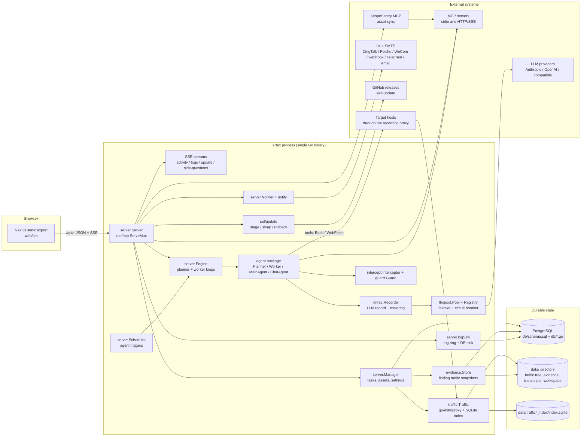

# ARTEX Architecture

| Field | Value |
| --- | --- |
| Module | `github.com/yukiteruamano/artex-global` (`go.mod:1`), matching the GitHub repository `yukiteruamano/artex-global` |
| Branch | `chore/i18n-en-es-hardening` |
| Commit analysed | `fdfb7a17b7da5e2de716c0e98475ec77a41c64c6` (`fdfb7a1`, 2026-10-14) |
| Go toolchain | `go 1.26.10` (`go.mod:3`) |
| Web stack | Next.js 16 App Router, React 19, TypeScript, Tailwind 4, zustand (`web/package.json`) |
| Scope | Whole running system: Go backend, embedded frontend, PostgreSQL schema, file-system state, process boundaries |

This document describes the code as it exists on the branch above. Everything here was read from source; every
structural claim carries a `path:line` citation. When the schema and the Go code disagree, the schema and the
DDL in `db/` win, because that is what PostgreSQL actually stores.

The working tree carried uncommitted changes while this document was written (the index already contained
staged edits unrelated to it). Citations refer to the working tree as read, which is the state a reviewer
reproducing them will see.

The document is split by area so you can open only the part you need; this page keeps the
overview and links to the rest. Section numbers are stable across the split.

---

## Document map

This page is the entry point. Each area below is a separate document, so you can open only
the one you need. Section numbers are stable across the split: `§4.5` is the tool catalog
whether you reach it from here or from another document.

| Document | Covers | Read it when you need |
| --- | --- | --- |
| architecture.md (this page) | §0 how to read, §1 system overview, component diagram | Orientation, or to explain the system to someone new |
| [runtime.md](architecture/runtime.md) | §2 Runtime topology and startup sequence | How the process boots, what it binds, how it shuts down and how configuration is resolved. |
| [backend-packages.md](architecture/backend-packages.md) | §3 Backend module map | One subsection per Go package: responsibility, key symbols with `file:line`, dependencies and owned data. |
| [agent-engine.md](architecture/agent-engine.md) | §4 The agent engine in depth | How a task run is assembled and executed: goals, planner, workers, tools, prompts, findings, cancellation, metering. |
| [data-model.md](architecture/data-model.md) | §5 Data model | The PostgreSQL schema, its ownership and migrations, and the state that lives outside the database. |
| [http-api.md](architecture/http-api.md) | §6 HTTP and API surface | Handler assembly, the route table, authentication, the realtime channel and the error contract. |
| [frontend.md](architecture/frontend.md) | §7 Frontend architecture | The Next.js static export, its source layout, API client, stores and locale handling. |
| [cross-cutting.md](architecture/cross-cutting.md) | §8 Cross-cutting concerns | Observability, notifications, evidence capture, traffic interception, self-update and skill distribution. |
| [integration-points.md](architecture/integration-points.md) | §9 Integration points | Every coupling between frontend, backend, database, agent runtime and the file system. |

### Quick answers

| Question | Go to |
| --- | --- |
| What starts when the binary boots? | [runtime.md §2.2](architecture/runtime.md#22-boot-sequence-step-by-step) |
| Which package owns this table? | [data-model.md §5.1](architecture/data-model.md#51-schema-ownership-and-application) |
| Which endpoint handles this? | [http-api.md §6.2](architecture/http-api.md#62-route-table) |
| How does a task actually run? | [agent-engine.md §4.1](architecture/agent-engine.md#41-one-task-run-end-to-end) |
| Which tools can the model call? | [agent-engine.md §4.5](architecture/agent-engine.md#45-tool-catalog) |
| How is the agent prompted? | [agent-engine.md §4.6](architecture/agent-engine.md#46-prompt-composition) |
| How does the UI talk to the API? | [frontend.md §7.4](architecture/frontend.md#74-api-client) |
| What connects to what? | [integration-points.md §9](architecture/integration-points.md) |

## 0. How to read this document

**Citation format.** `path:line` points at a single line; `path:12-40` points at a range. Line numbers are valid
for the commit in the header table. If a later commit shifts them, the surrounding prose still names the exact
symbol to search for.

**Evidence rule.** Nothing in this document is inferred from naming alone. When behaviour is derived from a
comment, the comment is attributed ("the source comment states ..."). Behaviour that could not be verified from
code is not described.

**Diagrams.** All diagrams are Mermaid and use English-only labels so they render in any viewer.

---

## 1. System overview

### 1.1 What ARTEX is

ARTEX is an LLM-driven, multi-agent autonomous penetration-testing platform. The operator describes an
engagement (a task with a description and a goal), and a set of language-model agents then run the work:

| Agent role | Implementation | Purpose |
| --- | --- | --- |
| Goals decomposer | `agent/goals.go:126` (`DecomposeGoalsWithProvider`) | Turns the free-text goal into concrete, checkable goal nodes. |
| Planner | `agent/planner.go:23` (`Planner`), `agent/planner.go:355` (`Plan`) | The only intent generator. Reads graph state, judges goals, emits exploration intents. |
| Worker | `agent/worker.go:54` (`Worker`), `agent/worker.go:361` (`execute`) | Executes exactly one intent, writes facts, assets and findings back to the graph. |
| Main agent | `agent/mainagent.go:20` (`MainAgent`), `agent/mainagent.go:112` (`Chat`) | Human interface inside a task: hints, intents, steering, goal edits. |
| Chat agent | `agent/chat.go:25` (`ChatAgent`), `agent/chat.go:105` (`Chat`) | Task-independent assistant for the chat page and for custom conversation agents. |
| Finding retester | `agent/retester.go:4` (`RetesterDefaultPrompt`) + `server/finding_retests.go:208` (`seedFindingRetester`) | Standalone conversation agent that re-verifies one already-recorded finding. |
| Reporter | `server/orchestration.go:745` (`seedReporterAgent`) | Trigger-driven agent that writes the long-form report for a confirmed finding. |

The engine that binds these together is event-driven, not scripted: graph changes wake the planner, the planner
emits intents, and a pool of workers claims intents from the frontier. The design intent is stated in the
`Engine` doc comment (`server/engine.go:102-108`, type at `server/engine.go:109`).

The system is explicitly authorized-testing software: every outbound probe runs under agent-supplied shell
tools, through an optional recording proxy, and through a guard/intercept layer that can block or ask for
approval (`guard/guard.go:31`, `intercept/intercept.go:141`).

### 1.2 Deployment shape

ARTEX ships as **one Go binary** that can embed the compiled frontend, with **PostgreSQL as the only application
datastore**:

| Concern | Implementation | Reference |
| --- | --- | --- |
| HTTP server + API | Go `net/http` with `ServeMux` patterns | `server/server.go:760` (`Handler`) |
| Web UI | Next.js static export embedded via `//go:embed all:webui/dist`, gated by build tag `embedui` | `server/webui_embed.go:16-19` |
| Web UI, un-embedded | 404 stub; developer runs `next dev` separately | `server/webui_stub.go:16-18` |
| Application database | PostgreSQL through `pgx` (`database/sql` driver `pgx`) | `db/db.go:23`, `db/db.go:134` (`Open`) |
| Traffic recording | Embedded go-mitmproxy proxy + sidecar SQLite index + file tree | `traffic/traffic.go:1-5`, `traffic/traffic.go:189-194` |
| Evidence bodies | Content-addressed files under `<data>/evidence` | `evidence/store.go:29` (`New`) |
| Raw LLM transcripts | JSON transcript store under `<data>/transcripts` | `server/task_llm.go:562` |
| JWT signing key | `<baseDir>/jwt.key`, 0600, outside the browsable workspace | `server/auth.go:79` (`loadOrCreateJWTKey`) |
| Workspace files | `<data>` itself, browsable through `/api/workspace/*` | `server/workspace.go:44` (`wsResolve`) |

Startup fails hard when PostgreSQL is not configured: `config.PostgresDSN` returns an error naming the config
file it inspected, and there is deliberately no built-in default (`config/config.go:201-214`).

### 1.3 Component diagram

---

Next: [§2 Runtime topology and startup sequence](architecture/runtime.md) — how the binary boots,
what it binds, and how configuration is resolved. Everything else is reachable from the
[document map](#document-map) above.
