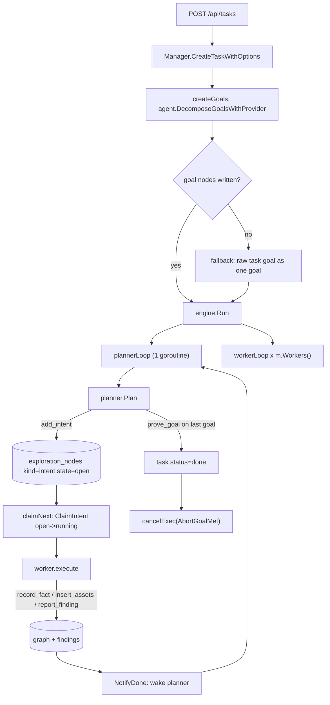
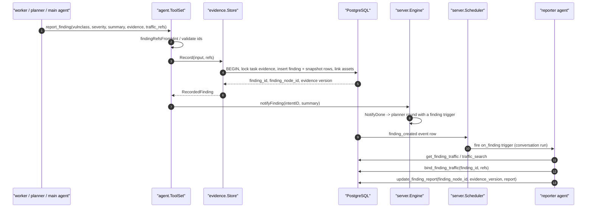
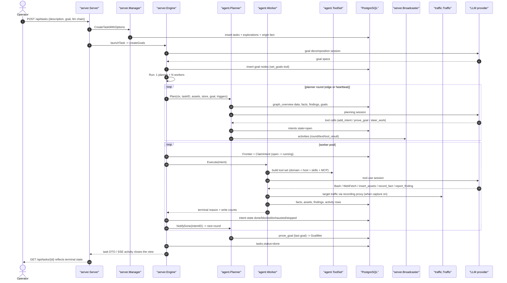

# §4 The agent engine in depth

> Part 4 of the architecture document · [back to the architecture index](../architecture.md)

How a task run is assembled and executed: goals, planner, workers, tools, prompts, findings, cancellation, metering.

#### Contents

- [4.1 One task run, end to end](#41-one-task-run-end-to-end)
- [4.2 Goal decomposition](#42-goal-decomposition)
- [4.3 The planner round](#43-the-planner-round)
- [4.4 Worker execution](#44-worker-execution)
- [4.5 Tool catalog](#45-tool-catalog)
- [4.6 Prompt composition](#46-prompt-composition)
- [4.7 Blackboard, asset graph and inheritance](#47-blackboard-asset-graph-and-inheritance)
- [4.8 Finding workflow](#48-finding-workflow)
- [4.9 Retester loop](#49-retester-loop)
- [4.10 Cancellation and terminal reasons](#410-cancellation-and-terminal-reasons)
- [4.11 LLM calls and metering](#411-llm-calls-and-metering)
- [4.12 Concurrency and admission](#412-concurrency-and-admission)
- [4.13 Full task-run sequence diagram](#413-full-task-run-sequence-diagram)

---

### 4.1 One task run, end to end

A task run is assembled in five stages. Each stage is a separate code path with its own failure handling.

| Stage | What happens | Code |
| --- | --- | --- |
| 1. Create | `POST /api/tasks` validates the request, creates the `tasks` row and the exploration graph. | `server/server.go:1572` (`createTask`), `server/manager.go:906` (`CreateTaskWithOptions`), `db/tasks.go:134` (`CreateTask`), `db/exploration.go:178` (`CreateExploration`) |
| 2. Launch | Seed root asset/scope, optional seeded first intent, then asynchronous goal decomposition; `engine.Run` starts only after goals exist. | `server/goals.go:48` (`launchTask`), `server/goals.go:62` (`startTaskEngine`) |
| 3. Admit | Task-level concurrency admission decides running vs queued. | `server/goals.go:119` (`admitTask`), `server/goals.go:130` (`admitTaskWhen`), `server/manager.go:1164` (`ApplyTaskAdmission`), `server/goals.go:273` (`reconcileConcurrency`) |
| 4. Run loops | One planner goroutine plus N worker goroutines per task. | `server/engine.go:783` (`Run`), `server/engine.go:835` (`plannerLoop`), `server/engine.go:951` (`workerLoop`) |
| 5. Settle | Goals met, deadline reached, pause, delete or shutdown ends the loops and fixes the terminal status. | `server/engine.go:900-940`, `server/engine_timeout.go:184` (`settleTask`) |

The task runtime handle is `server.Task` (`server/manager.go:29`). It keeps the persisted lifecycle fields together
with `Store` (the graph store) and `Guard` (hook registry), and it serialises lifecycle reads/writes through
`lifecycleSnapshot` / `updateLifecycle` (`server/manager.go:129`, `server/manager.go:139`). Two notify surfaces
exist: the buffered `notify` channel that wakes the planner, and `pendingTriggers`, which carries *what* changed
(`server/manager.go:82-87`).



### 4.2 Goal decomposition

`DecomposeGoalsWithProvider` (`agent/goals.go:126`) runs one LLM session whose system prompt is the goals
template (`agent/goals.go:19`) plus a scope tail (`agent/goals.go:53`) built by `goalsSystem`
(`agent/goals.go:77`). The agent's only writable tools are `set_goals` and `set_constraints`
(`agent/toolcatalog.go:50`). It returns `[]GoalSpec` (`agent/goals.go:86`) with an optional vulnerability class.

Two invariants matter:

* Goals are written before the engine starts. `startTaskEngine` runs decomposition, emits a round-0 activity,
echoes each goal into the transcript, and only then calls `engine.Run` (`server/goals.go:62-86`).
* If decomposition produces nothing (no provider, LLM error), the raw goal string becomes one goal node so the
task still has something the planner can judge (`server/goals.go:414-427`).

Goal judging is a planner responsibility inside `Plan`: `prove_goal` marks one goal met, and marking the last
open goal flips `ToolSet.GoalMet`, which the engine reads as "task done" (`agent/tools.go:1157`,
`agent/tools.go:1205`, `server/engine.go:915-925`).

### 4.3 The planner round

`plannerLoop` (`server/engine.go:835`) owns exactly one goroutine per task. It is woken by two sources:

| Source | Mechanism | Reference |
| --- | --- | --- |
| Edge (graph changed) | `Task.Notify()` on the buffered channel | `server/manager.go:1766`, `server/engine.go:936-948` |
| Heartbeat | Timer re-armed after every wake; interval from `tasks.plan_heartbeat_seconds`, minimum 600s | `server/engine.go:816-833`, `db/tasks.go:83` |

A round runs through these gates in order, and any of them can abandon the round without an LLM call:

| Gate | Condition | Reference |
| --- | --- | --- |
| Debounce | Burst coalescing window | `server/engine.go:845-853` |
| Provider present | `snapshotFor` returns nil while no LLM is installed | `server/engine.go:855-858` |
| Paused | `IsPaused` | `server/engine.go:859-861` |
| Deleting | `IsDeleting` (delete barrier) | `server/engine.go:862-864` |
| Terminal | Task already `done`/`failed`/`timeout` | `server/engine.go:866-871` |
| Settling | Task-deadline settlement in progress | `server/engine.go:872-875` |
| Goalless | No open goals: skip the LLM entirely, finish as `done` when the frontier is drained | `server/engine.go:876-893` |

The substantive round is `server/engine.go:894-933`: stamp first run, create a cancellation context that carries
the task deadline (`clockCtx`), emit a `kind=round` activity, drain accumulated trigger events, bracket the call
with `BeginLLMCall`/`EndLLMCall` (the stall detector reads that counter), and call `planner.Plan`
(`agent/planner.go:355`).

`Plan` itself:

1. Advances the cold-graph compaction round (`agent/planner.go:360`, `agent/compaction.go:68`).
2. Builds a `ToolSet` named `planner`, with `kill_work`/`steer_work` wired to the engine
   (`agent/planner.go:361-372`, `server/task_llm.go:580-581`).
3. Splits situational data into the *user* turn (triggers + graph overview) and keeps the *system* prompt static,
   so provider prompt caching stays effective (`agent/planner.go:379-389`).
4. Appends task constraints to the system prompt when enabled (`agent/planner.go:394-396`,
   `agent/constraints.go:14`).
5. Runs one harness session and returns `(met, reason, err)` (`agent/planner.go:465-472`).

The user-turn directive is explicit about the hard floor: when the goal is not met and no intent is open or
running, the round must emit at least one intent or the task is considered stalled
(`agent/planner.go:461-462`).

### 4.4 Worker execution

`workerLoop` (`server/engine.go:951`) runs `m.Workers()` goroutines per task (default 3,
`server/manager.go:288`). Each iteration:

1. Bail out or sleep on: no worker provider, paused, deleting, settling, terminal status
   (`server/engine.go:958-985`).
2. `runWorkerStep` (`server/engine.go:1000`) claims one intent from the frontier (`claimNext`,
   `server/engine.go:1274`) using the `open` -> `running` CAS (`db/exploration.go:1173`), then calls `runIntent`.
3. `runIntent` (`server/engine.go:1017`) is the single place where an intent is executed and settled, shared by
the pool and by the human-message path (`runDetachedIntent`, `server/engine.go:1206`).

Inside `runIntent`:

| Step | Detail | Reference |
| --- | --- | --- |
| Child context | Per-work `context.WithCancelCause` so `kill_work` stops only this intent | `server/engine.go:1030-1031` |
| Intercept context | Task id, agent label and activity emitter attached for approval audit | `server/engine.go:1041` |
| Hooks | `steerHooks` wrap the guard hooks and drain mid-run steering, with an empty-turn nudge limit | `server/engine.go:1044-1050`, `server/engine.go:553` |
| Execution | `worker.Execute` or `worker.ExecuteWithMessage`, bracketed by `BeginLLMCall` | `server/engine.go:1052-1061` |
| Model-error retry | Up to `modelErrorRetries` extra attempts (default 2) with backoff, skipped while paused/settling | `server/engine.go:1065-1081`, `server/engine.go:72`, `server/llmretry.go:67` |
| Detach | `detachWork` records who stopped the work (pause vs cancel vs normal) | `server/engine.go:1089` |
| Terminal state | `done`, `blocked` (error), `exhausted` (`ReasonMaxTurns`/`ReasonTimeout`), `stopped` (killed) | `server/engine.go:1170-1188` |
| Wake planner | `t.NotifyDone(intent.ID)` carries the completed intent into the next round | `server/engine.go:1190`, `server/manager.go:1777` |

Cancellation mapping inside the same function is exact and worth quoting as a table:

| Situation | Detection | Intent lands in |
| --- | --- | --- |
| User paused the task | `taskExecutionPaused(context.Cause(ectx))` | `open` (re-claimed on resume) |
| Task deadline settlement | `isSettling` | `exhausted` |
| Task already terminal (e.g. goal met) | `isTerminalStatus` | `stopped` |
| Planner killed this work | `workCtx` cancelled while task ctx alive | `stopped` |
| Explicit intent pause/cancel | `detachWork` action | `paused` then API cleanup |

`agent/worker.go` details that matter architecturally:

* The intent itself, its instruction, and its anchored assets go into the **system** prompt, so they survive
  compaction and remain present across resumes (`agent/worker.go:384-421`).
* Only the global graph overview goes into the first user turn (`agent/worker.go:485-491`).
* Each run gets its own directory `<workDir>/tasks/<taskID>/i<intentID>` with a `cmd-output/` spill directory
  (`agent/worker.go:276-286` defines `ensureRunDir`, called at `agent/worker.go:391`).
* Resuming a paused/blocked intent reopens the same transcript and seeds the skill unlock state from history
  (`agent/worker.go:500-514`, `agent/deferred.go:34`).

### 4.5 Tool catalog

Tool assembly for one run has four layers, applied in order:

```text
base (domain tools + actool.DefaultTools)
  -> AugmentTools          agent/assembly.go:39   (skills, MCP, host tools; deferred block)
  -> ToolResolve           agent/toolcatalog.go:108 (DB catalog: filter, override, inject defaults)
  -> findingWorkflowTools  agent/finding_workflow.go:25 (evidence contract notes, traffic param stripping)
  -> addToolAliases        agent/toolcatalog.go:267   (camelCase aliases kept from older prompts)
```

#### 4.5.1 SDK default tools

Every agent starts from `actool.DefaultTools()`; the planner comment names them Read/Write/Edit/MultiEdit/LS/Glob/Grep/Bash
(`agent/planner.go:373-375`). The worker deliberately drops `MultiEdit`, `Glob` and `Grep` to keep the tool
surface small (`agent/worker.go:377-379`). Interactive shell tools (`shell_open` and its siblings) are injected
per agent when `agents.interactive_shell` is on (`server/assembly.go:308-322`).

#### 4.5.2 ARTEX domain tools

| Tool | Purpose | Defined at | Default agents |
| --- | --- | --- | --- |
| `graph_overview` | Whole-graph situation report | `agent/tools.go:341` | planner, mainagent |
| `list_findings` | Findings of this task | `agent/tools.go:901` | planner, worker, mainagent |
| `list_facts` | Confirmed facts | `agent/tools.go:939` | planner, mainagent |
| `node_detail` | Full node payload | `agent/tools.go:992` | planner, worker, mainagent |
| `expand_digest` | Restore a folded cold region | `agent/tools_digest.go:120` | planner, mainagent |
| `add_intent` | Emit exploration directions | `agent/tools.go:1091` | planner, mainagent |
| `list_goals` | Goal list and state | `agent/tools.go:1148` | planner, mainagent |
| `prove_goal` | Mark one goal met | `agent/tools.go:1157` | planner |
| `goal_met` | Declare the whole task finished (unbound by default) | `agent/tools.go:1205`, `agent/toolcatalog.go:60` | none |
| `record_fact` | Write a conclusion (including negative results) | `agent/tools.go:1353` | worker, mainagent |
| `report_finding` | Register a confirmed vulnerability | `agent/tools.go:1219` | planner, worker, mainagent, auto, pentest |
| `add_hint` | Queue a hint for the next planner round | `agent/tools.go:1616` | mainagent |
| `kill_work` / `steer_work` | Stop or steer one running intent | `agent/tools.go:1676`, `agent/tools.go:1706` | planner, mainagent (steer) |
| `get_worker_output` | Final text of a finished work | `agent/tools.go:1740` | planner, mainagent |
| `get_worker_trace` / `search_all_worker_traces` / `list_worker_traces` | Cross-work readback | `agent/tools.go:1821`, `agent/tools.go:1930`, `agent/tools.go:1979` | planner, worker, mainagent |
| `set_goals` / `set_constraints` | Runtime goal and constraint edits | `agent/tools.go:1474`, `agent/tools.go:1567` | mainagent, goals |
| `insert_assets` | Upsert assets into the global asset graph | `agent/tools_insert.go:122` | worker, mainagent, auto, pentest |
| `list_assets` | Asset query DSL search | `agent/tools_insert.go:530` | planner, worker, mainagent, auto, pentest |
| `list_companies` | Companies with scope and asset counts | `agent/tools_insert.go:587` | planner, mainagent, auto, pentest |
| `add_company_scope` | Extend a company's asset scope | `agent/tools_insert.go:377` | planner, mainagent, auto |
| `add_task_scope` | Extend this task's scope (coverage denominator) | `agent/tools_insert.go:431` | planner, mainagent |
| `list_untested_assets` | In-scope assets not yet touched | `agent/tools_insert.go:487` | planner, mainagent |

Coverage tools are dropped from prompts when coverage is disabled for the task
(`agent/tools.go:189-210`, `agent/tools.go:177`).

#### 4.5.3 Host tools

Host tools are constructed by the server and injected into every agent's base list, then filtered per agent by
the DB binding (`server/orchestration.go:40-63`):

| Group | Tools | Reference |
| --- | --- | --- |
| Traffic (only when capture is on) | `traffic_search`, `traffic_get`, `traffic_blob` | `traffic/traffic.go:2000`, seeded with default binding `worker` at `server/assembly.go:224-234` |
| Cross-task orchestration | `list_tasks`, `list_llm_profiles`, `spawn_task`, `pause_task`, `get_task_graph`, `list_task_findings`, `add_task_hint`, `get_task_worker_trace`, `list_task_worker_traces`, `search_task_worker_traces`, `get_task_node_detail`, `update_finding_report`, `get_finding_traffic`, `bind_finding_traffic` | `server/orchestration.go:65-83` |
| Platform administration | `delete_assets_by_host`, `create_skill`, `update_skill_file`, `create_custom_tool`, `update_custom_tool`, `create_mcp`, `update_mcp` | `server/platform_tools.go:18-27`, default bindings `server/platform_tools.go:32-36` |
| Finding retest | `get_finding_retest_context`, `record_finding_retest_result` | `server/finding_retests.go:158-206` |

#### 4.5.4 Skill and MCP tools

`wireAgentAugment` rebuilds the augmentation closure per run (`server/assembly.go:25`). For the calling agent key
it:

1. Loads the agent row and its visible skill names (`server/assembly.go:33-53`).
2. Mounts one `Skill` meta-tool whose invocation unlocks the MCP servers declared by the skill and reveals their
tool names (`server/assembly.go:125-145`).
3. Connects every MCP server that is either directly visible or referenced by a visible skill; directly visible
and non-gated servers are available from the first turn, skill-gated ones stay deferred
   (`server/assembly.go:64-109`).
4. Adds host tools and marks custom tools flagged as deferred so their schemas are withheld until searched
   (`server/assembly.go:147-165`).

MCP tool names are `mcp__<server>__<tool>` (`mcphttp/client.go:35`). Deferred tools are advertised by name only
in a boundary block after the system prompt (`agent/deferred.go:18`).

#### 4.5.5 The DB tool catalog

`tools` is the runtime inventory of every built-in tool. On boot the server seeds rows (first insert only) with
key, description, JSON schema and default bindings (`agent/toolcatalog.go:64`, `server/assembly.go:214-234`).
At run time `ToolResolve` (`server/assembly.go:239-324`) drops tools that are disabled or not bound to the
calling agent, wraps the survivors so the model sees the DB description/schema and default arguments are
injected (`agent/toolcatalog.go:143`), injects domain tools that are bound but missing from the base list, and
appends shell-environment hints and interactive-shell tools.

Key consequences:

* The handler always comes from code; the database can only change prose and defaults (`agent/toolcatalog.go:12-16`).
* `kind='shell'` rows are not callable tools; they are declarations appended to the Bash description
  (`server/assembly.go:290-307`).
* A tool with no DB row (MCP, skill, host) passes through untouched (`server/assembly.go:260-263`).

### 4.6 Prompt composition

A run's system prompt is assembled, never stored whole. The layers, in order:

| Layer | Owner | Reference |
| --- | --- | --- |
| Body template rendered from a DB row, falling back to the code default | `agent_prompts` via `PromptOverride` | `agent/prompt.go:39-60` |
| Template variables | Per-role structs `PlannerVars`, `WorkerVars`, `MainVars`, `GoalsVars` | `agent/prompt.go:19-22` |
| Universal `{{.Now}}` wall clock | `nowStr` | `agent/prompt.go:28` |
| Artifact/output spec (worker) | Code-owned tail | `agent/worker.go:260-275` |
| Traffic block when capture is on | Code-owned tail | `agent/worker.go:250` |
| Task operation constraints | Rendered from `task_constraints` | `agent/constraints.go:14` |
| Intent block plus anchored assets (worker) | Built per run | `agent/worker.go:316`, `agent/worker.go:404-419` |
| Deferred tool boundary | Unlockable block | `agent/deferred.go:18` |
| Output-language directive | Code-owned tail, appended last | `agent/prompt.go:80` |

Presets seeded on first boot are `goals`, `planner`, `mainagent`, `worker`, `auto`, `pentest`
(`agent/promptcatalog.go:113-121`, seeded by `server/assembly.go:194`). A separate retester prompt is seeded
with its agent row (`server/finding_retests.go:240-250`). Wrap-up (settlement) prompts and turn budgets are also
DB-overridable (`agent/wrapup.go:19-24`, wired at `server/server.go:279-296`).
The output-language directive is appended after everything else, so a DB-edited body cannot remove it
(`agent/prompt.go:80-93`). It constrains only the language shown to the user, not the reasoning register of the
model; the source comment states this design choice explicitly (`agent/prompt.go:66-79`).

### 4.7 Blackboard, asset graph and inheritance

The "blackboard" is the exploration graph, stored in `explorations`, `exploration_nodes`,
`exploration_edges` and `exploration_anchors`. It is not a chat log: it is a typed graph the planner reads
every round.

| Node kind | Constant | Meaning |
| --- | --- | --- |
| `goal` | `db.KindGoal` (`db/constants.go:6`) | A checkable objective. |
| `intent` | `db.KindIntent` (`db/constants.go:7`) | One exploration direction; the unit of work. |
| `fact` | `db.KindFact` (`db/constants.go:8`) | A worker conclusion, including negative results. |
| `finding` | `db.KindFinding` (`db/constants.go:9`) | A confirmed vulnerability node. |
| `hint` | `db.KindHint` (`db/constants.go:10`) | Human guidance for the planner. |
| `digest` | `db.KindDigest` (`db/constants.go:11`) | Lossless fold of cold intents/facts. |

Edge relations are `spawns`, `derived_from`, `yields`, `proves`, `covers` (`db/constants.go:34-39`). The task
root is a `fact` node in state `origin` (`db/constants.go:22-26`).

Graph growth is bounded by cold-node compaction: `Planner.Plan` advances a round counter and, off the hot
path, folds eligible connected regions into digest nodes with `covers` edges back to their members
(`agent/compaction.go:68-108`, `agent/compaction.go:195`, `agent/coldgraph.go:183-284`). Members keep their rows
and remain restorable via `expand_digest`.

**Cross-task inheritance** is a read-only overlay, not a copy:

| Mechanism | Reference |
| --- | --- |
| `task_relations` rows declare source tasks (`MaxTaskSourceCount` = 8) | `db/tasks.go:89`, `schema.sql:636` |
| `DirectSourceStores()` returns the source tasks' stores | `db/exploration_sources.go:20` |
| `*WithSources` query variants merge source rows and mark them `inherited` with `source_task_id` | `db/exploration_sources.go:57-74`, `db/exploration_sources.go:87` |
| `graph_overview` renders inherited summaries under `related_tasks` with a text budget per source | `agent/tools.go:515-518`, `agent/tools.go:661`, `agent/tools.go:575-600` |
| Inherited intents never enter the local frontier | `agent/tools.go:513-518` |
| Inherited scope is readable but not writable | `db/task_assets_context.go`, `agent/tools.go:525-548` |

Asset-level state is separate: `assets` is global and shared, `company_scope` and `task_scope` gate what is in
scope, and `task_asset_links` records which task discovered which asset (`schema.sql:40`, `schema.sql:115`,
`schema.sql:648`, `schema.sql:738`). Coverage is computed from scope versus assets referenced by facts
(`db/task_scope.go:328`), and is only surfaced when enabled for the task (`agent/tools.go:527-531`).

### 4.8 Finding workflow

The finding path is deliberately transactional and evidence-first:



Details that are enforced in code:

| Rule | Reference |
| --- | --- |
| `report_finding` refuses outside a task context and points to `add_task_hint` | `agent/tools.go:1238-1240` |
| Auto-binding can be switched off; the advertising schema is then stripped, and stray parameters are ignored rather than failing the report | `agent/finding_workflow.go:26-48`, `agent/finding_workflow.go:85`, `agent/tools.go:1246-1248` |
| Findings are recorded through the evidence store when traffic refs exist; without it the call fails instead of writing a partial finding | `agent/tools.go:1258-1264` |
| `finding_id` (record) and `finding_node_id` (graph node) are distinct and documented in-tool | `agent/finding_workflow.go:11` |
| The reporter must read the current evidence version before writing the report | `agent/finding_workflow.go:76-78` |
| Status changes, filters, grouping, export and lineage are HTTP surfaces | `server/findings_groups.go`, `server/finding_traffic.go:95-104` |
| Follow-up "deepen" creates a new exploration run seeded with the finding context | `server/findings_groups.go:96` |

The evidence snapshot model is immutable: a snapshot row carries URL, method, status, request/response heads and
content hashes; bodies live once on disk keyed by hash (`evidence/store.go:62-119`, `evidence/store.go:182-195`).

### 4.9 Retester loop

Retesting is a separate, human-initiated loop, not part of the planner/worker cycle:

| Step | Reference |
| --- | --- |
| `POST /api/exploration/findings/{id}/retests` validates the finding, the retester agent and its tool bindings, then records a retest row | `server/finding_retests.go:75` |
| The retest row carries the finding, the initiator notes and the evidence version at start | `db/finding_retests.go` (`CreateFindingRetest`) |
| A conversation is created for agent key `retester` (`db.FindingRetestAgentKey`, `db/finding_retests.go:13`) | `db/finding_retests.go:116-127` |
| The agent calls `get_finding_retest_context` first; the tool refuses to serve a retest that is not its own | `server/finding_retests.go:158-206` |
| The agent finishes with `record_finding_retest_result(verdict, summary, evidence)` | `agent/retester.go:4-11` |
| Verdict vocabulary: `reproduced`, `fixed`, `inconclusive`; only `fixed` flips the finding's status | `agent/retester.go:6-9`, `server/finding_retests.go:257` |
| Active retests are surfaced so the UI can show in-flight verification | `server/finding_retests.go:35` |

### 4.10 Cancellation and terminal reasons

Cancellation is always named. `agent.AbortCause` (`agent/cancelcause.go:11`) carries a code, a short label and a
user-facing explanation, and `AbortReason` (`agent/cancelcause.go:71`) resolves it from the context, including a
fallback that reports an unnamed cancellation as a defect.

| Code | Scope | Reference |
| --- | --- | --- |
| `paused_by_user` | task | `agent/cancelcause.go:30` |
| `paused_by_orchestrator` | task | `agent/cancelcause.go:32` |
| `task_deleted` | task | `agent/cancelcause.go:34` |
| `paused_on_reload` | task | `agent/cancelcause.go:36` |
| `goal_met` | task | `agent/cancelcause.go:38` |
| `settle_drain_timeout` | task | `agent/cancelcause.go:40` |
| `killed_by_planner` | work | `agent/cancelcause.go:44` |
| `work_paused_by_user` | work | `agent/cancelcause.go:46` |
| `work_cancelled_by_user` | work | `agent/cancelcause.go:48` |
| `work_finished` | work | `agent/cancelcause.go:50` |
| `paused_race_guard` | work | `agent/cancelcause.go:52` |
| `chat_stopped_by_user` | chat | `agent/cancelcause.go:56` |
| `chat_paused_with_task` | chat | `agent/cancelcause.go:58` |
| `chat_turn_finished` | chat | `agent/cancelcause.go:60` |
| `shutdown` | process | `agent/cancelcause.go:64` |
| `run_hard_timeout` | run | `agent/cancelcause.go:66` |

Harness terminal reasons (`ReasonMaxTurns`, `ReasonTimeout`, `ReasonModelError`, `ReasonAbortedStreaming`,
`ReasonAbortedTools`, hook reasons, image reasons) are mapped to user-facing text by
`terminalText`/`terminalReasonHint` (`agent/terminalreason.go:49`, `agent/terminalreason.go:128`). That text is
what the transcript shows when a run ends without a final assistant message.

Budget handling has three layers:

| Layer | Mechanism | Reference |
| --- | --- | --- |
| Per-run step/time budget | `MaxTurns` and `MaxDuration` in the harness options, clamped by the task deadline | `agent/worker.go:455-462`, `agent/taskclock.go` |
| Wrap-up turn on budget hit | `Settlement` hides Bash and asks for a final write-back | `agent/wrapup.go:94`, `agent/wrapup.go:174` |
| Task deadline | `settleTask` runs a final planner round, then hard-cancels stragglers | `server/engine_timeout.go:184-234` |

### 4.11 LLM calls and metering

Every task resolves its own provider through `taskLLMRuntime` (`server/task_llm.go:50`) — a provider whose
`Stream`/`Complete` reads the *current* chain on every call (`server/task_llm.go:222`, `server/task_llm.go:232`).
That is what lets a chain edit take effect on the next call without rebuilding agents.

Resolution precedence per agent key:

1. Agent binding (`agents.llm_profile_id`) — see `effectiveProfileForAgent` (`server/server.go:624`).
2. Task pin / task chain (`task_llm_profiles`, `tasks.active_llm_profile_id`) — see
   `server/manager.go:1065` (`ReplaceTaskLLMProfiles`).
3. Global active profile, optionally wrapped in a failover pool.

Metering and recording are two separate tables with different lifetimes:

| Table | Written by | Content | Toggle |
| --- | --- | --- | --- |
| `llm_usage` | `llmrec.Recorder.recordUsage` (`llmrec/llmrec.go:267`) | One row per call: task, exploration, worker, model, profile, latency, tokens, status | Always on |
| `llm_records` | `llmrec.Recorder.record` (`llmrec/llmrec.go:296`) | Request/response bodies plus token counts | `settings.llm_record` |

In addition, the harness emits per-turn token counts onto activity rows (`agent/capture.go:162`), which is what
the live transcript and `GET /api/exploration/tokens` read.

Failover is opt-in and layered: the breaker registry lives in the server, not in the provider cache, so
rebuilding a chain does not erase what was learned about a backend (`server/server.go:186-190`,
`server/llmpool.go:22-56`). Bound profiles stay exclusive unless `llm_pool_bind_fallback` is on
(`server/llmpool.go:143-155`).

### 4.12 Concurrency and admission

Three independent limits exist and must not be confused:

| Limit | Setting | Scope | Reference |
| --- | --- | --- | --- |
| Worker pool size | `workers` (default 3) | Per task, read at `Engine.Run` | `server/manager.go:323`, `server/engine.go:784` |
| Simultaneous running tasks | `task_concurrency_enabled` + `task_concurrency_limit` (default 5) | Process-wide | `server/manager.go:296-321`, `server/goals.go:273` |
| Trigger runs per agent | `agents.trigger_run_mode`, `trigger_max_parallel` | Per agent | `server/server.go:158-180`, `server/scheduler.go` |

Admission is a FIFO queue persisted in task columns (`queued`, `queued_at`, `queue_mode`,
`schema.sql:544-553`). `ApplyTaskAdmission` (`server/manager.go:1164`) writes the transition; the queue is
drained by `reconcileConcurrency`, which is both ticked and triggered by task lifecycle events
(`server/goals.go:273`). Each in-flight agent operation increments an `inflight` counter so deletion can wait for
quiescence (`server/engine_timeout.go:42-66`, `server/engine_timeout.go:50`).

### 4.13 Full task-run sequence diagram



---

← [architecture index](../architecture.md) · section numbers are stable across the split (§4.x).
