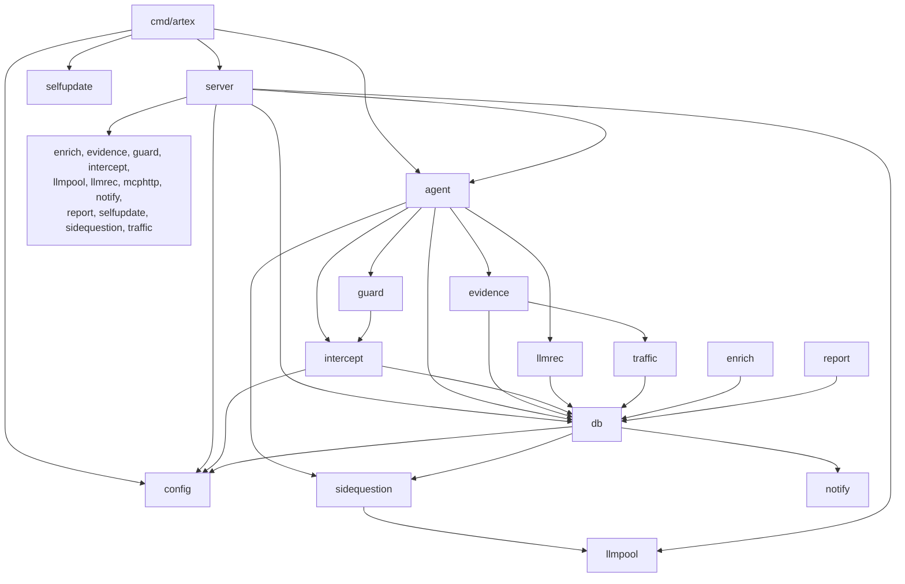

# §3 Backend module map

> Part 3 of the architecture document · [back to the architecture index](../architecture.md)

One subsection per Go package: responsibility, key symbols with `file:line`, dependencies and owned data.

#### Contents

- [3.0 Package dependency graph](#30-package-dependency-graph)
- [3.1 agent](#31-agent)
- [3.2 cmd/artex](#32-cmdartex)
- [3.3 config](#33-config)
- [3.4 db](#34-db)
- [3.5 enrich](#35-enrich)
- [3.6 evidence](#36-evidence)
- [3.7 guard](#37-guard)
- [3.8 intercept](#38-intercept)
- [3.9 llmpool](#39-llmpool)
- [3.10 llmrec](#310-llmrec)
- [3.11 mcphttp](#311-mcphttp)
- [3.12 notify](#312-notify)
- [3.13 report](#313-report)
- [3.14 selfupdate](#314-selfupdate)
- [3.15 server](#315-server)
- [3.16 sidequestion](#316-sidequestion)
- [3.17 traffic](#317-traffic)

---

### 3.0 Package dependency graph

Seventeen Go packages plus the command. Sizes are total Go lines including tests, measured from the working
tree (`wc -l <pkg>/*.go`).

| Package | Lines | Imports (internal) | Imported by |
| --- | --- | --- | --- |
| `agent` | 10,942 | db, evidence, guard, intercept, llmrec, sidequestion | server, cmd/artex |
| `cmd/artex` | 239 | agent, config, selfupdate, server | — (main) |
| `config` | 704 | — | db, intercept, server, cmd/artex |
| `db` | 30,275 | config, notify, sidequestion | agent, enrich, evidence, intercept, llmrec, report, server, sidequestion, traffic |
| `enrich` | 292 | db | server |
| `evidence` | 787 | db, traffic | agent, server |
| `guard` | 260 | intercept | agent, server |
| `intercept` | 1,707 | config, db | agent, guard, server |
| `llmpool` | 1,010 | — | server, sidequestion |
| `llmrec` | 785 | db | agent, server |
| `mcphttp` | 685 | — | server |
| `notify` | 5,887 | — (standard library only, by design: `notify/notify.go:1-9`) | db, server |
| `report` | 469 | db | server |
| `selfupdate` | 1,531 | — | server, cmd/artex |
| `server` | 40,293 | all of the above | cmd/artex |
| `sidequestion` | 1,440 | llmpool | agent, db, server |
| `traffic` | 4,158 | db | evidence, server |

Architectural rule visible in the graph: `agent` never imports `server`. Everything the server must inject into
the agent runtime is a package-level function variable (`agent/assembly.go:34`, `agent/toolcatalog.go:108`,
`agent/prompt.go:14`, `agent/outputlang.go:11`, `agent/finding_workflow.go:16`, `agent/wrapup.go:19-24`). This
keeps the agent layer unit-testable without a server and makes the wiring order explicit in `server/server.go`.

---

### 3.1 agent

**Responsibility.** The LLM runtime: all agent roles, their tool sets, prompt composition, the harness around a
model turn, terminal-reason rendering, context compaction, and the cancellation-cause vocabulary. It reads and
writes PostgreSQL only through `db` stores handed in by the caller.

**Key types and functions.**

| Symbol | Location | Role |
| --- | --- | --- |
| `Planner` | `agent/planner.go:23` | Event-driven intent generator; one `Plan` call per wake-up. |
| `Planner.Plan` | `agent/planner.go:355` | Builds tool set, system prompt and situational user input, runs one harness session. |
| `NewPlanner` | `agent/planner.go:51` | Constructor: provider, model, work dir, transcript store, context window, max turns. |
| `Worker` | `agent/worker.go:54` | Executes exactly one intent. |
| `Worker.Execute` / `ExecuteWithMessage` | `agent/worker.go:349`, `agent/worker.go:357` | Entry points; both delegate to `execute` (`agent/worker.go:361`). |
| `MainAgent` | `agent/mainagent.go:20` | Conversational interface bound to a task. |
| `MainAgent.Chat` | `agent/mainagent.go:112` | One human turn, with goal/hint notification callbacks. |
| `ChatAgent` | `agent/chat.go:25` | Task-independent conversational runner. |
| `ChatAgent.Chat` | `agent/chat.go:105` | One turn keyed by any agent key and a session id. |
| `DecomposeGoalsWithProvider` | `agent/goals.go:126` | Goal decomposition call. |
| `ToolSet` | `agent/tools.go:53` | Holds the per-run stores and every domain tool constructor. |
| `NewToolSet` | `agent/tools.go:163` | Binds an exploration store and a worker name. |
| `ToolSet.PlannerTools` | `agent/tools.go:2033` | Planner domain tool list. |
| `ToolSet.WorkerTools` | `agent/tools_insert.go:644` | Worker domain tool list. |
| `ToolSet.MainAgentTools` | `agent/tools_insert.go:664` | Main-agent domain tool list. |
| `ToolSet.AllDomainTools` | `agent/tools_insert.go:688` | Deduplicated union used to build the server-side registry. |
| `BuiltinToolSeeds` | `agent/toolcatalog.go:64` | Enumerates every built-in tool with its default agent bindings. |
| `ToolResolve` (hook) | `agent/toolcatalog.go:108` | Server-injected filter/override applied to each assembled tool list. |
| `DecorateTool` | `agent/toolcatalog.go:114` | Wraps a tool with DB-overridden description/schema and default-argument injection. |
| `AugmentTools` | `agent/assembly.go:39` | Applies `ToolAugment` (skills, MCP, host tools) and tailors the deferred-tool block. |
| `renderSystem` | `agent/prompt.go:39` | Renders the DB template over the code default, with fallback. |
| `PromptOverride` (hook) | `agent/prompt.go:14` | Server-injected accessor for `agent_prompts`. |
| `langDirective` | `agent/prompt.go:80` | Code-owned output-language tail appended after the prompt body. |
| `OutputLanguage` (hook) | `agent/outputlang.go:11` | Resolver for the active output language code. |
| `deferredSystem` | `agent/deferred.go:18` | Splits the system prompt into a static part and an unlockable tool block. |
| `Compactor` | `agent/compaction.go:35` | Folds cold graph regions into digest nodes. |
| `coldGraph` | `agent/coldgraph.go:50` | Connectivity model used to decide what is cold. |
| `captureRunSession` | `agent/capture.go:37` | Streams one harness session, emitting activities and an intercept trace. |
| `AbortCause` | `agent/cancelcause.go:11` | Named cancellation cause. |
| `AbortReason` | `agent/cancelcause.go:71` | Resolves code/short/text from a run context. |
| `terminalText` | `agent/terminalreason.go:49` | Renders the terminal summary and markdown detail for a run with no final text. |
| `FindingRecorder` | `agent/finding_recorder.go:11` | Interface the evidence store implements; called from `report_finding`. |
| `RunInfo` | `agent/runinfo.go:18` | Task/exploration/intent ids carried on the context for tool metering. |

**Dependencies.** Outbound: `db` (all stores and node kinds), `evidence` (record interface), `guard` (hook
registry handed in as `harness.HookRunner`), `intercept` (task context, review context, trace), `llmrec`
(capture wrapper used by provider construction), `sidequestion` (side-question capture). Inbound: `server` and
`cmd/artex` only.

**Data owned.** No tables. It writes through `db.ExplorationStore`, `db.AssetStore` and the `FindingRecorder`
interface, and it keeps only ephemeral state: per-task planner todo stores (`agent/planner.go:108`), the
compaction round counter, and per-run tool write counters (`agent/tools.go:143`).

---

### 3.2 cmd/artex

**Responsibility.** Process entry: flags, banner, log capture, self-update bootstrap, signal handling,
construction of `server.Manager` and `server.Server`, HTTP listen, graceful shutdown, exit code.

| Symbol | Location | Role |
| --- | --- | --- |
| `main` | `cmd/artex/main.go:51` | `os.Exit(run())`. |
| `run` | `cmd/artex/main.go:53` | The whole boot sequence ([2.2](runtime.md#22-boot-sequence-step-by-step)). |
| `printBanner` | `cmd/artex/main.go:38` | Banner plus version/OS/arch/address. |
| `shutdownContext` | `cmd/artex/main.go:151` | Cancel-cause context detached from the signal context so the cause is never lost. |
| `version` | `cmd/artex/main.go:27` | Injected with `-ldflags "-X main.version=<tag>"`; default `dev`. |

**Dependencies.** Outbound: `agent` (only for `agent.AbortShutdown`), `config`, `selfupdate`, `server`.
Inbound: none.

**Data owned.** None; it only decides the data directory (`-data`, default `<baseDir>/data`).

---

### 3.3 config

**Responsibility.** Bootstrap configuration with the precedence env > config file > default. It intentionally
holds no runtime settings; those live in the `settings` table.

| Symbol | Location | Role |
| --- | --- | --- |
| `Database` | `config/config.go:17` | DSN, or component fields assembled into a URL. |
| `Config` | `config/config.go:28` | On-disk shape: `database`, `skill_dir`, `language`. |
| `Path` | `config/config.go:146` | `ARTEX_CONFIG` else `./config.json` else `<baseDir>/config.json`. |
| `Load` | `config/config.go:165` | Reads and parses; a missing file yields a zero `Config`. |
| `BaseDir` | `config/config.go:107` | Executable directory, with a `go run` fallback to the CWD. |
| `SkillDir` | `config/config.go:180` | Env > file > `<baseDir>/skills`; created on demand. |
| `PostgresDSN` | `config/config.go:201` | Env > `database.dsn` > assembled fields; error when none. |
| `Redact` | `config/config.go:245` | Password-masked DSN for logs. |
| `SupportedLanguages` | `config/config.go:39` | `en`, `ko`, `zh`, `es`, `ja`. |
| `DefaultLanguage` | `config/config.go:44` | `en`. |
| `Language` | `config/config.go:87` | `ARTEX_LANG` > `language` > `DefaultLanguage`. |
| `CurrentLanguage` (hook) | `config/config.go:63` | Runtime language supplied by the server. |
| `ActiveLanguage` | `config/config.go:71` | Hook value or the `ko` fallback used only by standalone tests. |

**Dependencies.** None (standard library only). Inbound: `db`, `intercept`, `server`, `cmd/artex`.

**Data owned.** The process environment and `config.json` only.

---

### 3.4 db

**Responsibility.** The PostgreSQL data source: connection, schema application, seeding, and every query.
It also embeds the published contract of each area as Go types (`Node`, `Activity`, `Task`, `DBFinding`, …).

| Symbol | Location | Role |
| --- | --- | --- |
| `schemaSQL` | `db/db.go:20-21` | `//go:embed schema.sql` — the whole schema. |
| `DB` | `db/db.go:99` | Thin wrapper over `*sql.DB`; no application-level write mutex. |
| `Open` | `db/db.go:134` | Create database if absent, connect, apply schema under an advisory lock, seed. |
| `DSN` | `db/db.go:93` | Delegates to `config.PostgresDSN`. |
| `ensureDatabase` | `db/db.go:103` | Connects to `postgres` and issues `CREATE DATABASE` when needed. |
| `withSchemaMigrationLock` | `db/db.go:63` | Session-level `pg_advisory_lock` pinned to one connection. |
| `applySchemaWithRetry` | `db/db.go:47` | Retries on PostgreSQL deadlock (`40P01`). |
| `maxOpenConns` | `db/db.go:33` | Pool cap of 32, deliberately below PostgreSQL's default 100. |
| `ExplorationStore` | `db/exploration.go:172` | One task's graph store (nodes, edges, activity, main sessions). |
| `Node` / `Activity` | `db/exploration.go:67`, `db/exploration.go:87` | Graph node and transcript row shapes. |
| `CreateExploration` / `Exploration` | `db/exploration.go:178`, `db/exploration.go:185` | Graph lifecycle. |
| `AddNode` / `AddIntent` / `AddGoal` | `db/exploration.go:197`, `:220`, `:228` | Graph writes. |
| `Frontier` / `ClaimIntent` | `db/exploration.go:1136`, `db/exploration.go:1173` | Worker work acquisition (`open` → `running` CAS). |
| `AppendActivity` | `db/exploration.go:1205` | Transcript persistence. |
| `AssetStore` | `db/assets.go:87` | Process-wide asset graph + company store. |
| `AssetStore.QueryDSL` | `db/asset_dsl.go:509` | Asset query DSL used by `list_assets`. |
| `AssetStore.TaskCoverage` | `db/task_scope.go:328` | Coverage denominator/tested computation. |
| `RecordFindingTx` | `db/finding_traffic.go:342` | Finding + evidence snapshot insert inside one transaction. |
| `GetSetting` / `SetSetting` | `db/settings.go:9`, `db/settings.go:21` | Settings KV. |
| `EnsureLLMRecordsTable` | `db/commands.go:191` | Creates `llm_records` outside `schema.sql`. |
| `EnsureLLMUsageTable` | `db/llm_usage.go:51` | Creates `llm_usage` outside `schema.sql`. |
| `RecoverFindingRetests` | `db/finding_retests.go:267` | Re-drives interrupted retests at boot. |

**Dependencies.** Outbound: `config` (DSN/language), `notify` (label helpers and snapshot types), `sidequestion`
(persisted session/request shapes). Inbound: nearly everything else.

**Data owned.** All 50 tables in [5.2](data-model.md#52-table-inventory) except the traffic SQLite index. Every read and
write of PostgreSQL in the repository goes through this package.

---

### 3.5 enrich

**Responsibility.** Asynchronous asset auto-completion: DNS resolution and HTTP probing for assets the agents
write, routed through the recording proxy when capture is on.

| Symbol | Location | Role |
| --- | --- | --- |
| `Engine` | `enrich/enrich.go:42` | Worker pool with a cooldown map. |
| `New` | `enrich/enrich.go:63` | Takes the asset store, a proxy getter and a worker count. |
| `Engine.ResolveDomain` | `enrich/enrich.go:119` | Enqueues a DNS job. |
| `Engine.ProbeSite` | `enrich/enrich.go:122` | Enqueues an HTTP job. |
| `Engine.worker` | `enrich/enrich.go:145` | Job loop with cooldown suppression. |
| `Engine.doDNS` / `doHTTP` | `enrich/enrich.go:180`, `enrich/enrich.go:224` | The two job bodies. |

**Dependencies.** Outbound: `db` (asset updates). Inbound: `server` (`Manager.enrich`, `server/manager.go:457`;
exposed through `server/manager.go:351`).

**Data owned.** Writes `assets` columns owned by `db/assets.go` (resolved IPs, HTTP status, title, technologies).

---

### 3.6 evidence

**Responsibility.** Turns traffic references into immutable, content-addressed evidence snapshots bound to a
finding, and garbage-collects unreferenced bodies.

| Symbol | Location | Role |
| --- | --- | --- |
| `Store` | `evidence/store.go:23` | `db.DB` + `traffic.Traffic` + a directory. |
| `New` | `evidence/store.go:29` | Constructor used per request and per GC run. |
| `Store.prepare` | `evidence/store.go:146` | Resolves refs into `db.PreparedTrafficEvidence`. |
| `Store.Record` | `evidence/store.go:182` | Records a finding plus its snapshots in one transaction. |
| `Store.Bind` / `WithBinding` | `evidence/store.go:197`, `evidence/store.go:215` | Late binding of traffic to an existing finding. |
| `Store.OpenBody` | `evidence/store.go:247` | Streams a stored request/response body. |
| `Store.Collect` / `RunGC` | `evidence/store.go:347`, `evidence/store.go:406` | Reference counting and deletion. |
| `Store.StageFindingsExport` | `evidence/store.go:120` | Copies evidence into an export directory. |

**Dependencies.** Outbound: `db`, `traffic`. Inbound: `agent` (via the `FindingRecorder` interface),
`server` (wired at `server/finding_traffic.go:35`).

**Data owned.** `traffic_evidence_snapshots`, `finding_traffic_bindings`, and the files under
`<data>/evidence/<hash prefix>/`.

---

### 3.7 guard

**Responsibility.** Command/tool guard: a `hook.Registry` that runs before and after every tool call, applies
intercept rules, blocks destructive or out-of-scope actions, and keeps an audit trail.

| Symbol | Location | Role |
| --- | --- | --- |
| `Guard` | `guard/guard.go:31` | Hook registry plus audit entries and attribution counters. |
| `New` / `NewWithInterceptor` | `guard/guard.go:41`, `guard/guard.go:44` | With or without rule evaluation. |
| `Guard.Hooks` | `guard/guard.go:55` | Returns the `hook.Registry` handed to the harness. |
| `Guard.preToolUse` | `guard/guard.go:57` | Pre-call decision point. |
| `Guard.applyIntercept` | `guard/guard.go:83` | Applies the intercept decision (allow/ask/deny). |
| `Guard.postToolUse` | `guard/guard.go:157` | Post-call bookkeeping. |
| `Guard.Audit` | `guard/guard.go:200` | Audit entries for `GET /api/audit`. |

**Dependencies.** Outbound: `intercept`. Inbound: `agent` (as `harness.HookRunner`), `server`.

**Data owned.** In-memory audit slice only; persisted intercept decisions belong to `intercept`.

---

### 3.8 intercept

**Responsibility.** User-configurable tool-call interception: rule compilation and matching, the ask/approval
flow with a pending-decision channel, an LLM judge fallback, per-tool enable/disable, and audit persistence.

| Symbol | Location | Role |
| --- | --- | --- |
| `Interceptor` | `intercept/intercept.go:141` | Rule cache, pending manager, reviewer hook. |
| `New` | `intercept/intercept.go:167` | Takes the DB handle. |
| `Interceptor.Match` | `intercept/intercept.go:521` | Rule evaluation for one tool call. |
| `Interceptor.Judge` | `intercept/intercept.go:445` | Model-based verdict when no rule matched. |
| `Interceptor.HandleAsk` | `intercept/intercept.go:597` | Blocks the tool call until a human or timeout decides. |
| `Interceptor.Decide` | `intercept/intercept.go:684` | Resolves a pending item. |
| `Interceptor.Log` | `intercept/intercept.go:580` | Persists the audit row. |
| `Interceptor.IsToolEnabled` | `intercept/intercept.go:249` | Per-tool kill switch. |
| `WithTrace` | `intercept/trace.go:49` | Attaches the review trace to a run context. |
| `BuildReviewInput` | `intercept/review_context.go:54` | Builds the judge's input from tool + arguments + cwd. |
| `ParseVerdict` | `intercept/prompt.go:162` | Parses the judge's answer. |

**Dependencies.** Outbound: `config` (language for labels), `db` (rules, settings, pending, audit). Inbound:
`agent` (task context, review context), `guard`, `server`.

**Data owned.** `intercept_rules`, `intercept_pending`, `task_intercept_rules`, `asset_intercept_rules`, and the
intercept-related `settings` keys (`tool_config`, judge configuration).

---

### 3.9 llmpool

**Responsibility.** Provider failover: an ordered member list, per-call member selection with rotation, error
classification (retryable vs hard), and a circuit-breaker registry with persisted state.

| Symbol | Location | Role |
| --- | --- | --- |
| `Member` | `llmpool/pool.go:20` | One bound profile: provider, name, model, priority. |
| `Pool` | `llmpool/pool.go:48` | Ordered members + health registry. |
| `New` | `llmpool/pool.go:57` | Constructor. |
| `Pool.Stream` / `Complete` | `llmpool/pool.go:82`, `llmpool/pool.go:130` | Failover-aware calls. |
| `Pool.order` | `llmpool/pool.go:168` | Per-request member ordering (health, priority, rotation). |
| `shouldFailover` | `llmpool/pool.go:231` | Decides whether an error moves to the next member. |
| `Registry` | `llmpool/health.go:44` | Breaker state per profile id. |
| `NewRegistry` | `llmpool/health.go:92` | Takes persist/forget callbacks. |
| `Registry.Pass` / `Trip` / `Reset` | `llmpool/health.go:119`, `:138`, `:165` | State transitions. |
| `Registry.SetPolicy` | `llmpool/health.go:64` | Soft-trip count and cooldown. |

**Dependencies.** None internally (it consumes `norma/llm`). Inbound: `server` (`server/llmpool.go:22` builds the
registry with DB persistence), `sidequestion`.

**Data owned.** No tables itself; the server mirrors `Registry` state into `llm_profile_health`
(`server/llmpool.go:23-36`).

---

### 3.10 llmrec

**Responsibility.** A provider wrapper that records every LLM call — raw bodies into `llm_records`, token
metering into `llm_usage` — and a capture context used to snapshot raw HTTP attempts.

| Symbol | Location | Role |
| --- | --- | --- |
| `Recorder` | `llmrec/llmrec.go:64` | Provider decorator. |
| `Wrap` | `llmrec/llmrec.go:81` | Wraps a provider; `enabled` is consulted per call. |
| `Recorder.Stream` / `Complete` | `llmrec/llmrec.go:118`, `llmrec/llmrec.go:222` | Intercepted call paths. |
| `Recorder.recordUsage` | `llmrec/llmrec.go:267` | Writes one `llm_usage` row. |
| `Recorder.record` | `llmrec/llmrec.go:296` | Writes one `llm_records` row (bodies included). |
| `WithTaskID` / `WithWorker` | `llmrec/llmrec.go:24`, `llmrec/llmrec.go:46` | Attributes a call to a task and agent. |
| `Capture` | `llmrec/capture.go:29` | Raw request/response tee for transports. |
| `NewCapture` | `llmrec/capture.go:41` | Installs the capture on a context. |
| `Capture.TeeResponse` | `llmrec/capture.go:73` | Streams the body while keeping a copy. |

**Dependencies.** Outbound: `db`. Inbound: `server` (wraps providers in `applyLLM`, `server/server.go:557`),
`agent` (transport-level capture).

**Data owned.** `llm_records`, `llm_usage`.

---

### 3.11 mcphttp

**Responsibility.** Model Context Protocol client for HTTP transports (streamable HTTP and legacy SSE), turning
remote MCP tools into `actool.CoreTool` values named `mcp__<server>__<tool>`.

| Symbol | Location | Role |
| --- | --- | --- |
| `ToolName` | `mcphttp/client.go:35` | `mcp__` plus server plus tool. |
| `Client` | `mcphttp/client.go:60` | JSON-RPC over HTTP with session handling. |
| `New` | `mcphttp/client.go:99` | Streamable HTTP transport. |
| `NewSSE` | `mcphttp/client.go:124` | Legacy SSE transport. |
| `Client.initialize` | `mcphttp/client.go:242` | MCP handshake. |
| `Client.Tools` | `mcphttp/client.go:258` | `tools/list` mapped to core tools. |
| `Client.wrap` | `mcphttp/client.go:282` | Per-tool wrapper including permission and argument marshalling. |
| `Client.Call` | `mcphttp/client.go:330` | `tools/call`. |
| `Client.Close` | `mcphttp/client.go:357` | Session teardown. |

**Dependencies.** None internally. Inbound: `server` (`connectMCP` at `server/mcpdiscover.go:40`, used by
`server/assembly.go` and by the ScopeSentry sync at `server/sync_scopesentry.go:69`).

**Data owned.** None; the server caches discovered tools in `mcp_tools_cache` (`server/mcpdiscover.go:65`).

---

### 3.12 notify

**Responsibility.** A standard-library-only adapter layer for outbound notifications: channel implementations,
config validation, message rendering (markdown/HTML), severity and status labels in the active language,
filtering, masking and SSRF checks. It knows nothing about the database or the server.

| Symbol | Location | Role |
| --- | --- | --- |
| Package contract | `notify/notify.go:1-9` | Layer rules: leaf package, stateless channels, `map[string]any` config. |
| `Channel` | `notify/channel.go:13` | `Kind`, `Validate`, `Send` returning delivered count. |
| `Get` / `Kinds` | `notify/channel.go:58`, `notify/channel.go:70` | Registry lookup. |
| Kind constants | `notify/notify.go:16-21` | `dingtalk`, `feishu`, `wecom`, `webhook`, `telegram`, `email`. |
| Event constants | `notify/notify.go:26-28` | `finding_created`, `finding_status_changed`. |
| `Snapshot` / `Item` / `Message` | `notify/event.go:10`, `notify/event.go:26`, `notify/event.go:58` | Transport shape between server and channels. |
| `SeverityRank` / `SeverityLabel` / `StatusLabel` | `notify/notify.go:43`, `notify/notify.go:83`, `notify/notify.go:91` | Ranking and localized labels. |
| `Lang` (hook) | `notify/notify.go:51` | Injected language resolver. |
| Channel implementations | `notify/dingtalk.go`, `notify/feishu.go`, `notify/wecom.go`, `notify/webhook.go`, `notify/telegram.go`, `notify/email.go` | One file per channel. |

**Dependencies.** None internally. Inbound: `db` (snapshot and label types), `server` (the delivery engine
`server/notifier.go:96`).

**Data owned.** None.

---

### 3.13 report

**Responsibility.** Markdown and CSV rendering of findings for API export.

| Symbol | Location | Role |
| --- | --- | --- |
| `Markdown` | `report/report.go:49` | Renders the per-task report from graph nodes. |
| `Input` | `report/report.go:16` | Report inputs (task, findings, counters). |
| `FindingsMarkdown` | `report/findings.go:38` | Multi-finding export. |
| `SingleFindingMarkdown` | `report/findings.go:95` | One finding. |
| `FindingsCSV` | `report/findings.go:147` | CSV export. |
| `FindingFilename` | `report/findings.go:127` | Stable download filename. |

**Dependencies.** Outbound: `db` (finding DTOs). Inbound: `server` (`getReport`, `findingsExport`).

**Data owned.** None.

---

### 3.14 selfupdate

**Responsibility.** In-binary self-update: locate the running binary and staging paths, fetch the latest GitHub
release, verify checksums, stage, smoke-test, atomic swap, rollback on repeated failure.

| Symbol | Location | Role |
| --- | --- | --- |
| `ExitRestart` | `selfupdate/selfupdate.go:34` | Exit code 75 that asks the supervisor to relaunch. |
| `Paths` / `ResolvePaths` | `selfupdate/selfupdate.go:43`, `selfupdate/selfupdate.go:56` | Binary, staging and backup locations. |
| `CompareVersions` | `selfupdate/selfupdate.go:119` | Version ordering. |
| `InDocker` | `selfupdate/selfupdate.go:165` | Container detection. |
| `FetchLatest` | `selfupdate/github.go:88` | GitHub release lookup. |
| `AssetName` | `selfupdate/github.go:127` | Release asset naming. |
| `Stage` | `selfupdate/stage.go:47` | Download, verify, extract. |
| `Bootstrap` | `selfupdate/bootstrap.go:50` | Runs before anything else at boot. |
| `applyStaged` / `confirmOrRollback` | `selfupdate/bootstrap.go:76`, `selfupdate/bootstrap.go:110` | Swap and roll back. |
| `SettleDelay` / `Settle` | `selfupdate/bootstrap.go:157`, `selfupdate/bootstrap.go:137` | 30-second survival window. |
| `Rollback` | `selfupdate/bootstrap.go:242` | Manual rollback. |

**Dependencies.** None internally. Inbound: `cmd/artex` (`Bootstrap`, `Settle`), `server` (`updateCheck`,
`updateApply`, `updateRollback` at `server/update.go:223`, `:283`, `:328`).

**Data owned.** The staging directory next to the binary and the update marker file.

---

### 3.15 server

**Responsibility.** The composition root: HTTP API, engine, manager, auth, SSE broadcast, log sink, scheduler,
notifier, side questions, archives, and all DB-to-runtime wiring.

| Symbol | Location | Role |
| --- | --- | --- |
| `Server` | `server/server.go:111` | Holds manager, engine, auth state, LLM caches, trigger queues, side-question state. |
| `New` | `server/server.go:228` | Full runtime assembly ([2.2](runtime.md#22-boot-sequence-step-by-step)). |
| `Server.Handler` | `server/server.go:760` | Builds the route mux and middleware chain. |
| `Manager` | `server/manager.go:218` | Owns PG, asset store, traffic, enrich, interceptor, live task handles. |
| `NewManager` | `server/manager.go:355` | Opens PostgreSQL and starts the proxy. |
| `Task` | `server/manager.go:29` | Runtime handle for one engagement. |
| `Engine` | `server/engine.go:109` | Planner/worker loop driver. |
| `Engine.Run` | `server/engine.go:783` | Starts loops for a task (idempotent). |
| `Engine.plannerLoop` | `server/engine.go:835` | Debounced, heartbeat-driven planning rounds. |
| `Engine.workerLoop` | `server/engine.go:951` | Worker pool loop. |
| `Engine.runIntent` | `server/engine.go:1017` | Executes and settles one claimed intent. |
| `Engine.settleTask` | `server/engine_timeout.go:184` | Task-deadline settlement. |
| `Broadcaster` | `server/broadcast.go:13` | Per-task in-process pub/sub for SSE. |
| `logSink` | `server/logsink.go:34` | In-memory log ring plus async DB persistence. |
| `Notifier` | `server/notifier.go:96` | Delivery engine. |
| `Scheduler` | `server/scheduler.go:22` | Agent trigger scheduler. |
| `taskLLMRuntime` | `server/task_llm.go:50` | Per-task provider router. |
| `agentsForTask` | `server/task_llm.go:552` | Builds the task-scoped goal/planner/worker/main bundle. |
| `wireAgentAugment` | `server/assembly.go:25` | DB/FS-driven skills + MCP + host tools. |
| `wireTools` | `server/assembly.go:212` | DB tool catalog filter/override. |
| `seedPrompts` | `server/assembly.go:194` | Prompt seeding. |
| `applyLLM` | `server/server.go:538` | Installs the global provider and chat agent. |

**Dependencies.** Outbound: every internal package. Inbound: `cmd/artex` only.

**Data owned.** All tables indirectly (it is the only writer besides `db` itself); additionally the
in-memory broadcaster, log ring, trigger queues, provider caches, and the archive wake channel.

---

### 3.16 sidequestion

**Responsibility.** Mid-run side questions: a parent (conversation, task chat or worker intent) can ask a
question against a snapshot of the parent's context, with its own context budget, persistence and replay.

| Symbol | Location | Role |
| --- | --- | --- |
| `Parent` | `sidequestion/capture.go:18` | Identifies the owner (kind + ids). |
| `Model` | `sidequestion/capture.go:36` | Provider/model pair plus profile identity. |
| `Snapshot` | `sidequestion/capture.go:46` | Frozen parent context. |
| `SideQuestionService` | `sidequestion/service.go:27` | `Answer` (`:35`) and `Respond` (`context.go:349`). |
| `Exchange` | `sidequestion/request.go:13` | One question/answer record with status. |
| `BuildRequest` | `sidequestion/request.go:94` | Builds the completion request from snapshot + history + question. |
| `Memory` / `ContextInfo` | `sidequestion/context.go:32`, `sidequestion/context.go:40` | Persisted summarization state and budget reporting. |
| `contextBuilder.compactSnapshot` | `sidequestion/context.go:227` | Keeps the request inside the model window. |

**Dependencies.** Outbound: `llmpool` (shared circuit breaker per profile). Inbound: `agent` (capture hook),
`db` (persistence), `server` (HTTP + provider binding).

**Data owned.** Through `db`: `side_question_sessions`, `side_question_requests`; in memory: the per-request
cancel map in `server/side_questions.go:50`.

---

### 3.17 traffic

**Responsibility.** The traffic-recording subsystem: an embedded go-mitmproxy proxy whose addon writes every
target HTTP exchange into a browsable file tree plus a sidecar SQLite index for paged queries, and exposes the
three traffic tools to agents.

| Symbol | Location | Role |
| --- | --- | --- |
| `Traffic` | `traffic/traffic.go:137` | Proxy, index DB, blob store, rollup counters. |
| `Open` | `traffic/traffic.go:176` | Opens `data/traffic`, creates `_index/index.sqlite`. |
| `Traffic.ProxyAddr` / `Start` / `Close` | `traffic/traffic.go:305`, `:359`, `:366` | Lifecycle. |
| `Traffic.SetUpstreamProxy` | `traffic/traffic.go:317` | Global egress proxy as MITM upstream. |
| `Traffic.CACertPath` | `traffic/traffic.go:354` | CA path injected into agent shells. |
| `Traffic.record` | `traffic/traffic.go:436` | Addon: writes one exchange. |
| `Traffic.Page` | `traffic/traffic.go:859` | Paged/filtered query for the UI and `traffic_search`. |
| `Traffic.Get` / `Blob` / `BlobRange` | `traffic/traffic.go:950`, `:708`, `:728` | Body access with truncation and blob ranges. |
| `Traffic.DeleteHost` / `DeleteAll` | `traffic/traffic.go:1030`, `:1083` | Deletion with space reclamation. |
| `Traffic.Tools` | `traffic/traffic.go:2000` | `traffic_search`, `traffic_get`, `traffic_blob`. |
| `SeedToolMetas` | `traffic/traffic.go:2123` | Metadata-only tools for catalog seeding. |
| `Traffic.ReadEvidence` | `traffic/evidence.go:29` | Streams exchanges for evidence snapshotting. |
| `ExportHosts` / `ImportArchive` | `traffic/archive.go:47`, `traffic/archive.go:132` | Task archive support. |

**Dependencies.** Outbound: `db` (task/asset context for tool results). Inbound: `evidence`, `server`.

**Data owned.** `data/traffic/**` (file tree and blobs) and `data/traffic/_index/index.sqlite` (the `exchanges`,
`exchange_bodies` and FTS tables declared in `indexSchema`, `traffic/traffic.go:40-76`).

---

← [architecture index](../architecture.md) · section numbers are stable across the split (§3.x).
