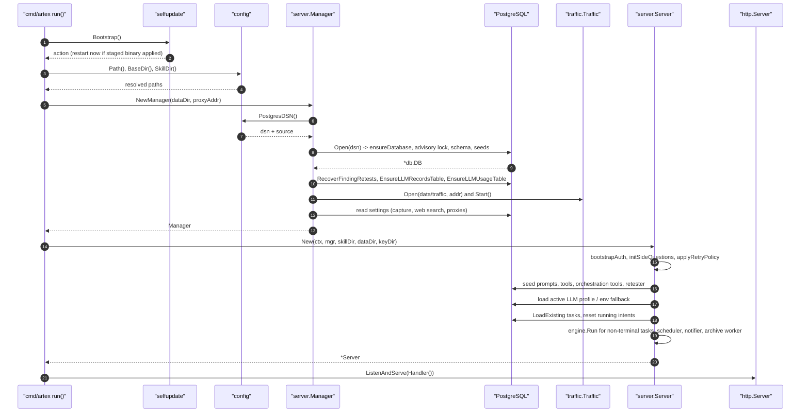

# §2 Runtime topology and startup sequence

> Part 2 of the architecture document · [back to the architecture index](../architecture.md)

How the process boots, what it binds, how it shuts down and how configuration is resolved.

#### Contents

- [2.1 Process and port topology](#21-process-and-port-topology)
- [2.2 Boot sequence, step by step](#22-boot-sequence-step-by-step)
- [2.3 Boot sequence diagram](#23-boot-sequence-diagram)
- [2.4 Shutdown and restart protocol](#24-shutdown-and-restart-protocol)
- [2.5 Configuration precedence](#25-configuration-precedence)
- [2.6 Build variants](#26-build-variants)

---

### 2.1 Process and port topology

| Process | Default bind | Purpose | Reference |
| --- | --- | --- | --- |
| `artex` HTTP server | `127.0.0.1:8787` (`-addr`) | UI, JSON API, SSE | `cmd/artex/main.go:55`, `cmd/artex/main.go:117-121` |
| `artex` traffic proxy | `127.0.0.1:8788` (`-proxy`, empty disables) | Recording MITM proxy | `cmd/artex/main.go:57`, `server/manager.go:395` |
| PostgreSQL | operator-provided DSN | All application state | `config/config.go:201` |
| `start.sh` / `start.bat` | n/a | Supervisor: relaunches on exit code 75 | `start.sh:12-13`, `start.sh:26` |

The HTTP server is created with `ReadHeaderTimeout: 10 * time.Second` (`cmd/artex/main.go:117-121`). Serving
the UI and the API on the same origin is what makes the static export work behind a reverse proxy — the
frontend builds same-origin SSE URLs for that reason (`web/src/lib/api.ts:201-212`).

The process is deliberately single-tenant: one administrator account, one active task selection, one shared
asset store. There is no user table; the only credential is the admin password hash stored in `settings`
(`server/auth.go:25` `authPassKey`, `server/auth.go:159` `readPassHash`).

### 2.2 Boot sequence, step by step

The entry point is small and strictly ordered. `main` only maps the return code onto the process exit code
(`cmd/artex/main.go:51-53`); all work is in `run` (`cmd/artex/main.go:53`).

| # | Step | Code |
| --- | --- | --- |
| 1 | Parse flags: `-addr`, `-data`, `-proxy` | `cmd/artex/main.go:54-67` |
| 2 | Publish the build version to the server package (used by `GET /api/health`) | `cmd/artex/main.go:63`, `server/server.go:34-36` |
| 3 | Print banner and version/runtime/address | `cmd/artex/main.go:65`, `cmd/artex/main.go:38` |
| 4 | Redirect `log` output into the in-memory log sink (also keeps stderr) | `cmd/artex/main.go:69`, `server/logsink.go:50` |
| 5 | Self-update bootstrap: apply a staged binary or count a boot attempt and roll back | `cmd/artex/main.go:75-78`, `selfupdate/bootstrap.go:50` |
| 6 | Resolve and log the config file path; log whether it exists | `cmd/artex/main.go:83-91`, `config/config.go:146` |
| 7 | Install signal context for `SIGINT`/`SIGTERM` | `cmd/artex/main.go:93` |
| 8 | Create a cancellable-cause shutdown context (deliberately detached from the signal context) | `cmd/artex/main.go:95`, `cmd/artex/main.go:151` |
| 9 | `server.NewManager`: resolve DSN, open PostgreSQL, apply schema, seed, start traffic proxy | `cmd/artex/main.go:98`, `server/manager.go:355` |
| 10 | Arm the 30s "the new build survived" settle timer | `cmd/artex/main.go:107`, `selfupdate/bootstrap.go:156-157` |
| 11 | Resolve the skill directory | `cmd/artex/main.go:110`, `config/config.go:180` |
| 12 | `server.New`: auth bootstrap, agent/tool/prompt wiring, background workers, LLM install, task restore | `cmd/artex/main.go:115`, `server/server.go:228` |
| 13 | Warn if bound to a non-loopback address while no admin password is set | `cmd/artex/main.go:116`, `server/auth.go:433` |
| 14 | Build the root handler (`srv.Handler()`) and start `ListenAndServe` in a goroutine | `cmd/artex/main.go:117-129`, `server/server.go:760` |
| 15 | Block on task context cancellation or `server.RestartRequested()` | `cmd/artex/main.go:133-138` |
| 16 | Graceful `httpSrv.Shutdown` with a 5s budget, return exit code | `cmd/artex/main.go:140-145` |

Inside `server.NewManager` (`server/manager.go:355`) the order is:

1. Make the data directory absolute and create it (`server/manager.go:362-366`).
2. Resolve the DSN and log its source (`server/manager.go:368-371`).
3. `pgdb.Open` — schema + seeds, see [5.4](data-model.md#54-startup-migrations-and-seeds) (`server/manager.go:373`).
4. `RecoverFindingRetests` — re-drive retests interrupted by a crash (`server/manager.go:377`).
5. `EnsureLLMRecordsTable` and `EnsureLLMUsageTable` — the two tables created outside `schema.sql`
   (`server/manager.go:381-386`).
6. Construct the `Manager` (holds `pg`, `assets`, `interceptor`) (`server/manager.go:387`).
7. If `-proxy` is non-empty, `traffic.Open(...)`, recover delete staging, then start the proxy in a goroutine
   (`server/manager.go:388-421`).
8. Load persisted toggles and web-search/global-proxy settings from `settings` (`server/manager.go:426-455`).
9. Push the global proxy into the MITM upstream (`server/manager.go:456-459`).
10. Build the `enrich.Engine` and reconcile the browser MCP proxy (`server/manager.go:457-460`).

Inside `server.New` (`server/server.go:228`) the order is:

1. Load or create `jwt.key` (`server/server.go:229`, `server/auth.go:79`).
2. Construct `Server` with the engine and empty in-memory maps (`server/server.go:232-238`).
3. `bootstrapAuth` — cache the password hash, issue the console setup token or apply `ARTEX_ADMIN_PASSWORD`
   (`server/server.go:241`, `server/auth.go:234`).
4. `initSideQuestions` (`server/server.go:242`, `server/side_questions.go:71`).
5. `applyRetryPolicy` — push the global LLM retry policy into the circuit-breaker registry
   (`server/server.go:245`).
6. Install the authoritative agent resolver and the global readiness predicate on the engine
   (`server/server.go:248-261`).
7. Wire DB-backed prompt overrides, wrap-up prompts, wrap-up budgets, output language, agent augmentation
   (`wireAgentAugment`), tool resolution (`wireTools`), prompt seeding, orchestration tool seeding, retester
   seeding, evidence GC goroutine, Python detection, scheduler goroutine, notifier goroutine, MCP discovery
   goroutine, log sink DB (`server/server.go:263-348`).
8. Install the LLM provider: persisted DB config first, then `agent.FromEnv()`, else idle
   (`server/server.go:350-362`).
9. `restoreTaskRuntimes` — reload tasks, reset stale `running` intents, restart loops for non-terminal tasks
   (`server/server.go:363`, `server/server.go:373`).
10. `reconcileConcurrency`, start the archive worker, wire the intercept reviewer
    (`server/server.go:364-366`).

### 2.3 Boot sequence diagram

### 2.4 Shutdown and restart protocol

Two exits exist and both are part of the update contract:

| Exit | Code | Meaning | Reference |
| --- | --- | --- | --- |
| Signal | 0 | Normal stop; the supervisor stops looping | `cmd/artex/main.go:133-135`, `start.sh:66-68` |
| Restart request | 75 (`EX_TEMPFAIL`) | Swap in the staged binary and relaunch | `cmd/artex/main.go:136-139`, `selfupdate/selfupdate.go:32-34` |
| Crash | other | Supervisor waits then relaunches | `start.sh:76` |

Shutdown cancels the process context with the named cause `agent.AbortShutdown`
(`agent/cancelcause.go:66-68`), which every running agent observes through
`context.Cause`; interrupted intents are reset to `open` on the next boot
(`server/server.go:371-374`, `db/exploration.go:312`). The HTTP server gets 5 seconds to drain
(`cmd/artex/main.go:141-144`).

### 2.5 Configuration precedence

Configuration has three sources and a strict precedence: **environment variable > config file > code default**.
There are two independent families — bootstrap configuration read by `config`, and runtime settings stored in
PostgreSQL and editable in the UI.

| Setting | Env | Config file key | Default | Reference |
| --- | --- | --- | --- | --- |
| PostgreSQL DSN | `ARTEX_PG_DSN` | `database.dsn` or `database.{host,port,user,password,dbname,sslmode}` | none — startup error | `config/config.go:201-232` |
| Config file location | `ARTEX_CONFIG` | n/a | `./config.json`, then `<baseDir>/config.json` | `config/config.go:146-163` |
| Skill root | `ARTEX_SKILL_DIR` | `skill_dir` | `<baseDir>/skills` | `config/config.go:180-193` |
| Bootstrap output language | `ARTEX_LANG` | `language` | `en` (`config.DefaultLanguage`) | `config/config.go:87-99`, `config/config.go:38` |
| Setup token | `ARTEX_SETUP_TOKEN` | n/a | random token printed to console | `server/auth.go:30-33`, `server/auth.go:234` |
| Initial admin password | `ARTEX_ADMIN_PASSWORD` | n/a | unset (setup screen required) | `server/auth.go:34-35` |
| CORS allowlist | CORS env (see `corsOriginsEnv`) | n/a | `defaultCORSOrigins` | `server/server.go:4033-4045` |
| LLM provider (legacy path) | `ARTEX_LLM_PROVIDER`, `ANTHROPIC_API_KEY`, `OPENAI_API_KEY`, `ARTEX_LLM_BASE_URL`, `ARTEX_LLM_MODEL`, `ARTEX_LLM_PROXY`, `ARTEX_LLM_STREAM` | n/a | no provider → engine idle | `agent/provider.go:145-196` |
| Notifier background loop kill switch | `ARTEX_NOTIFY_BACKGROUND_DISABLED` (`notifyBackgroundDisabledEnv`) | n/a | enabled | `server/notifier.go:37`, `server/server.go:337-343` |

`BaseDir` is the directory of the running executable, except when the binary sits in a temp/build-cache
directory (that is, under `go run`), where it falls back to the working directory (`config/config.go:107-140`).

Runtime settings are rows in the `settings` table (`db/settings.go:9` for `GetSetting`, `db/settings.go:21` for
`SetSetting`) and are read through typed helpers (`db/settings.go:47` `GetBool`, `db/settings.go:56` `SetBool`).
The keys that change system behaviour are declared as constants in `server/manager.go:250-292`. Notable ones:

| Key constant | Setting key | Effect |
| --- | --- | --- |
| `settingTrafficCapture` | `traffic_capture` | Recording proxy injected into agents, traffic tools exposed |
| `settingAgentTrafficBinding` | `agent_traffic_binding` | Whether agents may auto-bind traffic evidence to findings |
| `settingWebSearchOn` / `settingWebSearchBackend` | `web_search_enabled`, `web_search_backend` | `web_search` tool backend (`ddgs`, `brave-free`, `tavily`, `deepseek`) |
| `settingGlobalProxy` | `global_proxy` | Egress proxy for all target traffic |
| `settingWorkers` | `workers` | Worker pool size, default 3 (`server/manager.go:288`) |
| `settingLLMRecord` | `llm_record` | Raw LLM request/response recording |
| `settingLLMPoolOn` / `settingLLMPoolBindFallback` | `llm_pool_enabled`, `llm_pool_bind_fallback` | Failover chain behaviour |
| `settingConcurrencyOn` / `settingConcurrencyLimit` | `task_concurrency_enabled`, `task_concurrency_limit` | Simultaneous-running-task cap, default 5 |
| `settingNoaCompaction` | `noa_compaction` | Experimental external context compaction |
| `settingOutputLanguage` | `output_language` | Runtime output language (overrides `ARTEX_LANG`) |

### 2.6 Build variants

| Variant | Build command | Behaviour | Reference |
| --- | --- | --- | --- |
| Embedded (release) | `go build -tags embedui ./cmd/artex` after `pnpm run build:static` and copying `web/out` to `server/webui/dist` | UI served from the binary | `server/webui_embed.go:16-19`, `build.sh:123-126`, `build.sh:220` |
| No-embed (development) | plain `go build` | `/` returns 404 with a hint; run `next dev` | `server/webui_stub.go:16-18` |
| Docker | prebuilt binary + `start.sh` + `skills/` | `EXPOSE 8787 8788`, `VOLUME /app/data` | `Dockerfile:32-44` |

The embedded handler resolves requests in four steps — exact file, `<path>/index.html`, `<path>.html`, then SPA
fallback to `index.html` — which matches Next's `trailingSlash: true` export layout
(`server/webui_embed.go:24-46`, `web/next.config.mjs:23-31`).

---

← [architecture index](../architecture.md) · section numbers are stable across the split (§2.x).
