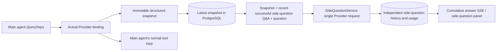

# ARTEX `/btw` side questions

English · [한국어](README.ko.md) · [中文](README.zh.md)

Ordinary chats, a task's MainAgent, and the Workers that the current task launched itself each support side questions that are kept separate from the main conversation. Typing `/btw <question>` in the main input box submits a side question; typing `/btw` with nothing after it, or clicking the "Side question" button, opens the earlier side-question history. On desktop it appears as a sidebar whose width you can adjust, and on mobile as a Drawer.

A side-question answer is generated from a snapshot of the agent's context taken at the moment the question was submitted, and supports streaming display, follow-up questions, stopping, and clearing. Closing the panel, reloading the page, or losing the SSE connection does not cancel the model request. Stop affects only the side question currently in progress; clear cancels side questions and deletes the side-question history, but leaves the main context snapshot in place.

> This document is an English translation of the original Chinese document (`README.zh.md`). The original is preserved unchanged so that changes in the upstream repository are easy to compare against.

## Implementation scope

It reuses Go, norma v0.3.7, Next.js, and the existing Markdown · ResizablePanel · Drawer · AlertDialog components as they are; it does not modify the norma source or add any new dependency for side questions. The Planner, Workers inherited from other tasks, and promotion of tool-style subtasks are out of scope for this work.

- `capture.go` marks requests as main-loop requests only in `Options.Deps.CallModel` · `CallModelSync`. The Provider decorator sits inside the concrete model, that is, after the routing pool has chosen a model on the outside, so it records the model that was actually selected. Compaction requests and summary requests do not overwrite the snapshot.
- A snapshot is published when a request starts, when the model completes a reply, and when the run reaches a terminal state. A half-finished reply that is still being generated is not published. Tool calls stay paired through norma's `MessagesForAPI`, and tool results enter the snapshot at the next main model request or at the run's terminal state. If streaming is aborted, the previous valid boundary is kept.
- The snapshot preserves the structured messages, system prompt, tool definitions, and generation parameters through a JSON deep copy. Model inference does not hold a snapshot lock or a database transaction.
- `SideQuestionService` calls the concrete Provider. If needed it first produces a side-question summary, and the final answer is retried once, after shrinking, only when the context exceeds the limit for the first time and no text or tool call has been emitted yet. It does not create an agent session; it does not connect to the tool executor, the main transcript, the activity stream, or the task graph; and it does not go through the task's model-switching chain. The answer keeps the tool definitions for compatibility with the existing structured tool context, while summary requests are given no tools. Tool calls that come back new have no execution path.
- Each parent session has one running request, each service process has at most four, and a single request times out after 120 seconds. Side questions use an independent cancellation context under the service lifecycle.
- A side-question request keeps a reference to the model configuration and a summary of non-sensitive identity information, and fetches credentials from the existing configuration at request time. If the configuration is deleted, or an identity field such as the model, protocol, or address changes, the user is asked to run the main agent first to refresh the snapshot. Tests do not change the product's default model.

## Persistence and recovery

`db/schema.sql` creates the `side_question_sessions` and `side_question_requests` tables automatically. The former stores the parent resource, the latest snapshot, the run number, the version, and the clear version; the latter stores the question, the cumulative answer, the status, the model, the snapshot time, usage, the event sequence number, and the paging sequence number.

The parent session key is the conversation ID, or the task ID + exploration ID + intent ID combined. Workers do not use reusable execution-slot names.

Snapshots are merged and written per parent session and flushed once every 250 milliseconds, and the database compares `(run_id, version)` so that an older version cannot overwrite a newer one. The selected snapshot is saved once more just before a side question is submitted. When the save succeeds, the large snapshot held in memory is released; when it fails, the version that has not yet been written is kept. Cumulative answer content is written at most once every 250 milliseconds as streaming events arrive; on a terminal state it is saved immediately, with a limited number of retries if a database error occurs.

When the service starts, it marks requests left in the `running` state as `interrupted`, keeps the partial answers and usage already stored in the database, and does not replay the requests automatically. The most recently saved context can be used for the next question right away. If an old session has no snapshot, the user is asked to run the main agent first; the context is not rebuilt from the UI activity records.

A clear increments the clear version and deletes the requests, and conditional updates keep callbacks that arrive late from writing back. Physically deleting a parent resource relies on foreign-key cascades; logically deleting a Worker deletes its side-question data in the same transaction and then rejects snapshots that arrive late. Archiving a task first blocks new requests, waits for the main flow to stop, cancels the side questions, and waits for them to be persisted. The archive format is v3 and remains compatible with v1 · v2, which have no side-question tables.

The history is stored in full and returned at most 20 items per page, using a sequence-number cursor. A model request replays at most the 20 most recent successful Q&A pairs verbatim, with the replayed amount capped by a token budget, while older Q&A is maintained as a separate rolling summary. When the main context exceeds the budget, only the older part of the side question's copy is summarized, and recent structured tool calls and their results are kept. Summarization, preparation progress, and usage all fall under the side question's concurrency, cancellation, and 120-second timeout rules. For details, see [Context budget and open-source references (CONTEXT_BUDGET.md)](CONTEXT_BUDGET.md).

## HTTP contract

The following paths serve as `{parent}` and follow the existing authentication and resource validation:

- `/api/conversations/{id}`
- `/api/tasks/{id}/chat`
- `/api/tasks/{id}/intents/{iid}`

| Request | Response and behavior |
| --- | --- |
| `GET {parent}/side-questions?before={ordinal}` | Returns `items` sorted newest first, together with the in-progress run state (`current`), snapshot metadata (`snapshot`), and the next cursor (`next_cursor`). A cursor of 0 means this is the latest page or there is no next page. |
| `POST {parent}/side-questions` | Accepts JSON of the form `{ "question": "…", "client_request_id": "UUID" }`. A new request returns 202 with the request object; the same ID and question return the existing object with 200. |
| `DELETE {parent}/side-questions` | Cancels and clears the side-question Q&A of the current parent session. |
| `GET /api/side-questions/{requestID}/events` | Sends `snapshot` SSE events, where `id` is an increasing sequence number and `data` is the full cumulative request object. Sends `cleared` when a clear happens. |
| `POST /api/side-questions/{requestID}/cancel` | Cancels the request explicitly; the terminal state can be read from the history or the SSE stream. |

A question is at most 4000 characters. A missing snapshot, a changed model configuration, a busy parent session, or an idempotency-ID conflict returns 409; hitting the global concurrency cap returns 429. Every SSE connection sends the cumulative state first, so the client does not depend on text fragments it received earlier. The frontend merges answers by request ID and sequence number, and discards stale callbacks when the parent session changes or is cleared.

## Validation and references

Automated checks, real-model usage, and known limitations are recorded in [VALIDATION.md](VALIDATION.md).

The independent-request approach follows [Grok CLI's side-question.ts (pinned commit)](https://github.com/superagent-ai/grok-cli/blob/fb97af83f06dca873281d60168430f06c8de6324/src/utils/side-question.ts), and the run isolation follows [OpenCode (pinned commit)](https://github.com/anomalyco/opencode/tree/b3f1a96c6dd7adeb28b36dd11add1998fc84d67b). ARTEX uses norma's structured messages for the context and does not stitch text together from frontend logs.
