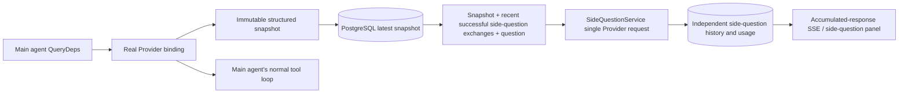

# ARTEX `/btw` side questions

Ordinary chat, a task's MainAgent, and the Worker a task launched directly each support a side
question that stays separate from the main conversation. Typing `/btw <question>` in the main input
box submits a side question; typing `/btw` with no content, or pressing the "side question" button,
opens the previous side-question history. It is shown as a resizable sidebar on desktop and as a
drawer on mobile.

A side-question answer is generated from the agent-context snapshot taken at the moment the question
was submitted, and supports streaming display, follow-up questions, stop, and clear. Closing the
panel, reloading the page, or dropping the SSE connection does not cancel the model request. Stop
affects only the one in-flight side question; clear cancels the side question and deletes its history
while leaving the main-context snapshot untouched.

> This document was translated from the original Chinese document. The upstream text stays available
> in the upstream repository for comparison.

## Implementation scope

It uses Go, norma v0.3.7, Next.js, and the existing Markdown · ResizablePanel · Drawer · AlertDialog
components as they are; no norma source was modified and no new dependency was added for side
questions. The Planner, a Worker inherited from another task, and promotion of tool-based
sub-tasks are out of scope.

- `capture.go` marks a request as a main-loop request only on `Options.Deps.CallModel` ·
  `CallModelSync`. Because the Provider decorator sits inside the individual model, that is, at the
  step after the model has been chosen outside the routing pool, it records the model actually
  selected. Compaction and summarization requests do not overwrite the snapshot.
- A snapshot is published when a request starts, when the model completes its response, and when the
  run reaches a terminal state. Half-written responses in the middle of generation are not published.
  Tool calls stay paired through norma's `MessagesForAPI`, and tool results enter the snapshot either
  at the next main model request or at the run's terminal state. If streaming is interrupted, the last
  valid boundary is kept.
- The snapshot preserves structured messages, the system prompt, tool definitions, and generation
  parameters through a JSON deep copy. Model inference holds neither a snapshot lock nor a database
  transaction.
- `SideQuestionService` calls a Provider of its own. If needed it first produces a side-question
  summary, and it retries the final response with a reduced context at most once, and only when the
  context was over the limit for the first time and nothing textual or tool-call related has been
  emitted yet. It does not create a new agent session, does not connect to the tool runner, the main
  transcript, the activity stream, or the task graph, and does not go through the task's model-switch
  chain. Responses keep the tool definitions only for compatibility with the existing structured tool
  context; the summarization request is given no tools. Newly returned tool calls have no execution
  path.
- There is one in-flight request per parent session and at most four per service process, and a single
  request has a 120-second timeout. Side questions use an independent cancellation context under the
  service lifecycle.
- A side-question request stores a model-configuration reference and a summary of non-sensitive
  identifying information, and fetches the credential from the existing configuration at request time.
  If the configuration was deleted, or an identifying field such as the model, protocol, or address
  changed, it first requires the main agent to run and refresh the snapshot. Tests do not change the
  product's default model.

## Persistence and recovery

`db/schema.sql` creates the `side_question_sessions` and `side_question_requests` tables
automatically. The former stores the parent resource, the latest snapshot, the run number, the
version, and the cleanup version; the latter stores the question, the accumulated response, the
status, the model, the snapshot time, the usage, the event sequence number, and the page sequence
number.

The parent-session key is either a conversation ID, or a task ID combined with an exploration ID and
an intent ID. A Worker uses a reusable run-slot name.

Snapshots are merged and recorded per parent session and flushed once every 250 milliseconds, and the
database compares `(run_id, version)` so that a stale version cannot overwrite a newer one. The
snapshot chosen just before a side question is submitted is stored once more. A successful save
releases the large in-memory snapshot; a failed one leaves the not-yet-recorded version in place. The
accumulated response is written at most once every 250 milliseconds as streaming events arrive, and
is saved immediately in a terminal state, retrying a limited number of times on a database error.

When the service starts it marks requests left in `running` as `interrupted`, keeps the partial
response and usage already stored in the database, and does not re-run the request automatically. The
most recently and successfully saved context is available to the next question right away. If an old
session has no snapshot, it first requires the main agent to run; it does not rebuild the context from
the UI activity history.

A clear operation bumps the cleanup version once and deletes the requests, and the conditional update
stops a late-arriving callback from re-recording them. Physically deleting a parent resource is left
to the foreign-key cascade, while logically deleting a Worker deletes the side-question data in the
same transaction and afterwards rejects late-arriving snapshots. Archiving a task first blocks new
requests, waits for the main flow to stop, cancels the side questions, and then waits for them to be
reflected in the database. The archive format is v3, and it is compatible with v1 and v2, which have
no side-question tables.

History is stored without gaps and returned at most 20 items per page, keyed by a sequence cursor. A
model request replays the most recent successful question-and-answer pairs, up to 20 bundles, with
their size capped to fit the token budget; older pairs are kept as a separate rolling summary. When
the main context is over budget, only the older part of the side-question copy is summarized, keeping
the recent structured tool calls and their results. Summarization, preparation progress, and usage all
count against the side question's concurrency, cancellation, and 120-second timeout rules. For
details, see [context budget and open-source references (CONTEXT_BUDGET.md)](CONTEXT_BUDGET.md).

## HTTP contract

The paths below are written as `{parent}`, and they follow the existing authentication and resource
checks.

- `/api/conversations/{id}`
- `/api/tasks/{id}/chat`
- `/api/tasks/{id}/intents/{iid}`

Per-request responses and behavior:

- `GET {parent}/side-questions?before={ordinal}` returns `items` in newest-first order, together with
  the in-flight run state (`current`), the snapshot metadata (`snapshot`), and the next cursor
  (`next_cursor`). A cursor of 0 means either this is the newest page or there is no next page.
- `POST {parent}/side-questions` accepts JSON of the form
  `{ "question": "…", "client_request_id": "UUID" }`. For a new request it returns 202 with the request
  object; if the ID and question match an existing one it returns that object with 200.
- `DELETE {parent}/side-questions` cancels and clears the side-question exchange of the current parent
  session.
- `GET /api/side-questions/{requestID}/events` sends `snapshot` SSE events, where `id` is an
  increasing sequence number and `data` is the full accumulated request object. It sends `cleared`
  when a clear happens.
- `POST /api/side-questions/{requestID}/cancel` explicitly cancels the request; the terminal state can
  be read from the history or the SSE stream.

A question is at most 4000 characters. It returns 409 when there is no snapshot, the model
configuration changed, the same parent session is busy, or the idempotency ID collides, and 429 when
the global concurrency limit is reached. An SSE connection always sends the accumulated state first,
so the client does not depend on text fragments received earlier. The frontend merges responses by
request ID and sequence number, and discards previous callbacks when the parent session changes or is
cleared.

## Verification and references

Automated checks, real-model use, and known limitations are recorded in [VALIDATION.md](VALIDATION.md).

For the independent-request approach it referenced [Grok CLI's side-question.ts (pinned
commit)](https://github.com/superagent-ai/grok-cli/blob/fb97af83f06dca873281d60168430f06c8de6324/src/utils/side-question.ts),
and for execution isolation [OpenCode (pinned
commit)](https://github.com/anomalyco/opencode/tree/b3f1a96c6dd7adeb28b36dd11add1998fc84d67b).
ARTEX uses norma's structured messages for the context, and does not use the frontend-side approach
of concatenating text from logs.
