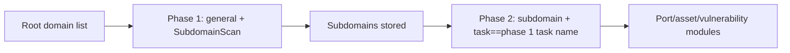

# ScopeSentry MCP guide

For users of an **already-deployed ScopeSentry instance**. You connect to the platform through Cursor
(or another MCP client) and need no local source code.

## 1. Preparation

### 1.1 Confirm the service is reachable

- Default web UI: `http://<host>`
- MCP endpoint: `http://<host>/mcp` (if a reverse proxy or frontend proxy sits in front, use the real
  `/mcp` address)

### 1.2 Create an API key

1. Log in to the ScopeSentry web UI in a browser
2. Open the **API Key** management page and create a key (or create it through the interface your
   administrator provides)
3. Save the returned `ssk_...` string (**it is shown only once**)

### 1.3 Configure the Cursor MCP

Cursor → Settings → MCP → add a server:

```json
{
  "mcpServers": {
    "scopesentry": {
      "url": "http://<your-host>:8082/mcp",
      "headers": {
        "X-API-Key": "ssk_your_key"
      }
    }
  }
}
```

`Authorization: Bearer ssk_your_key` also works.

After configuring, restart the MCP server or reload Cursor and confirm that the tool list contains
`list_projects`, `list_assets`, and the like.

---

## 2. Tool overview


| Tool                     | Purpose                |
| ---------------------- | ----------------- |
| `list_projects`        | Project tree grouped by tag (with project IDs) |
| `list_projects_data`   | Paged project list, searchable by name |
| `get_project`          | Project details |
| `create_project`       | Create a project |
| `list_tasks`           | Scan-task list |
| `get_task`             | Task details |
| `list_scan_templates`  | Scan-template list |
| `get_scan_template`    | Template details |
| `list_plugin_modules`  | Names of the scan-pipeline modules |
| `list_plugins`         | Available plugins (with hash and default parameters) |
| `create_scan_template` | Create a scan template |
| `create_scan_task`     | Create a scan task |
| `list_assets`          | Query assets of any type (paged list) |
| `count_assets`         | Count assets (`/api/assets/common/total`) |
| `get_asset_detail`     | Asset or vulnerability details |
| `add_asset_tag`        | Add a tag to an asset |
| `list_nodes`           | Scan-node list |


The parameters of each tool are defined by its MCP schema; `list_assets` / `count_assets` share the
same search and filter syntax, so read the `list_assets` description before querying assets.

To know "how many items there are in total", use `count_assets` (it maps to the web pagination total
endpoint); do not page through `list_assets` repeatedly just to count.

---

## 3. Common workflows

### 3.1 Query assets by project

When the user or the context **already has a project condition**, include `filter.project` first to
narrow the scope, so that too much cross-project data does not slow the response. With no clear
project, adding a project filter is not mandatory.

1. Get the target project's **ObjectID** with `list_projects` or `list_projects_data` (`id` /
   `children[].value`)
2. Pass `filter.project` to `list_assets` (**it must be the ID, never the project's display name**)

```json
{
  "asset_type": "asset",
  "pageIndex": 1,
  "pageSize": 20,
  "search": "domain=^example.com",
  "filter": {
    "project": ["<project ObjectID>"]
  }
}
```

### 3.2 Create a scan task

1. Get the online node names with `list_nodes`
2. Get the template **ObjectID** with `list_scan_templates` or `create_scan_template`
3. `create_scan_task`: `name` and `node` are required, and `template` takes the template ID (not the
   template name)

**Target source `targetSource` (same as the web UI):**

| targetSource | Meaning | Required parameters |
| --- | --- | --- |
| `general` | Enter targets directly | `target` |
| `project` | Read targets from a project | `project` (array of project ObjectIDs) |
| `asset` | Search the web asset store | `search`; optional `project`, `filter`, `targetNumber` |
| `RootDomain` | Search the root-domain store | `search`; optional `project`, `filter`, `targetNumber` |
| `subdomain` | Search the subdomain store | `search`; optional `project`, `filter`, `targetNumber` |
| `UrlScan` | Search the URL-scan results | `search`; optional `project`, `filter`, `targetNumber` |
| `*Source` (e.g. `subdomainSource`) | Created from "selected/searched" on the asset page | `search` when `targetTp=search`; `targetIds` when `targetTp=select` |

**Example — scan root domains directly:**

```json
{
  "name": "example-subdomain-collection",
  "node": ["node-1"],
  "template": "<template ObjectID>",
  "targetSource": "general",
  "target": "example.com\nfoo.com",
  "project": ["<project ObjectID>"]
}
```

**Example — continue scanning from the subdomain store (filtered by the previous task name):**

```json
{
  "name": "example-ports-and-vulnerabilities",
  "node": ["node-1"],
  "template": "<follow-up module template ObjectID>",
  "targetSource": "subdomain",
  "search": "task==\"example-subdomain-collection\"",
  "project": ["<project ObjectID>"]
}
```

### 3.3 Full information gathering for root domains (two phases recommended)

When the input is a **root domain** and you want **full information gathering**, split it into two
scans instead of running the whole pipeline at once.

**Reason:** distributed tasks are dispatched **per single target**. When a root domain is the target,
the node that receives it also runs the follow-up modules on the subdomains it discovers for that root
domain, which easily produces uneven load, slow runs, and more errors.

**Best practice:**

1. **Phase 1 — subdomain collection only**
   - `targetSource`: `general`
   - `target`: all root domains (multiple lines)
   - Template: enable only `SubdomainScan` and `SubdomainSecurity` (subdomain scanning + subdomain
     takeover)
   - Wait for completion with `get_task`

2. **Phase 2 — follow-up modules**
   - `targetSource`: `subdomain`
   - `search`: `task=="<phase 1 task name>"` (exact task-name match)
   - Optional `project` to narrow the scope
   - Template: port scanning, asset mapping, vulnerability scanning, and so on (may omit SubdomainScan)
   - The subdomains are dispatched to the nodes as independent targets, so parallelism is higher

You can also filter by task name on the "Subdomain" asset page in the web UI and use "create a task
from subdomains", which has the same effect.



### 3.4 Create a scan template

1. `list_plugin_modules` → module-name list
2. `list_plugins` (optionally filtered by `module`) → each plugin's `hash` and default `parameter`
3. `create_scan_template`: use `modules` to specify "module → array of plugin hashes"

---

## 4. Asset queries (`list_assets` / `count_assets`)

`count_assets` uses the same `asset_type`, `search` and `filter` as `list_assets` and returns
`{ "total": N }`, corresponding to the web UI's `/api/assets/common/total`.

```json
{
  "asset_type": "subdomain",
  "search": "task==\"some task name\"",
  "filter": {"project": ["<project ObjectID>"]}
}
```

**Performance advice (both `list_assets` / `count_assets`):** when a project condition exists, use
`filter.project` first to narrow the scope; in `search`, prefer `==` (exact) or `^` (prefix) matching
on indexed fields (see [4.3](#43-search-expression)), to avoid a broad `=` fuzzy query slowing the
response. With no project context, adding a project filter is not mandatory.

For the types that support `filter.project`, see the table in [4.4](#44-filter-exact-filtering).

### 4.1 Asset type `asset_type`

`asset`, `RootDomain`, `subdomain`, `app`, `mp`, `UrlScan`, `SensitiveResult`, `DirScanResult`,
`crawler`, `vulnerability`, `PageMonitoring`, `IPAsset`, `SubdomainTakerResult`

Alias examples: `web`→asset, `vuln`→vulnerability, `ip`→IPAsset, `url`→UrlScan

### 4.2 Parameter reference


| Parameter                | Description                             |
| ------------------------ | --------------------------------------- |
| `pageIndex` / `pageSize` | Pagination, defaults 1 / 20 |
| `search`                 | Search expression (next section) |
| `filter`                 | Exact filter JSON (next section) |
| `sort`                   | Only UrlScan and DirScanResult support sorting by `length` |
| `sid`                    | Only SensitiveResult: sensitive-rule name |


`search` and `filter` **can be used together**.

### 4.3 search expression

A custom DSL (**not SQL**):


| Operator | Meaning | Index | Example                          |
| ---- | ---- | ---- | --------------------------- |
| `=`  | Fuzzy match (regex) | Not indexed | `domain=example`            |
| `==` | Exact match (equality) | **Indexed** | `port==443`                 |
| `!=` | Exclude   | — | `port!="80"`                |
| `&&` | And    | — | `domain==example.com && port==443` |
| `||` | Or    | — | `title=admin || body=login` |


**Indexes and operators:** fields such as `domain`, `ip`, `port` and `title` are indexed, but only
**`==` equality** or **a value starting with `^`** (a prefix match such as `domain=^example.com`) can
use the index; **`=` is turned into a regex fuzzy match and cannot use the index**, so it tends to be
slow on large data sets.

**search fields common to every type:** `tag`, `task` (task name), `rootDomain`

**project cannot be written inside search** (it is either ineffective or errors when combined with
`&&`). To filter by project, use `filter.project`.

**Common search fields per type:**


| asset_type           | Fields                                                                              |
| -------------------- | ----------------------------------------------------------------------------------- |
| asset                | domain, ip, port, service, app, title, statuscode, icon, banner, type, body, header |
| RootDomain           | domain, icp, company                                                                |
| subdomain            | domain, ip, type, value                                                             |
| app                  | name, icp, company, category, description, url, apk                                 |
| mp                   | name, icp, company, category, description, url                                      |
| UrlScan              | url, input, source, resultId, type                                                  |
| SensitiveResult      | url, sname, body, info, md5                                                         |
| DirScanResult        | url, statuscode, redirect, length                                                   |
| vulnerability        | url, vulname, matched, request, response, level                                     |
| crawler              | url, method, body, resultId                                                         |
| PageMonitoring       | url, hash, diff, response                                                           |
| IPAsset              | ip, domain, port, service, webServer, app                                           |
| SubdomainTakerResult | domain, value, type, response                                                       |


**search examples:**

- `domain==www.example.com && port==443` (exact, indexed)
- `domain=^example.com` (prefix match, indexed)
- `ip==192.168.1.1`
- `task=="some task name"`
- `level==high` (vulnerability)
- `statuscode==200` (DirScanResult)

Use `=` only when you need a fuzzy contains match, e.g. `title=admin` (not indexed; combine it with a
project or other condition to narrow the scope).

### 4.4 filter exact filtering

A JSON object: several values under the same key are **OR**, different keys are **AND**.

**With a project condition, prefer `project`:** if the user or the context already names a project and
the asset_type supports `project`, include it to narrow the scope; with no project information it is
not mandatory.


| filter key   | Meaning      | Value |
| ------------ | -------- | -------------------------------------------------------- |
| `project`    | Owning project     | **ObjectID**, obtained with `list_projects` / `list_projects_data` |
| `task`       | Source task     | **Task name**, from `list_tasks`' `name` |
| `port`       | Port       | e.g. `"443"` |
| `service`    | Service/protocol    | e.g. `"https"` |
| `app`        | Application fingerprint     | e.g. `"Nginx"` |
| `icon`       | Icon hash  | |
| `statuscode` | HTTP status code | Mostly for asset |
| `status`     | Status       | UrlScan/DirScan HTTP code; processing status of vulnerabilities/sensitive findings |
| `level`      | Vulnerability level     | critical / high / medium / low / info |
| `type`       | Type       | e.g. subdomain record type A, CNAME |
| `color`      | Sensitive-rule color   | SensitiveResult |
| `sname`      | Sensitive-rule name    | SensitiveResult |
| `tags`       | Tags       | |


**filter keys available per type:**


| asset_type                            | filter key                                                      |
| ------------------------------------- | --------------------------------------------------------------- |
| asset                                 | project, port, service, app, icon, statuscode, type, task, tags |
| RootDomain                            | project, tags                                                   |
| subdomain                             | project, type, task, tags                                       |
| app / mp                              | project, tags                                                   |
| UrlScan                               | status, tags                                                    |
| DirScanResult                         | status, tags                                                    |
| SensitiveResult                       | status, color, sname, tags                                      |
| crawler                               | project, task, tags                                             |
| vulnerability                         | project, level, status, task, tags                              |
| PageMonitoring / SubdomainTakerResult | tags                                                            |
| IPAsset                               | project, port, service, app                                     |


**filter example:**

```json
{"project": ["<project ObjectID>"], "port": ["443"]}
```

**Combined query example:**

```json
{
  "asset_type": "asset",
  "search": "domain=^baidu && port==443",
  "filter": {"project": ["<project ObjectID>"]},
  "pageIndex": 1,
  "pageSize": 10
}
```

**Notes:**

- With a project condition, include `filter.project` first (when supported); with no project context it
  is not mandatory
- Never put the project's display name in `filter.project`
- Use `==` for known values and `^` for prefixes; avoid `=` fuzzy matching on large tables
- For UrlScan HTTP status use `filter.status`; for DirScanResult you can use `statuscode==200` in search
- For SensitiveResult by rule name: `search` with `sname=ruleName`, or `filter.sname`

### 4.5 Sorting with sort

Only **UrlScan** and **DirScanResult** support it:

```json
{"length": "ascending"}
```

Other types ignore `sort` and use the default time order.

---

## 5. Scan-template module names

`TargetHandler`, `SubdomainScan`, `SubdomainSecurity`, `PortScanPreparation`, `PortScan`,
`PortFingerprint`, `AssetMapping`, `AssetHandle`, `URLScan`, `WebCrawler`, `URLSecurity`, `DirScan`,
`VulnerabilityScan`, `PassiveScan`

---

## 6. Troubleshooting


| Symptom        | Action                                                |
| --------- | -------------------------------------------------- |
| No tools in the MCP   | Check the URL, the API key, and whether ScopeSentry is running |
| 401 / 403 | Re-create or replace the API key |
| Assets not found     | Confirm `filter.project` is an ObjectID; do not write project in search |
| Template/task creation failed | `template` must be a template ObjectID; `node` takes an online node name |
| Queries are slow / hang   | Add `filter.project` when a project is known; in search use `==` or a `^` prefix on indexed fields instead of `=`; reduce `pageSize` |


---
