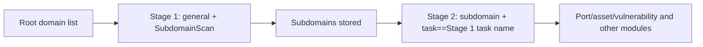

---

## name: scopesentry-mcp
description: Manage the security scanning platform (projects, tasks, templates, assets, nodes) through ScopeSentry MCP. Use when the user mentions ScopeSentry, MCP, API Key, scan tasks, or asset queries.

# ScopeSentry MCP Usage Guide

For users of an **already deployed ScopeSentry instance**. Connect to the platform through Cursor (or another MCP client); no local source code is needed.

## 1. Preparation

### 1.1 Confirm the Service Is Reachable

- Default web UI: `http://<主机>` (`<主机>` = host; in the config below, `<你的主机>` = your host and `ssk_你的密钥` = your `ssk_` key)
- MCP endpoint: `http://<主机>/mcp` (if there is a reverse proxy or frontend proxy in front, use the actual `/mcp` address)

### 1.2 Create an API Key

1. Log in to the ScopeSentry web UI in a browser
2. Go to the **API Key** management page and create a key (or create one through an interface provided by an administrator)
3. Save the returned `ssk_...` string (**it is shown only once**)

### 1.3 Configure Cursor MCP

Cursor → Settings → MCP → add a server:

```json
{
  "mcpServers": {
    "scopesentry": {
      "url": "http://<你的主机>:8082/mcp",
      "headers": {
        "X-API-Key": "ssk_你的密钥"
      }
    }
  }
}
```

You can also use: `Authorization: Bearer ssk_你的密钥`

After configuring, restart MCP or reload Cursor and confirm that `list_projects`, `list_assets`, etc. appear in the tool list.

---

## 2. Tool Overview


| Tool                   | Purpose                                       |
| ---------------------- | --------------------------------------------- |
| `list_projects`        | Project tree grouped by tag (includes project IDs) |
| `list_projects_data`   | Paginated project list, searchable by name    |
| `get_project`          | Project details                               |
| `create_project`       | Create a project                              |
| `list_tasks`           | Scan task list                                |
| `get_task`             | Task details                                  |
| `list_scan_templates`  | Scan template list                            |
| `get_scan_template`    | Template details                              |
| `list_plugin_modules`  | Scan pipeline module names                    |
| `list_plugins`         | Available plugins (including hash and default parameters) |
| `create_scan_template` | Create a scan template                        |
| `create_scan_task`     | Create a scan task                            |
| `list_assets`          | Query all kinds of assets (paginated list)    |
| `count_assets`         | Count assets (`/api/assets/common/total`)     |
| `get_asset_detail`     | Asset or vulnerability details                |
| `add_asset_tag`        | Add a tag to an asset                         |
| `list_nodes`           | Scan node list                                |


The MCP tool descriptions (schemas) are authoritative for each tool's parameters; `list_assets` / `count_assets` share the same search and filter syntax, so read the `list_assets` description before querying assets.

When you need to know "how many in total", use `count_assets` (it maps to the web UI's pagination total endpoint); do not page through `list_assets` repeatedly just to count the total.

---

## 3. Common Workflows

### 3.1 Query Assets by Project

When the user or the context **already has a project condition**, prefer adding `filter.project` to narrow the scope and avoid slow responses caused by too much cross-project data. If there is no explicit project, a project filter is not mandatory.

1. Use `list_projects` or `list_projects_data` to get the target project's **ObjectID** (`id` / `children[].value`)
2. Pass `filter.project` to `list_assets` (**it must be the ID; do not use the project's Chinese display name**)

```json
{
  "asset_type": "asset",
  "pageIndex": 1,
  "pageSize": 20,
  "search": "domain=^example.com",
  "filter": {
    "project": ["<项目ObjectID>"]
  }
}
```

### 3.2 Create a Scan Task

1. `list_nodes` to get the names of online nodes
2. `list_scan_templates` or `create_scan_template` to get the template **ObjectID**
3. `create_scan_task`: `name` and `node` are required; `template` takes the template ID (not the template name)

**Target source `targetSource` (consistent with the web UI):**

| targetSource | Description | Required parameters |
| --- | --- | --- |
| `general` | Enter targets directly | `target` |
| `project` | Read targets from a project | `project` (array of project ObjectIDs) |
| `asset` | Search the web asset library | `search`; optional `project`, `filter`, `targetNumber` |
| `RootDomain` | Search the root domain library | `search`; optional `project`, `filter`, `targetNumber` |
| `subdomain` | Search the subdomain library | `search`; optional `project`, `filter`, `targetNumber` |
| `UrlScan` | Search URL scan results | `search`; optional `project`, `filter`, `targetNumber` |
| `*Source` (e.g. `subdomainSource`) | Created from an asset page via "select/search" | `search` when `targetTp=search`; `targetIds` when `targetTp=select` |

**Example — scan root domains directly:**

```json
{
  "name": "example-子域名收集",
  "node": ["node-1"],
  "template": "<模板ObjectID>",
  "targetSource": "general",
  "target": "example.com\nfoo.com",
  "project": ["<项目ObjectID>"]
}
```

**Example — continue scanning from the subdomain library (filtered by the previous task's name):**

```json
{
  "name": "example-端口与漏洞",
  "node": ["node-1"],
  "template": "<后续模块模板ObjectID>",
  "targetSource": "subdomain",
  "search": "task==\"example-子域名收集\"",
  "project": ["<项目ObjectID>"]
}
```

### 3.3 Full Information Gathering for Root Domains (Two Stages Recommended)

When the input is a **root domain** and **full information gathering** is required, split it into two scans; do not run the whole pipeline in one go.

**Reason:** distributed tasks are dispatched per **single target**. When a root domain is the target, the node that receives it also runs all subsequent modules on the subdomains it discovers, which easily causes unbalanced load, slow scans, and errors.

**Best practice:**

1. **Stage 1 — subdomain collection only**
   - `targetSource`: `general`
   - `target`: all root domains (one per line)
   - Template: enable only `SubdomainScan` and `SubdomainSecurity` (subdomain scanning + subdomain takeover)
   - Use `get_task` to wait for the task to finish

2. **Stage 2 — subsequent modules**
   - `targetSource`: `subdomain`
   - `search`: `task=="<第一阶段任务名称>"` (exact match on the task name; the placeholder means "Stage 1 task name")
   - Optional `project` to narrow the scope
   - Template: port scanning, asset mapping, vulnerability scanning, etc. (SubdomainScan can be left out)
   - Subdomains are dispatched to the nodes as independent targets, which gives better parallel efficiency

You can also filter by task name on the "Subdomains" asset page of the web UI and use "Create task from subdomains"; the effect is the same.



### 3.4 Create a Scan Template

1. `list_plugin_modules` → list of module names
2. `list_plugins` (can be filtered by `module`) → each plugin's `hash` and default `parameter`
3. `create_scan_template`: use `modules` to specify "module → array of plugin hashes"

---

## 4. Asset Queries (`list_assets` / `count_assets`)

`count_assets` uses the same `asset_type`, `search`, and `filter` as `list_assets` and returns `{ "total": N }`, which maps to the web UI's `/api/assets/common/total`.

```json
{
  "asset_type": "subdomain",
  "search": "task==\"某任务名\"",
  "filter": {"project": ["<项目ObjectID>"]}
}
```

**Performance advice (applies to both `list_assets` / `count_assets`):** when there is a project condition, prefer `filter.project` to narrow the scope; in `search`, use `==` exact match or `^` prefix match on indexed fields whenever possible (see [4.3](#43-search-expressions)), and avoid broad `=` fuzzy queries that slow responses down. Without project context, a project filter is not mandatory.

For the types that support `filter.project`, see the table in [4.4](#44-filter-exact-filtering).

### 4.1 Asset Types `asset_type`

`asset`, `RootDomain`, `subdomain`, `app`, `mp`, `UrlScan`, `SensitiveResult`, `DirScanResult`, `crawler`, `vulnerability`, `PageMonitoring`, `IPAsset`, `SubdomainTakerResult`

Alias examples: `web`→asset, `vuln`→vulnerability, `ip`→IPAsset, `url`→UrlScan

### 4.2 Parameters


| Parameter                | Description                                     |
| ------------------------ | ----------------------------------------------- |
| `pageIndex` / `pageSize` | Pagination, default 1 / 20                      |
| `search`                 | Search expression (see next section)            |
| `filter`                 | Exact-filter JSON (see next section)            |
| `sort`                   | Only UrlScan and DirScanResult support sorting by `length` |
| `sid`                    | SensitiveResult only: sensitive rule name       |


`search` and `filter` **can be used together**.

### 4.3 search Expressions

Custom DSL (**not SQL**):


| Operator | Meaning | Index | Example                     |
| ---- | ---- | ---- | --------------------------- |
| `=`  | Fuzzy match (regex) | Does not use the index | `domain=example`            |
| `==` | Exact match (equality) | **Uses the index** | `port==443`                 |
| `!=` | Exclude | — | `port!="80"`                |
| `&&` | AND  | — | `domain==example.com && port==443` |
| `||` | OR   | — | `title=admin || body=login` |


**Indexes and operators:** fields such as `domain`, `ip`, `port`, and `title` are indexed, but only **`==` exact match** or a **prefix match whose value starts with `^`** (e.g. `domain=^example.com`) can use the index; **`=` is converted into a regex fuzzy match and cannot use the index**, so it easily becomes slow on large data sets.

**search fields common to all types:** `tag`, `task` (task name), `rootDomain`

**project must not be written in search** (it is ineffective, or raises an error when combined with `&&`). To filter by project, use `filter.project`.

**Common search fields per type:**


| asset_type           | Fields                                                                              |
| -------------------- | ----------------------------------------------------------------------------------- |
| asset                | domain, ip, port, service, app, title, statuscode, icon, banner, type, body, header |
| RootDomain           | domain, icp, company                                                                |
| subdomain            | domain, ip, type, value                                                             |
| app                  | name, icp, company, category, description, url, apk                                 |
| mp                   | name, icp, company, category, description, url                                      |
| UrlScan              | url, input, source, resultId, type                                                  |
| SensitiveResult      | url, sname, body, info, md5                                                         |
| DirScanResult        | url, statuscode, redirect, length                                                   |
| vulnerability        | url, vulname, matched, request, response, level                                     |
| crawler              | url, method, body, resultId                                                         |
| PageMonitoring       | url, hash, diff, response                                                           |
| IPAsset              | ip, domain, port, service, webServer, app                                           |
| SubdomainTakerResult | domain, value, type, response                                                       |


**search examples:**

- `domain==www.example.com && port==443` (exact match, uses the index)
- `domain=^example.com` (prefix match, uses the index)
- `ip==192.168.1.1`
- `task=="某任务名"` (placeholder: "some task name")
- `level==high` (vulnerability)
- `statuscode==200` (DirScanResult)

Use `=` only when you need a fuzzy "contains" match, e.g. `title=admin` (does not use the index; combine it with a project or other condition to narrow the scope).

### 4.4 filter Exact Filtering

A JSON object: multiple values for the same key are **OR**, different keys are **AND**.

**Prefer `project` when there is a project condition:** if the user or the context has clearly specified a project and the asset_type supports `project`, include it to narrow the scope; without project information it is not mandatory.


| filter key   | Meaning           | Value notes                                              |
| ------------ | ----------------- | -------------------------------------------------------- |
| `project`    | Owning project    | **ObjectID**, obtained with `list_projects` / `list_projects_data` |
| `task`       | Source task       | **Task name**, the `name` from `list_tasks`              |
| `port`       | Port              | e.g. `"443"`                                             |
| `service`    | Service/protocol  | e.g. `"https"`                                           |
| `app`        | App fingerprint   | e.g. `"Nginx"`                                           |
| `icon`       | Icon hash         |                                                          |
| `statuscode` | HTTP status code  | Mainly used for asset                                    |
| `status`     | Status            | UrlScan/DirScan HTTP code; handling status for vulnerabilities/sensitive information |
| `level`      | Vulnerability severity | critical / high / medium / low / info               |
| `type`       | Type              | e.g. subdomain record types A, CNAME                     |
| `color`      | Sensitive rule color | SensitiveResult                                       |
| `sname`      | Sensitive rule name | SensitiveResult                                        |
| `tags`       | Tags              |                                                          |


**Available filter keys per type:**


| asset_type                            | filter key                                                      |
| ------------------------------------- | --------------------------------------------------------------- |
| asset                                 | project, port, service, app, icon, statuscode, type, task, tags |
| RootDomain                            | project, tags                                                   |
| subdomain                             | project, type, task, tags                                       |
| app / mp                              | project, tags                                                   |
| UrlScan                               | status, tags                                                    |
| DirScanResult                         | status, tags                                                    |
| SensitiveResult                       | status, color, sname, tags                                      |
| crawler                               | project, task, tags                                             |
| vulnerability                         | project, level, status, task, tags                              |
| PageMonitoring / SubdomainTakerResult | tags                                                            |
| IPAsset                               | project, port, service, app                                     |


**filter example:**

```json
{"project": ["<项目ObjectID>"], "port": ["443"]}
```

**Combined query example:**

```json
{
  "asset_type": "asset",
  "search": "domain=^baidu && port==443",
  "filter": {"project": ["<项目ObjectID>"]},
  "pageIndex": 1,
  "pageSize": 10
}
```

**Notes:**

- When there is a project condition, prefer including `filter.project` (where supported); without project context it is not mandatory
- Do not put the project's display name in `filter.project`
- Use `==` for known values and `^` for prefixes; avoid overusing `=` fuzzy matching on large tables
- For UrlScan HTTP status use `filter.status`; for DirScanResult you can use `statuscode==200` in search
- SensitiveResult by rule name: use `sname=规则名` (placeholder: "rule name") in `search`, or `filter.sname`

### 4.5 Sorting `sort`

Supported only by **UrlScan** and **DirScanResult**:

```json
{"length": "ascending"}
```

Other types ignore `sort` and are sorted by time by default.

---

## 5. Scan Template Module Names

`TargetHandler`, `SubdomainScan`, `SubdomainSecurity`, `PortScanPreparation`, `PortScan`, `PortFingerprint`, `AssetMapping`, `AssetHandle`, `URLScan`, `WebCrawler`, `URLSecurity`, `DirScan`, `VulnerabilityScan`, `PassiveScan`

---

## 6. Troubleshooting


| Symptom   | Fix                                                |
| --------- | -------------------------------------------------- |
| MCP has no tools | Check the URL, the API Key, and whether ScopeSentry is running |
| 401 / 403 | Recreate or replace the API Key                    |
| Assets not found | Confirm `filter.project` is an ObjectID; do not write project in search |
| Template/task creation fails | `template` must be the template ObjectID; `node` takes an online node name |
| Queries slow/stuck | Add `filter.project` when there is a project; in search use `==` or a `^` prefix on indexed fields and use `=` sparingly; reduce `pageSize` |


---

